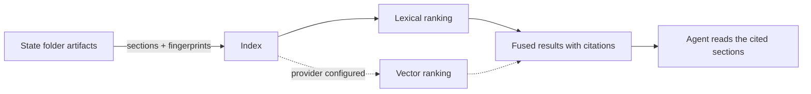

# Artifact Memory Index

**Version:** 1.0.1
**Status:** Stable
**Layer:** concept

## Overview

A local, derived index over the project's SDD artifacts — specification sections, constitution rules, plan phases, task entries, recorded decisions and retrospective entries — that lets an agent find, by words and optionally by meaning, every place that bears on a question without reading every file. It always answers with citations to the sections it found, and the agent reads those sections before relying on them: the index finds, the text decides. It is rebuilt from the artifacts at any time, needs no service and no network on its default path, and losing it loses nothing.

## Related Specifications

- [l2-spec-graph-memory.md](l2-spec-graph-memory.md) - The graph and wiki, which answer structure questions; §4.5 routes content questions to the specification text, which this index searches faster.
- [l1-coherence-check.md](l1-coherence-check.md) - CH-1 finds its comparison set through the index when it exists.
- [l1-idea-intake-gate.md](l1-idea-intake-gate.md) - IK-2, the repository investigation before any question, which the index speeds up.
- [l1-fix-command.md](l1-fix-command.md) - FX-6, the sibling-site search.
- [l1-sdd-reference-containment.md](l1-sdd-reference-containment.md) - The index is SDD runtime state, never part of the product.
- [l2-artifact-memory-store.md](l2-artifact-memory-store.md) - Implementation.

## 1. Motivation

The owner's flowchart draws a memory store ("DB / wiki / graph") fed by specifications, plans and tasks, and the list of 2026-10-29 asks for a SQLite vector store informed by the memory projects collected in `.references/.memory`.

The engine has the graph and the wiki for structure, and deliberately keeps specification text out of both (`l2-spec-graph-memory.md` §4.5: a generated summary lost recall when measured). A content question — "which specification already defines the retry rule", "has a decision about the lock been recorded" — is answered by searching the text, and the text is large: this repository's state folder holds 98 Markdown files, its plan alone 131 KB, and a consumer project's registry has been measured at 597 KB. The checks this pass adds — the coherence check, the fix workflow's sibling-site search, intake investigation — all begin with "find every place that mentions this mechanic", and without an index each one repeats a full scan.

A reference-mining pass over the collection (seventeen memory and code-graph projects) found three designs, recorded by class:

1. **Graph only, no embeddings** — several projects traverse a structure and keep plain files the agent can grep, with nothing to keep warm.
2. **Lexical full-text index** — a local database with ranked full-text search over chunks; no model needed.
3. **Hybrid lexical + vector** — the lexical index plus embeddings, ranks fused. One project's published benchmark (its own numbers, on a public retrieval set with embeddings supplied by the harness) shows the hybrid ahead of each half alone by a few points; the embeddings require a model, bundled, local or remote.

The lexical half gives most of the benefit with none of the cost; the vector half adds recall on paraphrase at the price of a model.

## 2. Constraints & Assumptions

- The markdown artifacts stay the only source of truth; the index is runtime state, ignored by version control and safe to delete.
- The default path adds no dependency, no install step and no network access.
- **Assumption (forecast):** lexical search is always on and vector search is opt-in, used only when the person configures an embedding provider, because a model would be the engine's first dependency and, if remote, its first silent network use. Runner-up: vectors on by default with a bundled model. Override: the index's provider setting.
- **Assumption (forecast):** the index covers the state folder only, not the product's code, because code search and code graphs are what the host and dedicated tools already do. Runner-up: index product code too. Override: `/magicspec spec amend l1-artifact-memory.md "index product code"`.

## 3. Core Invariants

- **AM-1 Derived and disposable.** The index is built only from the project's SDD artifacts and can be deleted and rebuilt with no loss; nothing is ever written into it that is not in an artifact.
- **AM-2 Section units with provenance.** The unit of the index is a section; each carries its file, its heading path, its artifact kind and, for a specification, its status and version.
- **AM-3 Cite, then read.** A query returns sections with their citations and a score, never a synthesized answer. An agent that relies on a result reads the cited section first.
- **AM-4 Lexical always, semantic optional.** Ranked lexical search works on every installation. Semantic search is added only when an embedding provider is configured; then results combine both rankings. A query states which modes produced its results.
- **AM-5 Fresh on use.** The index knows the content fingerprint of every file it holds. A query first re-indexes files whose fingerprint changed, so it never answers from a stale section; the refresh that already follows every change to the state folder also refreshes the index.
- **AM-6 History stays history.** Archives, history tables, retrospectives and changelogs are indexed with their kind, and excluded from results by default; a query can ask for them.
- **AM-7 Local unless configured.** The index never sends text anywhere. A configured remote embedding provider receives section text only after the person has configured it, and the configuration names what it sends.
- **AM-8 Never in the way.** A failure to build, open or query the index never fails a workflow: the caller falls back to plain text search and the failure is recorded as a diagnostic.

## 5. Detailed Design

**Consumers.** The coherence check (CH-1, §5.2 step 2), intake investigation (IK-2), the fix workflow's sibling-site search (FX-6), and any agent question about content.

## 6. Implementation Notes

1. Built after the graph refresh in the same call, so that one refresh keeps graph, wiki and index current.
2. A query subcommand returns the top sections as citations, in text or as data.

## 7. Drawbacks & Alternatives

- **Another runtime artifact.** Bounded by AM-1 and the cache retention contract: it is rebuilt, not maintained.
- **Summaries in the wiki instead** — rejected earlier on measured recall (`l2-spec-graph-memory.md` §4.5).
- **A vector store only** — rejected: it needs a model on every installation and loses exact-name matches that lexical search gets right.
- **A memory server process** — rejected: the engine has no long-running process, and the index must work in a plain session.

## Canonical References

| Alias | Path | Purpose |
| --- | --- | --- |
| `[GRAPH-SPEC]` | `.magicspec/engine/specifications/l2-spec-graph-memory.md` | Question routing (§4.5) and artifact location (§4.6). |
| `[MEMORY-REFS]` | `.references/.memory/` | The collection mined for §1 (local, not part of the product). |
| `[FLOWCHART]` | `.drafts/flowchart.md` | The memory store in the owner's pipeline drawing. |

## Document History

| Version | Date | Author | Description |
| --- | --- | --- | --- |
| 1.0.1 | 2026-10-30 | Agent | **Reality sync: the printed command form** is `/magicspec <command>` ([l1-command-surface.md](l1-command-surface.md) CS-2); the earlier colon spelling is rewritten wherever the text prints a command. No requirement changed. |
| 1.0.0 | 2026-10-29 | Agent | Created from the owner's list of ideas (SQLite vector memory, research `.references/.memory`) and the memory store of `.drafts/flowchart.md`. Reference-mining recorded by class only. Post-Update Review: spec-critic PASS after the fixes of the review, prompt-engineer PASS-WITH-REWRITES (rewrites applied in the same pass); promoted to Stable under Trust Mode. |
