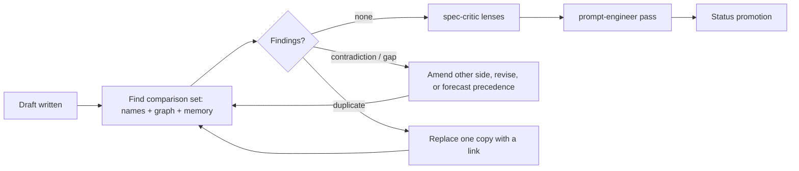

# Cross-Artifact Coherence Check

**Version:** 1.0.0
**Status:** Draft
**Layer:** concept

## Overview

Before a specification is finalized, and before a plan is finalized, the engine checks the new or changed content against every other artifact of the same kind that touches the same mechanics — not only the artifacts it declares as related — for contradictions, duplicated definitions, broken interactions between functions and mechanics, and, for plans, conflicting order. A contradiction blocks finalization until one side is amended or the precedence is decided and recorded; nothing is left silently inconsistent.

## Related Specifications

- [l1-multi-angle-review.md](l1-multi-angle-review.md) - The review lenses; the Ecosystem lens checks composition with declared relations only, which this check widens to every artifact sharing a mechanic.
- [l2-role-cards-governance.md](l2-role-cards-governance.md) - The `spec-critic` card, which carries the specification check (CH-6).
- [l2-role-cards-execution.md](l2-role-cards-execution.md) - The `planner` card, which carries the plan check (CH-6).
- [l1-plan-command.md](l1-plan-command.md) - The planning command whose write-back the plan check precedes.
- [l1-artifact-memory.md](l1-artifact-memory.md) - The retrieval index that finds the comparison set (CH-1) when it exists.
- [l1-engine-core.md](l1-engine-core.md) - The audit workflow (`analyze` Mode C) that finds the same classes after the fact, across the whole project.

## 1. Motivation

The owner's intake flowchart (`.drafts/flowchart.md`, block 3) places two checks on the path from intent to implementation: before a specification document is formed in its final version, contradictions and the logic of the relations between functions and mechanics are checked against the other specifications; before a plan is formed in its final version, the same is checked against the other plans.

The engine does part of this today, in the wrong places:

- The Post-Update Review's Ecosystem lens asks whether a specification "composes cleanly with `Related Specifications`". A specification that does not know a neighbour does not list it, so it is never checked against it — the gap is exactly where the author's knowledge ends.
- The planner's audit (optimism bias, hidden dependencies, cascade risk) looks inside one plan. Nothing compares a workspace's plan with another workspace's plan, or a new phase with what earlier phases already delivered.
- Ventilation (`analyze` Mode C) checks the whole project, but only on request and after the inconsistent artifact is already Stable and planned.

**Observed occurrence (2026-10-29).** The constitution's C26 item 1 states that every workflow that creates or amends specifications, tasks or rules runs Workspace Intent Detection; the shared context module states that only the specification workflow runs it and that the planning and rule workflows skip it. Both texts are Stable and both are loaded together; neither declares the other related, and no gate compared them. The contradiction was found by hand while preparing this pass.

## 2. Constraints & Assumptions

- The check is a reasoning pass over text, carried by the existing reviewers; it adds no role and no command.
- It reads sections, not whole files: the comparison set is found by search first, and only the matching sections are read.
- An artifact that shares no mechanic with any other costs one search and produces no output.
- Archives, history tables and retrospectives are history, not specification: they are never part of the comparison set.
- **Assumption (forecast):** a contradiction whose resolution the new input states (the requester asked for the behaviour to change) is resolved by amending the other artifact in the same invocation, because leaving the old statement in force would make the request unimplementable. Runner-up: keep the new artifact at `Draft` until the other is amended by a separate request. Override: `/magicspec:spec amend l1-coherence-check.md "contradictions always block"`.

## 3. Core Invariants

- **CH-1 Scope by mechanic, not by declaration.** The comparison set of an artifact is every artifact of the same kind that defines, constrains, produces or consumes a mechanic the artifact touches. A mechanic is anything an artifact names and another can name too: a command, a file or folder, a field, a status, a state, an event, an invariant identifier, a defined term. The set is found by searching the artifact text of every workspace for those names and by the neighbours the specification graph reports; the declared `Related Specifications` are a starting point, never the boundary.
- **CH-2 Closed finding classes.** A finding is exactly one of:
  - **Contradiction** — two statements in force cannot both hold.
  - **Duplicate definition** — the same mechanic is defined in two places (forbidden by constitution §6; the fix is a link).
  - **Interaction gap** — one artifact produces or consumes something another defines differently or not at all: a consumer with no producer, a producer with no consumer, a mismatched shape, order or name.
  - **Ordering conflict** — plans only: work scheduled before what it depends on, or two plans changing the same mechanic in ways that cannot both land.
- **CH-3 Both sides quoted.** Every finding cites the exact text of both sides with file and section. A suspicion that cannot be quoted on both sides is not a finding (precision over recall, as `l1-prompt-quality-gate.md` PQ-4).
- **CH-4 Specification check before finalization.** For a created or substantively amended specification, the check runs after the draft is written and before the Post-Update Review promotes it. A contradiction or an interaction gap blocks promotion. It is resolved in the same invocation by one of: amending the other artifact (its own version bump and history row), revising the new artifact, or — when neither text settles which statement should win — deciding by the Consequence Forecast and recording the premise as an `Assumption (forecast)` in the artifact that yields. A duplicate definition is resolved by replacing one copy with a link.
- **CH-5 Plan check before write-back.** A drafted plan is compared with the other phases of the same plan, with the plans of every other registered workspace, and with what archived phases record as delivered. An ordering conflict or a contradiction is resolved before the plan is written; work duplicated across workspaces is assigned to one of them and referenced from the other.
- **CH-6 Carried by the existing reviewers.** The specification check is a mandatory step of the `spec-critic` review; the plan check is a mandatory step of the `planner` audit. Neither reviewer may report a pass without having run it.
- **CH-7 One result line.** The check reports `[Coherence] {N} artifacts compared — {k} findings` followed by one line per finding (`{class}: {file-a} §{x} ↔ {file-b} §{y} — {resolution}`). Zero findings produces only the first line.
- **CH-8 Independent of the audit.** Ventilation keeps checking the whole project after the fact; this check does not replace it, and an audit finding of a class in CH-2 is resolved through the same resolutions as CH-4 and CH-5.

## 5. Detailed Design

### 5.1 Placement

The plan check sits at the same place in the planning workflow: after the draft plan, inside the planner audit, before the task instruction review and write-back.

### 5.2 Finding the Comparison Set

1. Extract the names the new or changed sections introduce or use (headings, code-quoted tokens, invariant identifiers, file paths, command names).
2. Search the specification text of every workspace for each name; when the artifact memory index exists, also query it with the changed section's statement.
3. Add the specification graph's direct neighbours of the artifact.
4. Read only the matching sections of the artifacts found. Stop expanding once a round adds no new artifact.

### 5.3 Example

A new specification states that a planning command owns `PLAN.md`. The search for `PLAN.md` finds the planning workflow body, which states that the task workflow writes it, and the finalization specification, which reads it. The first is a contradiction (two owners); the second is an interaction (a consumer whose producer moves). Resolution: the new specification records the ownership change, and the planning workflow's specification is amended in the same invocation to point at the new owner.

## 6. Implementation Notes

1. `l2-role-cards-governance.md` and `l2-role-cards-execution.md` gain the step in the `spec-critic` and `planner` cards; the specification and planning workflow bodies name it at the review and audit gates.
2. Until the artifact memory index exists, step 2 of §5.2 uses text search only.

## 7. Drawbacks & Alternatives

- **Cost.** One search per introduced name and a read of the matching sections. Bounded by CH-1's stop rule and by reading sections, not files.
- **A separate coherence workflow command** — rejected: it would run after the fact, like ventilation, and the owner's flowchart places the check before the final version.
- **Checking only declared relations, but requiring them to be complete** — rejected: completeness of the declaration is the very thing the author cannot know.
- **Blocking on every finding class** — rejected: a duplicate definition has a mechanical fix (a link) and never needs a decision.

## Canonical References

| Alias | Path | Purpose |
| --- | --- | --- |
| `[FLOWCHART]` | `.drafts/flowchart.md` | The owner's intake flowchart; block 3 places both checks. |
| `[SPEC]` | `skills/magicspec/workflows/spec.md` | Post-Update Review, where the specification check runs. |
| `[TASK]` | `skills/magicspec/workflows/task.md` | Planning Audit, where the plan check runs until the planning command exists. |
| `[CRITIC]` | `skills/magicspec/roles/spec-critic.md` | Carries CH-4. |
| `[PLANNER]` | `skills/magicspec/roles/planner.md` | Carries CH-5. |

## Document History

| Version | Date | Author | Description |
| --- | --- | --- | --- |
| 1.0.0 | 2026-10-29 | Agent | Created from the owner's list of ideas (items: check every new specification and every plan against the existing ones for contradictions and the logic of relations between functions and mechanics, per `.drafts/flowchart.md`). Observed occurrence: the C26 item 1 / `context.md` Step 0 contradiction. |
