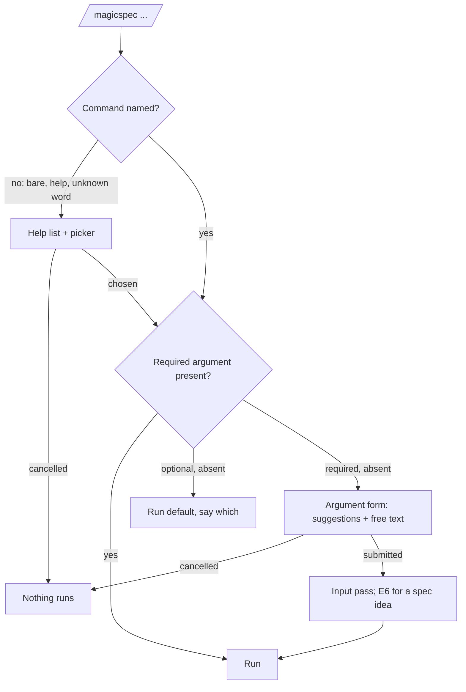

# Command Surface: One Command, Interactive Help and Argument Intake

**Version:** 2.1.2
**Status:** Stable
**Layer:** concept

## Overview

The engine is addressed through one command, `/magicspec`, followed by a required command name and that command's argument (`/magicspec task`, `/magicspec spec {idea}`). No host receives a per-command entry. A bare `/magicspec`, or `/magicspec help`, shows the commands the way a command-line tool shows its help and offers to run one; a command whose required argument is missing asks for it. Both use the host's choice form where the host has one and the chat where it has not. This specification keeps the command set, the grammar, the argument contract of every command, the interactive help and the `migrate` command; `plan`, `goal`, `fix` and `simulate` have contracts of their own.

## Related Specifications

- [l1-skill-packaging.md](l1-skill-packaging.md) - SP-5 one source per workflow (the help text is derived, not authored twice) and SP-10 explicit migration (the path `migrate` exposes).
- [l2-skill-distribution.md](l2-skill-distribution.md) - The single command surface that remains, and the `migrate` subcommand the command runs (§5.6).
- [l2-skill-wrappers.md](l2-skill-wrappers.md) - The router contract that carries the command table and the grammar.
- [l1-decision-autonomy.md](l1-decision-autonomy.md) - E7, the whitelist entry under which this specification asks (CS-11), and E1, which `migrate --apply` needs.
- [l1-idea-intake-gate.md](l1-idea-intake-gate.md) - The intake an idea collected by the argument form passes next.
- [l1-input-prompt-pass.md](l1-input-prompt-pass.md) - The pass every prose argument goes through, typed or entered in a form (CS-3, CS-10).
- [l1-plan-command.md](l1-plan-command.md) - `plan`.
- [l1-goal-mode.md](l1-goal-mode.md) - `goal`.
- [l1-fix-command.md](l1-fix-command.md) - `fix`.
- [l1-product-simulation.md](l1-product-simulation.md) - `simulate`.

## 1. Motivation

The engine answers seven commands. The owner's list of 2026-10-29 asks for six more — `plan`, `goal`, `fix`, `simulate`, `migrate` and `help`. Two of them have no contract elsewhere:

- **help.** A bare `/magicspec` with nothing after it reaches no defined behaviour: the router defines a bare `magicspec` followed by an idea as `spec`, and says nothing about a bare one. A user who installs the engine has no command that lists the others, and the explanations are in English only; the owner asks for `help ru`, with the agent supplying the translation.
- **migrate.** The migration from the 2.x layout exists as an executor subcommand (`node <skills folder>/magicspec/scripts/executor.js migrate`), and every other command of an unmigrated project stops with that path as its instruction. The user has to copy a script path; nothing guides the dry run, the consent before old files are removed, or the references to the old layout left inside the migrated artifacts (old command names, old folder names).

Constitution C2 forbids new workflow commands unless strictly necessary and explicitly authorized as a C2 exception. The owner's request names each of the six commands; that request is the authorization (CS-1).

### 1.1 One Command Instead of Wrappers `[ADDED]`

The owner decided on 2026-10-30 to remove the per-command wrappers from the user's project and keep one command, `/magicspec`, with a required argument; a bare `/magicspec` and `/magicspec help` list the commands with their descriptions, as a console application's help does, or offer them in a form — choose a command, confirm, and it runs, with a text field for the argument when the command takes one, and the chat when the host has no form; a command given without its argument, such as `/magicspec spec` without an idea, asks for it, opens a text field or offers options.

Measured the same day on a disposable installation for all three hosts: the wrappers are the generated folders `.claude/commands/magicspec/` and `.qwen/commands/magicspec/`, seven files each and thirteen each with the command set of CS-1, every one of them two lines that point at the router. Codex has none and already works through the router alone. What their removal costs, measured the same day: the colon form they register is the form the engine tells the user to type — 320 occurrences in 23 shipped files, 51 in the output of 5 scripts, 108 in the README and the documentation, 368 in the tests. Left as they are, they would send the user to a command that no longer exists; CS-2 therefore fixes one printed form.

## 2. Constraints & Assumptions

- Every command is one workflow with one source (SP-5); the router is the only command surface.
- Command names, file paths, flags and arguments are never translated.
- `help` and the dry run of `migrate` are read-only; neither finalizes.
- The questions this specification asks are entry E7 of the escalation whitelist, consented to by the owner on 2026-10-30; the constitution and the shipped rule text record E7 in the same delivery as the behaviour (`l1-decision-autonomy.md` 2.1.0).
- **Unverified:** whether Claude Code hands a typed `/magicspec:task` to the model or refuses it as an unknown command before the model sees it; the owner has not tried it yet. The engine's side is decided (CS-2): when the text reaches the model, the likely command is assumed and run. If the host refuses it, the release notes tell the user to type the command with a space.
- **Assumption (forecast):** with no language argument, `help` explains in the language of the conversation, because that is the language the agent already answers in; an explicit argument overrides it. Runner-up: English unless asked. Override: `/magicspec spec amend l1-command-surface.md "help defaults to English"`.
- **Assumption (forecast):** after the folder migration, `migrate` also rewrites references to the old layout inside the project's SDD artifacts, because those references are the engine's own vocabulary and a stale one misleads every later workflow. Runner-up: report them only. Override: `/magicspec spec amend l1-command-surface.md "migrate reports stale references only"`.
- **Assumption (forecast):** a command whose argument is optional and has a defined default runs the default without asking — the owner's examples are commands that cannot act without input, while asking on `/magicspec run` or `/magicspec status` would add a question to commands that already know what to do, against the decide-by-default posture (DA-1). Runner-up: every command typed without an argument asks. Override: `/magicspec spec amend l1-command-surface.md "ask for every missing argument"`.
- **Assumption (forecast):** a first word that is not a command opens the help with the typed text kept, its first choice running `spec` on that text, because the command is now required and a typo of a command name must not become a specification. Runner-up: run `spec` on the whole text at once, as 1.0.0 did. Override: `/magicspec spec amend l1-command-surface.md "unknown first word runs spec"`.

## 3. Core Invariants

- **CS-1 The command set.** The engine's user-facing commands are exactly: `spec`, `plan`, `task`, `run`, `fix`, `simulate`, `goal`, `analyze`, `rule`, `status`, `graph`, `migrate`, `help`. The six added on 2026-10-29 are C2 exceptions authorized by the owner's request of that date; the constitution's C2 records the command set when the first of them ships. Adding or removing a command is a constitutional event (C2).
- **CS-2 One command, one printed form.** `[MODIFIED]` A user addresses the engine as `/magicspec <command> [argument]` — `$magicspec <command> [argument]` on a host that invokes skills with `$`. The first word after `magicspec` is the command when it equals a command name, case-insensitively; the rest is its argument. The engine registers no per-command entry with any host. Every text the engine prints or ships — narration, next steps, hints, override hints, documentation — names a command in this form. The colon spelling `magicspec:<command>` and the dot spelling `magicspec.<command>`, typed as text, are still read by the router as that command — the user slipped in the form, not in the intent — and it runs it, saying in one line which form the engine prints; the engine never prints either spelling.
- **CS-3 Bare and unknown forms.** `[MODIFIED]` A bare `/magicspec` and `/magicspec help` are the same command: the interactive help (CS-4, CS-10). A first word that is not a command name opens the same help with the typed text kept: its first, recommended choice runs `spec` with the whole text as the idea, unless the word is one edit away from a command name, in which case that command is offered first. Text that begins with a command name by accident (`/magicspec plan a holiday booking feature`) is parsed as that command; quoting the text (`/magicspec "plan a holiday booking feature"`) or naming `spec` forces the idea reading. When the input pass finds that the remaining text cannot be that command's argument — a planning command given a product idea that names no specification or phase — it routes to `spec` instead and narrates one `[DR]` line with the override.
- **CS-4 Help is derived and interactive.** `[MODIFIED]` `help` renders as a command-line tool's help: a usage line, the commands by group with one line each and their argument, and the next step the project's live memory records, when there is one (§5.2). Its content comes from the router's command table and the workflow descriptions — never from a second hand-written copy — so it cannot list a command that does not exist or miss one that does. It then offers to run a command (CS-10). `help {command}` shows that command's argument, its forms and one example each, and offers to run it.
- **CS-5 Help language.** `help {language}` takes a language code (`ru`, `de`, `pt-BR`) or a language name. The explanations and the labels of the picker are translated by the agent at render time; command names, paths, flags, code and identifiers stay verbatim. An unrecognized language value is answered in the default language with one line saying which value was not recognized. `help {command} {language}` combines both.
- **CS-6 Migrate is guided and consented.** `migrate` runs the migration subcommand as a dry run and shows its plan. When the plan removes or renames anything, it asks one consent question (E1) with the dry run as context; only a yes runs the apply step. A project that is already migrated gets the finished message and nothing else.
- **CS-7 Migrate leaves no stale vocabulary.** After a successful apply, `migrate` searches the migrated state folder for references to the earlier layout — the earlier command names, the earlier state-folder and engine-folder names — and rewrites them in the SDD artifacts it is allowed to edit, listing every changed file with a revert hint. A rewritten specification receives a patch version and a history row (a reality sync: no requirement changes), and its registry row follows. Archives, history tables, retrospectives and changelogs are history and are never rewritten. A reference found in a product file is reported, never edited (`l1-sdd-reference-containment.md`).
- **CS-8 The stop names the command.** `[MODIFIED]` A command refused on an unmigrated project names `/magicspec migrate` as the one way forward, beside the script path.
- **CS-9 Argument contract.** `[ADDED]` Every command declares its argument as required, optional with a default, or none (§5.1). A command whose required argument is missing asks for it (CS-10) and does nothing until it has it. A command whose optional argument is missing runs its default and says, in its first line, which default ran and how to pass an argument. Where a required argument has suggestions (§5.1), they are offered with the recommended one first; free text is always accepted.
- **CS-10 The picker and the argument form.** `[ADDED]`
  1. **Picker.** One choice per command, `help` excepted; the recommended choice — the next step live memory records, else the first pipeline command by DA-3 — comes first and is marked. Choosing and submitting is the confirmation; no second confirmation follows, except a consent question the chosen command asks anyway (E1).
  2. **Argument form.** For a chosen command that takes an argument: a text entry, with the command's suggestions as choices where it has them; for an optional argument, the first choice runs the default. Submitting runs the command.
  3. **Host capability.** A host with a choice form uses it. When the form holds fewer choices than there are commands, the picker takes two steps — a group, then a command — and a group with one command skips its second step. When the form cannot hold a text entry on its own, free text is entered through its free-text choice, and an argument with no suggestion at all is asked for in the chat. A host with no choice form gets the numbered list in the chat; the reply is a number or a name. On every host, a command name typed into the free-text choice is accepted, so a choice that does not fit the form is never out of reach.
  4. **Cancel.** A dismissed or cancelled form runs nothing, and the engine says so in one line.
  5. **Text is prose.** Free text entered in a form passes the input pass like a typed argument (IP-1); an idea for `spec` then passes the intake gate (E6).
- **CS-11 Asking is bounded.** `[ADDED]` This specification asks only at the invocation itself: for the command when none was named, and for a required argument that is missing — at most the picker and one argument form per invocation. It never asks for an optional argument, never asks again once the argument is given, and never asks in the middle of a workflow. These questions are entry E7 of the escalation whitelist (`l1-decision-autonomy.md` DA-2); every other question stays where DA-2 puts it.

## 5. Detailed Design

### 5.1 Command Table and Argument Contract

| Command | Group | Purpose | Argument | When it is missing |
| --- | --- | --- | --- | --- |
| `spec` | pipeline | Create, amend and check specifications | an idea · `amend {file} …` · `stabilize [workspace]` | **required** — up to three suggested topics, the highest-coverage gaps by DA-3; free text |
| `plan` | pipeline | Plan and replan: phases, order, backlog | an order or membership directive · a workspace | optional — revalidate the whole plan |
| `task` | pipeline | Decompose the plan into atomic tasks | a decomposition directive · a workspace | optional — decompose the active phase, planning first when the plan is stale |
| `run` | pipeline | Execute the active phase | a workspace · a task identifier | optional — the active phase |
| `fix` | quality & automation | Triage and fix reported defects | the defect: a description, a report, a finding | **required** — the open findings (the diagnostics digest, simulation findings; feedback notes in the engine's own repository); free text |
| `simulate` | quality & automation | Run the product's user-interaction scenarios | an area · a feature · `--live-only` | optional — every scenario |
| `goal` | quality & automation | Pursue a stated goal through the pipeline without pausing | the goal | **required** unless a goal is recorded — a recorded goal continues; otherwise free text |
| `analyze` | health | Audit; reverse-engineer specifications | a mode · a focus directive | optional — the full audit |
| `rule` | health | Amend the constitution | the rule text · `amend {id}` · `remove {id}` | **required** — the rule candidates the latest audit reported, when there are any; free text |
| `status` | health | Read-only briefing | a workspace | optional — the resolved workspace |
| `graph` | health | The specification graph | a mode (`visualize`) | optional — the analysis |
| `migrate` | maintenance | Move a project from an earlier layout | none (`--apply` only after consent) | — |
| `help` | — | List and explain the commands, offer to run one | a command · a language | optional — the whole list and the picker |

Pipeline: `spec` → `plan` → `task` → `run`; `fix` and `simulate` feed back into it; `goal` drives it. The four groups are the picker's first step on a host whose form holds four choices.

### 5.2 Help Layout

```plaintext
Magic Spec {version}
Usage: /magicspec <command> [argument]

Pipeline
  spec       <idea | amend <file> | stabilize>   Create, amend and check specifications
  plan       [directive | workspace]            Plan and replan
  ...
Quality & automation
  fix        <defect>                           Triage and fix reported defects
  ...
Health
  ...
Maintenance
  migrate                                       Move a project from an earlier layout

Next:  /magicspec {next step from live memory}
More:  /magicspec help <command> [<language>]
```

`<…>` marks a required argument and `[…]` an optional one, as console tools do. The picker follows the list.

### 5.3 Migrate Flow


### 5.4 Intake Flow



## 6. Implementation Notes

1. The router's command table gains the argument column of §5.1, and its dispatch CS-2 and CS-3; where the host reads it, the router declares its argument hint (`<command> [argument]`) for completion (`l2-skill-wrappers.md`).
2. The host command entries and the plugin channel are retired (`l2-skill-distribution.md` 2.0.0 §5.2); `init` removes the entries an earlier 3.0.x installation left, by their marker.
3. The printed form: every `/magicspec:<command>` in shipped text, script output, the README and documentation, and the tests becomes `/magicspec <command>` in one pass guarded by a residue search; this repository's specifications follow with a reality-sync patch each.
4. `migrate` reuses the existing subcommand; the sweep (CS-7) is new and owned by `l2-skill-distribution.md` §5.6 at deployment.
5. The constitution's C2 is amended through `/magicspec rule` (origin `user-stated`) when the first new command ships.
6. `help` and `migrate` join the drift-check exemptions of the always-on rules beside `status`: a drift line before help would answer a question nobody asked.
7. Declared supersessions (`l1-coherence-check.md` CH-9): the router's command table, grammar and bare-`magicspec` rule (`SKILL.md`); the specification workflow's Blank Trigger, which selects a topic without asking, and its hints and checklists; E7 in the constitution's C27 and C13 §3 with the template mirror, and in the always-on rules §7 and §8 (`l1-decision-autonomy.md` 2.1.0); the finalization list of the always-on rules §3 and [l2-engine-finalization.md](l2-engine-finalization.md), which gain `plan`, `fix` and `simulate` (`goal` finalizes per step through them; `help` and the `migrate` dry run never finalize); the unmigrated-project stop in [l2-skill-distribution.md](l2-skill-distribution.md) §5.6; the router description that lists seven commands by name in [l2-skill-wrappers.md](l2-skill-wrappers.md) §2 and [l2-skill-layout.md](l2-skill-layout.md) §7, which list thirteen; and the host table of the README and `docs/distribution.md`.
8. **As built** (Phase 47, engine 3.0.x). `[ADDED]` The router's table has six columns (command, group, what it does, argument, when it is missing, body); `help` has no group, `migrate` is `maintenance`; its frontmatter carries `argument-hint: "<command> [argument]"`. The two new bodies are `workflows/help.md` and `workflows/migrate.md`; `spec`, `rule` and `graph` gained the `Arguments` and `Examples` the detail view (`help {command}`) reads, and `spec` (Blank Trigger) and `rule` (Missing Rule Text) are the argument forms of their commands.
   - **Help.** In `help`'s arguments a token equal to a command name (any letter case) is the command and any other token a language, in either order; the typed text of an unknown first word is not parsed. The unknown-word picker opens with the choice that runs `spec` on the typed text (recommended), the command one edit away when there is one, and *choose a command instead*; a chat reply that is neither a number nor a command name is an unknown first word. The recommended command is the one `Next Action` names, else by pipeline order as the status briefing computes it; the `Next:` line is printed only when live memory records a command.
   - **Migrate.** The body runs the dry run, asks one E1 question for a printed plan (a project that is already migrated gets the finished message and no question), and runs `--apply` only on a yes; it initializes nothing, because Auto-Init would create the new state folder beside the old one, and it never finalizes.
   - **The sweep (CS-7).** `scripts/lib/vocabulary-sweep.js`, run by `migrate --apply` after the rename and before the old engine is removed, so an interrupted run repeats it; a run that migrates nothing never sweeps. It rewrites `/magic.<command>` for the seven earlier commands to `/magicspec <command>`, the earlier state folder to the present one and the earlier engine folder to the engine's project-relative path (an engine outside the project is reported, not written). Edited: the specifications (patch version, history row, registry row), plan, tasks, registries, live state and context files. Never edited: Document History and Recent Decisions sections, archives, retrospectives, changelogs, the graph and cache folders; the constitution is reported with the pointer to `/magicspec rule`; a specification with no version header or no history table is left and named. Every edited file is first copied into the dated backup folder, and the output lists it with a revert hint. Product files are the git listing (tracked and untracked, not ignored) minus the state folders, the engine and host folders, the backups and the files being removed, text extensions up to 512 KB, the first hit of each file, ten shown; they are reported and never edited. The dry run's plan carries the sweep as its step 4.

## 7. Drawbacks & Alternatives

- **No per-command completion.** The host completes `/magicspec` and its argument hint only; the help and the picker take over discovery. Accepted by the owner's decision.
- **A two-step picker** on a host whose form holds four choices. Accepted: the recommended command is marked at the first step, and a typed command skips the picker entirely.
- **Wrappers kept, but opt-in** — rejected by the owner on 2026-10-30 in favour of removal.
- **Asking for every missing argument** — the forecast's runner-up (§2).
- **Thirteen commands against C2's minimalism.** Accepted on the owner's authorization; the groups keep the help readable.
- **`help` as a section of `status`** — rejected: `status` reports the project's state, `help` explains the engine; a user with no project yet needs the second.
- **A hand-written help page per language** — rejected: it would drift from the command table (SP-5) and the owner asks for agent translation.
- **Rewriting stale references in product files too** — rejected: product files are outside the engine's write scope and containment forbids the vocabulary there in the first place.

## Canonical References

| Alias | Path | Purpose |
| --- | --- | --- |
| `[ROUTER]` | `skills/magicspec/SKILL.md` | The command table, grammar and dispatch CS-1 to CS-4 and CS-9 change. |
| `[HOSTS]` | `skills/magicspec/scripts/lib/hosts.js` | The projection generator whose command entries are retired. |
| `[MIGRATE]` | `skills/magicspec/scripts/migrate.js` | The subcommand CS-6 runs. |
| `[EXECUTOR]` | `skills/magicspec/scripts/executor.js` | The unmigrated-project stop CS-8 rewords. |
| `[MIGRATION-DOC]` | `docs/migration.md` | User guide that names the command. |

## Document History

| Version | Date | Author | Description |
| --- | --- | --- | --- |
| 2.1.2 | 2026-10-30 | Agent | **Host observation recorded** (origin `user-stated`: the owner's answers of 2026-10-30): the open marker of §2 becomes an explicit `Unverified` statement, since only the part of it that happens before the model sees the text is still unknown. No requirement changed. |
| 2.1.1 | 2026-10-30 | Agent | **CS-2 clarified** (origin `user-stated`: the owner's answer of 2026-10-30 to the host check, "assume the likely command and run it, the user probably slipped"): the dot spelling `magicspec.<command>` is read like the colon spelling, and either one runs the command and says in one line which form the engine prints. What a host does with such a name before the model sees it stays the open observation of §2. Patch: a clarification of a tolerance already stated, no new requirement on any other surface. |
| 2.1.0 | 2026-10-30 | Agent | **As built** (Phase 47): the router table columns, the help argument grammar and the unknown-word picker, the migrate body, and the realization of CS-7 (§6 item 8) are recorded; the printed command form of this specification follows its own CS-2. Amendment Rule: `Stable → RFC`, re-promoted to `Stable` after the Post-Update Review in the same invocation. |
| 2.0.0 | 2026-10-30 | Agent | **One command instead of wrappers** (origin `user-stated`: the owner's decision of 2026-10-30). CS-2: `/magicspec <command> [argument]` is the only form, no host receives a per-command entry, and the engine prints only this form (the colon spelling is still read as text). CS-3: a bare `/magicspec` and `/magicspec help` are the interactive help; an unknown first word opens it with the text kept. CS-4: the help reads like a console tool's and offers to run a command. New CS-9 (every command's argument is required, optional with a default, or none; a missing required argument is asked for, a missing optional one runs its default), CS-10 (the picker and the argument form, by host capability, the chat as fallback) and CS-11 (asking only at the invocation: E7). §1.1 records the measured footprint and the cost of removal; §5.1 gains the argument contract, §5.4 the intake flow. Two forecasts recorded: optional arguments run their default; an unknown first word opens the help. Amendment Rule: `Stable → RFC`, re-promoted to `Stable` after the Post-Update Review in the same invocation. |
| 1.0.0 | 2026-10-29 | Agent | Created from the owner's list of ideas: the `help` command with a language argument, the `migrate` command, and the set of six new commands authorized as C2 exceptions. Post-Update Review: spec-critic PASS after the fixes of the review, prompt-engineer PASS-WITH-REWRITES (rewrites applied in the same pass); promoted to Stable under Trust Mode. |
