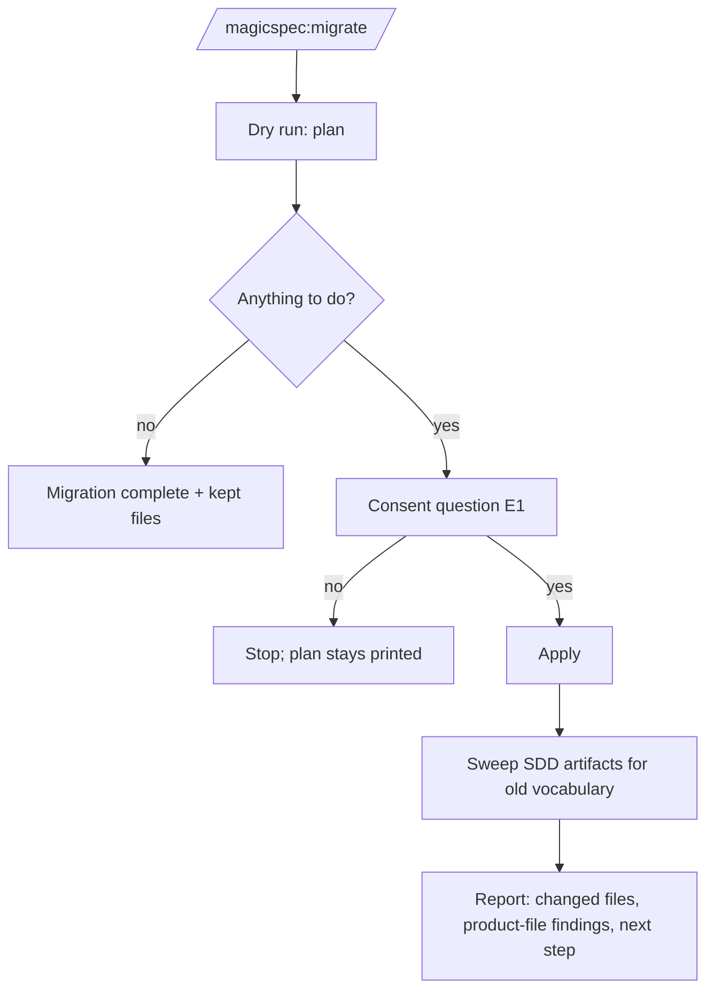

# Command Surface: Command Set, Grammar, Help and Migrate

**Version:** 1.0.0
**Status:** Draft
**Layer:** concept

## Overview

The set of user-facing commands the engine answers, how a command is addressed, what a bare invocation does, the `help` command with an optional language for its explanations, and the `migrate` command that brings a project from an earlier layout to the current one. The commands with a contract of their own — `plan`, `goal`, `fix`, `simulate` — are specified in their own documents; this one keeps the table they all belong to and the rules every command shares.

## Related Specifications

- [l1-skill-packaging.md](l1-skill-packaging.md) - SP-5 one source per workflow (the help text is derived, not authored twice) and SP-10 explicit migration (the path `migrate` exposes).
- [l2-skill-distribution.md](l2-skill-distribution.md) - The command surfaces that register each command with a host, and the `migrate` subcommand the command runs (§5.6).
- [l1-plan-command.md](l1-plan-command.md) - `plan`.
- [l1-goal-mode.md](l1-goal-mode.md) - `goal`.
- [l1-fix-command.md](l1-fix-command.md) - `fix`.
- [l1-product-simulation.md](l1-product-simulation.md) - `simulate`.
- [l1-input-prompt-pass.md](l1-input-prompt-pass.md) - The pass every command's prose argument goes through before routing is final (CS-3).
- [l1-decision-autonomy.md](l1-decision-autonomy.md) - E1 consent, which `migrate --apply` needs.

## 1. Motivation

The engine answers seven commands. The owner's list of 2026-10-29 asks for six more — `plan`, `goal`, `fix`, `simulate`, `migrate` and `help` — each named in the colon form and the space form (`/magicspec:migrate`, `/magicspec migrate`). Two of them have no contract elsewhere:

- **help.** A bare `/magicspec` with nothing after it reaches no defined behaviour: the router defines a bare `magicspec` followed by an idea as `spec`, and says nothing about a bare one. A user who installs the engine has no command that lists the others, and the explanations are in English only; the owner asks for `help ru`, with the agent supplying the translation.
- **migrate.** The migration from the 2.x layout exists as an executor subcommand (`node <skills folder>/magicspec/scripts/executor.js migrate`), and every other command of an unmigrated project stops with that path as its instruction. The user has to copy a script path; nothing guides the dry run, the consent before old files are removed, or the references to the old layout left inside the migrated artifacts (old command names, old folder names).

Constitution C2 forbids new workflow commands unless strictly necessary and explicitly authorized as a C2 exception. The owner's request names each of the six commands; that request is the authorization (CS-1).

## 2. Constraints & Assumptions

- Every command is one workflow with one source (SP-5); the host surfaces only register it.
- Command names, file paths, flags and arguments are never translated.
- `help` and the dry run of `migrate` are read-only; neither finalizes.
- **Assumption (forecast):** with no language argument, `help` explains in the language of the conversation, because that is the language the agent already answers in; an explicit argument overrides it. Runner-up: English unless asked. Override: `/magicspec:spec amend l1-command-surface.md "help defaults to English"`.
- **Assumption (forecast):** after the folder migration, `migrate` also rewrites references to the old layout inside the project's SDD artifacts, because those references are the engine's own vocabulary and a stale one misleads every later workflow. Runner-up: report them only. Override: `/magicspec:spec amend l1-command-surface.md "migrate reports stale references only"`.

## 3. Core Invariants

- **CS-1 The command set.** The engine's user-facing commands are exactly: `spec`, `plan`, `task`, `run`, `fix`, `simulate`, `goal`, `analyze`, `rule`, `status`, `graph`, `migrate`, `help`. The six added on 2026-10-29 are C2 exceptions authorized by the owner's request of that date; the constitution's C2 records the command set when the first of them ships. Adding or removing a command is a constitutional event (C2).
- **CS-2 One grammar.** A command is addressed as `magicspec <command> [args]` and may arrive as `magicspec:<command>`, `/magicspec:<command>`, `/magicspec <command>` or `$magicspec <command>`; all are the same. The first word after `magicspec` is a command when it equals a command name exactly, case-insensitively; the rest is its argument.
- **CS-3 Bare forms.** A bare `magicspec` with no text runs `help`. A bare `magicspec` followed by text whose first word is not a command name runs `spec` with the whole text as the idea. Text that begins with a command name by accident (`/magicspec plan a holiday booking feature`) is that command; quoting the text (`/magicspec "plan a holiday booking feature"`) or naming `spec` forces the idea reading. When the input pass (`l1-input-prompt-pass.md`) finds that the reading taken contradicts the text — a planning command given a product idea with no plan to act on — it routes to `spec` and narrates one `[DR]` line with the override.
- **CS-4 Help is derived.** `help` renders the command table, the pipeline order, the argument forms and, for `help {command}`, that command's arguments and one example per form. Its content comes from the router's command table and the workflow descriptions — never from a second hand-written copy — so it cannot list a command that does not exist or miss one that does. It ends with one line naming the next step the project's live memory records, when there is one.
- **CS-5 Help language.** `help {language}` takes a language code (`ru`, `de`, `pt-BR`) or a language name. The explanations are translated by the agent at render time; command names, paths, flags, code and identifiers stay verbatim. An unrecognized language value is answered in the default language with one line saying which value was not recognized. `help {command} {language}` combines both.
- **CS-6 Migrate is guided and consented.** `migrate` runs the migration subcommand as a dry run and shows its plan. When the plan removes or renames anything, it asks one consent question (E1) with the dry run as context; only a yes runs the apply step. A project that is already migrated gets the finished message and nothing else.
- **CS-7 Migrate leaves no stale vocabulary.** After a successful apply, `migrate` searches the migrated state folder for references to the earlier layout — the earlier command names, the earlier state-folder and engine-folder names — and rewrites them in the SDD artifacts it is allowed to edit, listing every changed file with a revert hint. Archives, history tables, retrospectives and changelogs are history and are never rewritten. A reference found in a product file is reported, never edited (`l1-sdd-reference-containment.md`).
- **CS-8 The stop names the command.** A command refused on an unmigrated project names `/magicspec:migrate` as the one way forward, beside the script path for hosts that do not register commands.

## 5. Detailed Design

### 5.1 Command Table

| Command | Group | Purpose | Contract |
| --- | --- | --- | --- |
| `spec` | pipeline | Create, amend and check specifications | `workflows/spec.md` |
| `plan` | pipeline | Plan and replan: phases, order, backlog | `l1-plan-command.md` |
| `task` | pipeline | Decompose the plan into atomic tasks | `workflows/task.md` |
| `run` | pipeline | Execute the active phase | `workflows/run.md` |
| `fix` | quality | Triage and fix reported defects | `l1-fix-command.md` |
| `simulate` | quality | Run the product's user-interaction scenarios | `l1-product-simulation.md` |
| `goal` | automation | Pursue a stated goal through the pipeline without pausing | `l1-goal-mode.md` |
| `analyze` | health | Audit; reverse-engineer specifications | `workflows/analyze.md` |
| `rule` | health | Amend the constitution | `workflows/rule.md` |
| `status` | health | Read-only briefing | `workflows/status.md` |
| `graph` | health | The specification graph | `workflows/graph.md` |
| `migrate` | maintenance | Move a project from an earlier layout | this specification |
| `help` | maintenance | List and explain the commands | this specification |

Pipeline: `spec` → `plan` → `task` → `run`; `fix` and `simulate` feed back into it; `goal` drives it.

### 5.2 Help Layout

```plaintext
Magic Spec {version} — commands
  Pipeline   spec → plan → task → run
  {group}    {command}   {one-line purpose, translated}
  ...
  Forms      /magicspec:{command} · /magicspec {command} · magicspec {command}
  More       /magicspec help {command} [{language}]
  Next       {Next Action from live memory, when present}
```

### 5.3 Migrate Flow



## 6. Implementation Notes

1. The router's command table and its dispatch gain the new rows and CS-3; host command entries are regenerated from it (`l2-skill-distribution.md` §5.2).
2. `migrate` reuses the existing subcommand; the sweep (CS-7) is new and owned by `l2-skill-distribution.md` §5.6 at deployment.
3. The constitution's C2 is amended through `/magicspec:rule` (origin `user-stated`) when the first new command ships.
4. `help` and `migrate` join the drift-check exemptions of the always-on rules beside `status`: a drift line before help would answer a question nobody asked.

## 7. Drawbacks & Alternatives

- **Thirteen commands against C2's minimalism.** Accepted on the owner's authorization; the groups in §5.1 keep the table readable, and `help` makes the set discoverable.
- **`help` as a section of `status`** — rejected: `status` reports the project's state, `help` explains the engine; a user with no project yet needs the second.
- **A hand-written help page per language** — rejected: it would drift from the command table (SP-5) and the owner asks for agent translation.
- **Rewriting stale references in product files too** — rejected: product files are outside the engine's write scope and containment forbids the vocabulary there in the first place.

## Canonical References

| Alias | Path | Purpose |
| --- | --- | --- |
| `[ROUTER]` | `skills/magicspec/SKILL.md` | The command table and dispatch CS-1 to CS-4 change. |
| `[MIGRATE]` | `skills/magicspec/scripts/migrate.js` | The subcommand CS-6 runs. |
| `[EXECUTOR]` | `skills/magicspec/scripts/executor.js` | The unmigrated-project stop CS-8 rewords. |
| `[MIGRATION-DOC]` | `docs/migration.md` | User guide that names the command. |

## Document History

| Version | Date | Author | Description |
| --- | --- | --- | --- |
| 1.0.0 | 2026-10-29 | Agent | Created from the owner's list of ideas: the `help` command with a language argument, the `migrate` command, and the set of six new commands authorized as C2 exceptions. |
