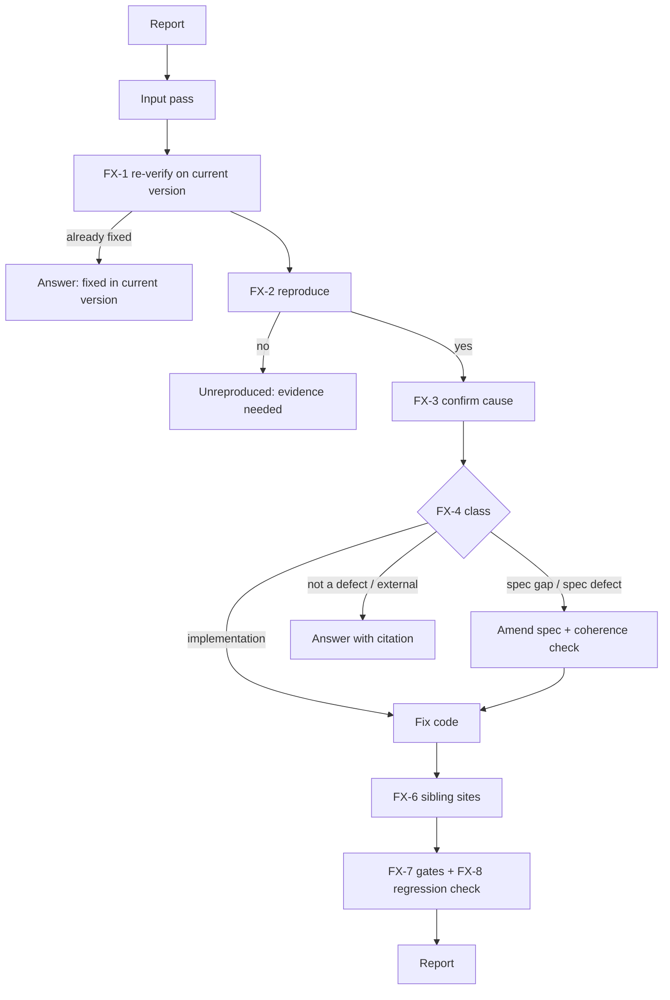

# Defect Intake: the Fix Command

**Version:** 1.0.2
**Status:** Stable
**Layer:** concept

## Overview

`fix` takes reported defects — a user's description, a failing test, a simulation finding, an agent's feedback note, a pasted engine bug report in the engine's own repository — and carries each one from report to verified repair. Its centre is triage: before anything is changed, the defect is reproduced and classified against the specifications, and a closed decision rule settles whether the repair changes a specification or only the code. Every repair leaves a regression check behind and is traced as a task.

## Related Specifications

- [l1-engine-core.md](l1-engine-core.md) - The execution gates a fix passes through, as a task of `run` does.
- [l1-product-simulation.md](l1-product-simulation.md) - Simulation findings are a main input, and a reproduction may become a scenario.
- [l1-agent-feedback.md](l1-agent-feedback.md) - Feedback notes are an input; in the engine's own repository they arrive here instead of being reported.
- [l1-coherence-check.md](l1-coherence-check.md) - A specification amendment made by a fix passes the same check.
- [l1-input-prompt-pass.md](l1-input-prompt-pass.md) - The report's prose is normalized before triage.
- [l1-command-surface.md](l1-command-surface.md) - CS-1, the command set `fix` joins.

## 1. Motivation

Defect reports reach a project from several directions, and today none has a path. A user's report goes to `run`, which executes planned tasks and has no step that asks whether the specification is wrong; to `spec`, which writes specifications and cannot touch code; or to an unrecorded edit, which is the one outcome the SDD exists to prevent. The owner asks for `/magicspec fix`, and asks it to look carefully at what must go into the specifications and what need not.

This repository's own field reports show what goes wrong without a triage step (engine history, 2026-08 to 2026-10): a report is often already partly fixed in the current version, the part that remains is a missed branch of the same defect, and the reporter's explanation of the cause is sometimes wrong — so a repair that follows the report literally fixes the symptom at one site and leaves the others.

## 2. Constraints & Assumptions

- `fix` writes product code and SDD artifacts, under the same containment and review rules as `run`.
- Beyond the command intake for a missing report (`l1-command-surface.md` CS-9, E7), it asks nothing (DA-2): a report too thin to reproduce is recorded as unreproduced with the evidence that would reproduce it, and the report says so.
- **Assumption (forecast):** a fix is recorded as a task of the active phase — or of a maintenance phase when no phase is active — rather than in a separate fix ledger, so that progress, live memory and the archive stay truthful through the existing machinery. Runner-up: a separate fix log. Override: `/magicspec spec amend l1-fix-command.md "separate fix ledger"`.

## 3. Core Invariants

- **FX-1 Re-verify first.** Before triage, the defect is checked against the current version of the product (or engine). A report may describe a version that is already fixed in part; only what still reproduces proceeds.
- **FX-2 Reproduce before changing.** Every defect that proceeds is reproduced by a named check — a command, a test, a simulation step — and the check is recorded. A defect that cannot be reproduced is classified `Unreproduced` with what was tried and the one piece of evidence that would reproduce it; nothing is changed for it.
- **FX-3 The reporter's cause is a hypothesis.** The cause stated in a report is tested, not adopted: the triage names the cause it confirmed and how.
- **FX-4 Closed classification.** Each reproduced defect is exactly one of:
  - **Implementation defect** — the product violates behaviour a specification already states. The code is fixed; no specification changes; the fix cites the statement it restores.
  - **Specification gap** — the expected behaviour is not stated anywhere, and it is consistent with what the specifications intend. The specification gains the statement (an edge case, an invariant, an error path), then the code is fixed.
  - **Specification defect** — a specification prescribes the behaviour reported as wrong. The specification is amended under the Amendment Rule (with the cascade it triggers), then the code is fixed.
  - **Not a defect** — the product behaves as specified and as intended. Nothing changes; the answer cites the specification. A misleading document is a documentation fix, not a product fix.
  - **External** — the cause is outside the product: a dependency, the host, the environment, the user's configuration. No specification changes; the finding and a workaround are recorded.
- **FX-5 The specification test.** A repair goes into a specification exactly when it adds or changes a statement about observable behaviour or a contract — what the product does, accepts, returns, guarantees or refuses. A repair that restores already-stated behaviour, or changes internals with no observable difference, does not. When in doubt, the deciding question is: *would an implementer who reads only the specifications reintroduce this defect?* Yes → the specification gains the statement.
- **FX-6 Sibling sites.** Before the repair is final, the same defect class is searched for at every site that shares the mechanism (the same guard, parser, path computation or rule in another file). Each site found is fixed in the same repair or recorded as a separate defect.
- **FX-7 Traced and gated.** Every repair is a task with a `Verify` line equal to the reproduction (FX-2), and passes the execution gates a `run` task passes (`coder`, `code-reviewer`, `test-engineer`; `debugger` when the first attempt fails).
- **FX-8 Regression left behind.** The reproduction becomes a lasting check — a test, or a simulation scenario for user-facing behaviour — that fails without the repair. A repair with no lasting check is not `Done`.
- **FX-9 Batches by root cause.** Several defects in one invocation are triaged one by one, then grouped by confirmed cause; one cause is one repair task.

## 5. Detailed Design

### 5.1 Flow



### 5.2 Report Layout

```plaintext
[Fix] {n} reported → {r} reproduced, {u} unreproduced, {a} already fixed
  {id} {class} — {confirmed cause} — {spec change | none} — Verify: {check}
  Sibling sites: {k} fixed, {m} recorded
Next: {one command}
```

## 6. Implementation Notes

1. A new workflow body for `fix`; it reuses the execution gates of `run` and the amendment steps of `spec` by reference.
2. With no active phase, `fix` hands the planning command a membership directive to open a maintenance phase for the repair (PL-1: only `plan` writes the plan), then records the task there; the phase archives like any other.
3. In the engine's own repository, the developer predicate routes pasted engine bug reports and pending feedback notes here.

## 7. Drawbacks & Alternatives

- **A spec amendment for every bug** — rejected: most defects restore stated behaviour, and amending for them would bury the specifications in incident history.
- **Never amending specifications from a fix** — rejected: a gap closed only in code reappears when the code is rewritten from the specifications.
- **Asking the reporter for missing detail** — rejected by DA-2; FX-2 names the missing evidence in the report instead, and the next message can supply it.

## Canonical References

| Alias | Path | Purpose |
| --- | --- | --- |
| `[RUN]` | `skills/magicspec/workflows/run.md` | The execution gates FX-7 reuses. |
| `[SPEC]` | `skills/magicspec/workflows/spec.md` | The amendment steps FX-4 reuses. |
| `[DEBUGGER]` | `skills/magicspec/roles/debugger.md` | The stance on a failed first attempt. |

## Document History

| Version | Date | Author | Description |
| --- | --- | --- | --- |
| 1.0.2 | 2026-10-30 | Agent | **Reality sync: the printed command form** is `/magicspec <command>` ([l1-command-surface.md](l1-command-surface.md) CS-2); the earlier colon spelling is rewritten wherever the text prints a command. No requirement changed. |
| 1.0.1 | 2026-10-30 | Agent | Clarification (no requirement changed): `fix` typed without a report asks for one through the command intake of [l1-command-surface.md](l1-command-surface.md) 2.0.0 (E7); a thin report still asks nothing. |
| 1.0.0 | 2026-10-29 | Agent | Created from the owner's list of ideas (route defect feedback through `/magicspec fix`, deciding carefully what goes into the specifications). Post-Update Review: spec-critic PASS after the fixes of the review, prompt-engineer PASS-WITH-REWRITES (rewrites applied in the same pass); promoted to Stable under Trust Mode. |
