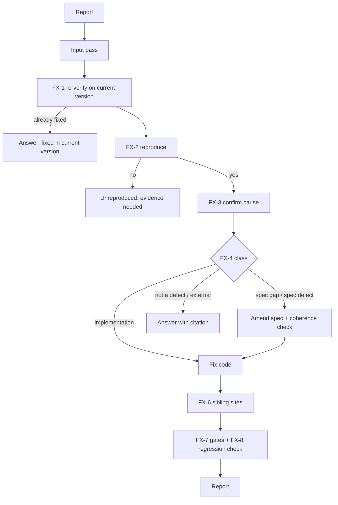

# Defect Intake: the Fix Command

**Version:** 1.3.1
**Status:** Stable
**Layer:** concept

## Overview

`fix` takes reported defects — a user's description, a failing test, a simulation finding, an agent's feedback note, a pasted engine bug report in the engine's own repository — and carries each one from report to verified repair. Its centre is triage: before anything is changed, the defect is reproduced and classified against the specifications, and a closed decision rule settles whether the repair changes a specification or only the code. Every repair leaves a regression check behind and is traced as a task.

## Related Specifications

- [l1-engine-core.md](l1-engine-core.md) - The execution gates a fix passes through, as a task of `run` does.
- [l1-product-simulation.md](l1-product-simulation.md) - Simulation findings are a main input, and a reproduction may become a scenario; the findings of the engine's own scenarios enter through the engine's form (FX-10).
- [l1-agent-feedback.md](l1-agent-feedback.md) - Feedback notes are an input; in the engine's own repository they arrive here instead of being reported.
- [l1-coherence-check.md](l1-coherence-check.md) - A specification amendment made by a fix passes the same check.
- [l1-input-prompt-pass.md](l1-input-prompt-pass.md) - The report's prose is normalized before triage.
- [l1-command-surface.md](l1-command-surface.md) - CS-1, the command set `fix` joins, and CS-15, the maintenance set its engine form (FX-10) belongs to.

## 1. Motivation

Defect reports reach a project from several directions, and today none has a path. A user's report goes to `run`, which executes planned tasks and has no step that asks whether the specification is wrong; to `spec`, which writes specifications and cannot touch code; or to an unrecorded edit, which is the one outcome the SDD exists to prevent. The owner asks for `/magicspec fix`, and asks it to look carefully at what must go into the specifications and what need not.

This repository's own field reports show what goes wrong without a triage step (engine history, 2026-08 to 2026-10): a report is often already partly fixed in the current version, the part that remains is a missed branch of the same defect, and the reporter's explanation of the cause is sometimes wrong — so a repair that follows the report literally fixes the symptom at one site and leaves the others.

The owner's list of 2026-11-11 adds the engine's own side: error feedback about the engine is to be carried through a maintenance `fix` command, not through `spec` (FX-10, FX-11). In this repository such feedback has so far arrived as pasted bug reports handled by hand, or as a `spec` invocation that had to work out on its own that the input was a defect and not an idea.

## 2. Constraints & Assumptions

- `fix` writes product code and SDD artifacts, under the same containment and review rules as `run`.
- Beyond the command intake for a missing report (`l1-command-surface.md` CS-9, E7), it asks nothing (DA-2): a report too thin to reproduce is recorded as unreproduced with the evidence that would reproduce it, and the report says so.
- **Assumption (forecast):** a fix is recorded as a task of the active phase — or of a maintenance phase when no phase is active — rather than in a separate fix ledger, so that progress, live memory and the archive stay truthful through the existing machinery. Runner-up: a separate fix log. Override: `/magicspec spec amend l1-fix-command.md "separate fix ledger"`.
- **Assumption (forecast):** the route FX-11 names in the engine's repository, `/magicspec-dev fix`, is carried by the repository's own text — the constitution's C28 item 2 and the maintenance router — while the shipped router, body and scripts route to `/magicspec fix`: the maintenance set's specification forbids shipped text from naming the maintenance command, and the shipped `finalize` prints its next step from the router's table, which has no maintenance row. Runner-up: a shipped script prints the maintenance command when the developer predicate holds. Override: `/magicspec spec amend l1-fix-command.md "the developer predicate chooses the printed route in a shipped script"`.
- **Assumption (forecast):** in the engine's own repository a failed or inconclusive step of the engine's own scenarios is error feedback about the engine and enters through `/magicspec-dev fix` (FX-10), while `simulate` and `finalize` keep printing `/magicspec fix` as in every project: the route is carried by the repository's own text, as the route of FX-11 is. If the printed step is followed instead, the user command classifies a cause inside the skill folder `External` and records a `bug` feedback note, which the engine's form then takes as a pending note — at worst one hop more. Runner-up: the user command repairs the engine's scenario findings in this repository, which leaves out the steps only the engine has (the meta update, the harness case shown to fail, the release lines). Override: `/magicspec spec amend l1-fix-command.md "the user fix repairs the engine's scenario findings"`.
- **Assumption (forecast):** the override of FX-11 is the same text retyped to `spec`; a text already routed once in the conversation is not routed again, so the override cannot loop. Runner-up: a distinct override spelling. Override: `/magicspec spec amend l1-fix-command.md "a distinct override form"`.

## 3. Core Invariants

- **FX-1 Re-verify first.** Before triage, the defect is checked against the current version of the product (or engine). A report may describe a version that is already fixed in part; only what still reproduces proceeds.
- **FX-2 Reproduce before changing.** Every defect that proceeds is reproduced by a named check — a command, a test, a simulation step — and the check is recorded. A defect that cannot be reproduced is classified `Unreproduced` with what was tried and the one piece of evidence that would reproduce it; nothing is changed for it.
- **FX-3 The reporter's cause is a hypothesis.** The cause stated in a report is tested, not adopted: the triage names the cause it confirmed and how.
- **FX-4 Closed classification.** Each reproduced defect is exactly one of:
  - **Implementation defect** — the product violates behaviour a specification already states. The code is fixed; no specification changes; the fix cites the statement it restores.
  - **Specification gap** — the expected behaviour is not stated anywhere, and it is consistent with what the specifications intend. The specification gains the statement (an edge case, an invariant, an error path), then the code is fixed.
  - **Specification defect** — a specification prescribes the behaviour reported as wrong. The specification is amended under the Amendment Rule (with the cascade it triggers), then the code is fixed.
  - **Not a defect** — the product behaves as specified and as intended. Nothing changes; the answer cites the specification. A misleading document is a documentation fix, not a product fix.
  - **External** — the cause is outside the product: a dependency, the host, the environment, the user's configuration. No specification changes; the finding and a workaround are recorded.
- **FX-5 The specification test.** A repair goes into a specification exactly when it adds or changes a statement about observable behaviour or a contract — what the product does, accepts, returns, guarantees or refuses. A repair that restores already-stated behaviour, or changes internals with no observable difference, does not. When in doubt, the deciding question is: *would an implementer who reads only the specifications reintroduce this defect?* Yes → the specification gains the statement.
- **FX-6 Sibling sites.** Before the repair is final, the same defect class is searched for at every site that shares the mechanism (the same guard, parser, path computation or rule in another file). Each site found is fixed in the same repair or recorded as a separate defect.
- **FX-7 Traced and gated.** Every repair is a task with a `Verify` line equal to the reproduction (FX-2), and passes the execution gates a `run` task passes (`coder`, `code-reviewer`, `test-engineer`; `debugger` when the first attempt fails). `[ADDED]` The repair of a simulation finding records the scenario, the step and the date of the `Last run` it was found in, so a later run of that scenario tells a repaired finding from a new one (`l1-goal-mode.md` GM-4).
- **FX-8 Regression left behind.** The reproduction becomes a lasting check — a test, or a simulation scenario for user-facing behaviour — that fails without the repair. A repair with no lasting check is not `Done`.
- **FX-9 Batches by root cause.** Several defects in one invocation are triaged one by one, then grouped by confirmed cause; one cause is one repair task.
- **FX-10 The engine repository's form.** `[MODIFIED]` In the engine's own repository, `/magicspec-dev fix {report}` is the entry for error feedback about the engine: a pasted engine bug report, a pending feedback note, a failing harness case, a finding of the maintenance test command (`/magicspec-dev test`), and a failed or inconclusive step of the engine's own scenarios (`l1-product-simulation.md` §5.4). It runs FX-1 to FX-9 unchanged, with the engine as the product, and adds the steps that only the engine has: the sibling-site search covers the whole shipped folder, role cards and workflow bodies included; the lasting check is a harness case that is shown to fail without the repair; the engine meta update (C14) follows every change inside the shipped folder; and the repair reaches every maintained release line the defect is present on. The user command keeps no engine-maintenance step and never needs the maintenance tooling.
  - **A scenario finding** `[ADDED]`. A `simulate` run with a failed or inconclusive step ends with `/magicspec fix` (SM-7) here as in every project: shipped text names no maintenance command (`l1-command-surface.md` CS-15), so the repository's own text, not the printed line, routes the finding to this form (§2), as it routes FX-11's reports and the feedback notes (`l1-agent-feedback.md` EF-12). The failed step is the report; its reproduction (FX-2) runs in a disposable project that holds its own copy of the engine, never in this repository's own state folder (`l1-product-simulation.md` §5.4), and the repair is made in the shipped folder. The lasting check is the harness case above; the scenario stays the check from the user's side, is updated in the repair only when what it expects has changed (SM-4), and is not restated as a case of the cognitive suite. A step that fails because the scenario no longer matches what its specification states is `Not a defect` of the engine: the scenario file is repaired and the engine is not changed. The finding is closed by the next `simulate` run of its area, which rewrites the scenario's `Last run`; `fix` does not write that record (SM-7). With no input given, the open findings are the pending notes, then the failing cases, then the scenario findings.
- **FX-11 A report is not an idea.** `[ADDED]` Input given to `spec` that is a defect report — an error message or stack trace, a pasted bug report, a statement that existing behaviour is wrong ("X does not work", "Y fails when Z") with nothing new to build — is routed to `fix` with one `[DR]` line and its override (`/magicspec spec "{text}"` keeps it an idea). In the engine's repository the route is `/magicspec-dev fix`. Input that both reports a defect and asks for new behaviour goes to `fix` for the defect; the new behaviour is a specification gap (FX-4) or, when it is beyond the defect, the next step `fix` names.

## 5. Detailed Design

### 5.1 Flow



### 5.2 Report Layout

```plaintext
[Fix] {n} reported → {r} reproduced, {u} unreproduced, {a} already fixed
  {id} {class} — {confirmed cause} — {spec change | none} — Verify: {check}
  Sibling sites: {k} fixed, {m} recorded
Next: {one command}
```

## 6. Implementation Notes

1. A new workflow body for `fix`; it reuses the execution gates of `run` and the amendment steps of `spec` by reference.
2. With no active phase, `fix` hands the planning command a membership directive to open a maintenance phase for the repair (PL-1: only `plan` writes the plan), then records the task there; the phase archives like any other.
3. `[MODIFIED]` In the engine's own repository, pasted engine bug reports and pending feedback notes go to `/magicspec-dev fix` (FX-10): a maintenance workflow `skills/magicspec-dev/workflows/fix.md` that names the shipped `fix` body for the triage and adds the engine steps; the maintenance router gains its row. The developer predicate decides which route FX-11 narrates.
4. `[ADDED]` The router's argument check and the specification workflow's dispatch gain the FX-11 test. Declared supersessions (`l1-coherence-check.md` CH-9): the router's step that routes text it cannot take to `spec` (`SKILL.md` Dispatch step 3), which gains the reverse route; the bug-report handling of this repository's constitution C28 item 2, which names the maintenance command when it is next amended.
5. `[ADDED]` **The scenario finding (FX-10, 1.2.0).** The maintenance form's input table gains the failed or inconclusive step of the engine's own scenarios, read from the `Last run` records of the engine's workspace, and its open findings with no input end with them; its lasting-check step names the engine's scenario files, not the cognitive suite, for user-facing behaviour; the maintenance router's `fix` row, the development guide's row and the contributor document's paragraph on the engine's scenarios name the one route. The constitution's C28 item 2 stays as it is: the rule workflow's admission declined the amendment (agent-originated, no occurrence of harm on record, the route already stated here at rung 2). **As built (Phase 62).** The maintenance workflow's input table has the two rows, its open findings end with the scenario steps, and a section *A Failed Scenario Step* states how the step is reproduced (a disposable copy of the engine), repaired (the shipped folder, or the scenario file alone when the scenario is out of date) and closed (the next `simulate` run of its area); the harness case of the workflow pins the rows, the order and six sentences of the section, and the maintenance-router case pins the phrase in the router and guide rows and the contributor sentence; seven mutation entries caught. No file of the shipped folder changes (the shipped triage already carries the record of FX-7): `simulate`, `finalize` and the user `fix` body print and read as before. Declared supersessions (`l1-coherence-check.md` CH-9): the input row *a finding of an engine simulation — the report of `/magicspec-dev test`* and the sentence *User-facing behaviour of the engine also gets a scenario in `tests/suite.md`* of `skills/magicspec-dev/workflows/fix.md`; the open finding of `l1-product-simulation.md` §6 item 5 and the last sentence of the engine-scenario paragraph of `docs/dev-test.md`, which state both routes. The supersession of C28 item 2, which names the pasted bug report alone, is withdrawn: C28 item 2 is not amended.

## 7. Drawbacks & Alternatives

- **A spec amendment for every bug** — rejected: most defects restore stated behaviour, and amending for them would bury the specifications in incident history.
- **Never amending specifications from a fix** — rejected: a gap closed only in code reappears when the code is rewritten from the specifications.
- **Asking the reporter for missing detail** — rejected by DA-2; FX-2 names the missing evidence in the report instead, and the next message can supply it.

## Canonical References

| Alias | Path | Purpose |
| --- | --- | --- |
| `[RUN]` | `skills/magicspec/workflows/run.md` | The execution gates FX-7 reuses. |
| `[SPEC]` | `skills/magicspec/workflows/spec.md` | The amendment steps FX-4 reuses. |
| `[DEBUGGER]` | `skills/magicspec/roles/debugger.md` | The stance on a failed first attempt. |

## Document History

| Version | Date | Author | Description |
| --- | --- | --- | --- |
| 1.3.1 | 2026-11-18 | Agent | As built in Phase 62, Stable retained, no requirement changed (coherence: zero artifacts compared for a patch, no mechanic introduced). §6 item 5 records what landed in the maintenance workflow, the maintenance router, the development guide and the contributor document, and withdraws the declared supersession of C28 item 2: the amendment was declined by the admission of the rule workflow (agent-originated, no harm on record, covered here at rung 2), so the constitution is unchanged at 1.24.0. |
| 1.3.0 | 2026-11-18 | Agent | **The repair of a simulation finding records the run it answered** (FX-7, a specification gap closed by `/magicspec-dev fix`, feedback note n4, Phase 63): the scenario, the step and the date of the `Last run` the finding was found in go into the task's notes, so goal mode re-runs the scenario of a repaired finding before choosing `fix` for it again and a newer failed run is read as a new finding (`l1-goal-mode.md` 1.2.0 GM-4). Amendment Rule round trip: RFC, Post-Update Review (coherence: 3 artifacts compared — `l1-goal-mode.md` GM-4, `l1-product-simulation.md` SM-7, `workflows/fix.md` Step 6 — 0 findings; spec-critic PASS; prompt-engineer PASS), Stable. |
| 1.2.0 | 2026-11-18 | Agent | **Which command repairs a failure of the engine's own scenarios** (origin: the open finding of Phase 60, `l1-product-simulation.md` §6 item 5, carried in the plan's Backlog; decided by the Consequence Forecast, premise in §2). FX-10 names the failed or inconclusive step of the engine's own scenarios, beside the finding of `/magicspec-dev test`, among the inputs of `/magicspec-dev fix`, with a sub-item for it: the printed step stays `/magicspec fix` (SM-7, CS-15) and the repository's own text routes the finding to the maintenance form, as for FX-11 and EF-12; the reproduction runs in a disposable copy of the engine and the repair in the shipped folder; the harness case is the lasting check and the scenario stays the user-side check, never restated in the cognitive suite; a scenario out of date is repaired in the scenario file alone; the next `simulate` run of the area closes the finding. §6 item 5 lists the deployment (maintenance form, maintenance router, contributor document, C28 item 2; nothing in the shipped folder) and the declared supersessions. Amendment Rule round trip: RFC, Post-Update Review (coherence: 6 artifacts compared, 3 findings — the open finding of `l1-product-simulation.md` §6 item 5 and its §5.4 row, resolved by its patch 1.1.2; the list of inputs in `l1-command-surface.md` CS-15, a duplicate definition replaced by a link in its patch 2.2.6; C28 item 2, a declared supersession resolved on deployment; spec-critic PASS; prompt-engineer PASS-WITH-REWRITES, two sentences rewritten in the pass), Stable. |
| 1.1.1 | 2026-11-11 | Agent | As built in Phase 51, Stable retained (the two premises below are recorded in §2; no requirement changed). The user command is `workflows/fix.md`: triage Steps 1 to 4 (FX-1 to FX-5, the deciding question verbatim), grouping by confirmed cause, sibling sites with the `{k} fixed, {m} recorded` counts (FX-6), the repair as a task of the active phase under the identifier `T-{phase}F{nn}` — the next free number of the `F` track, so it never collides with the tracks the task workflow writes — gates by reference to the execution workflow's steps (FX-7), the check written first and seen to fail (FX-8). With no active phase the body makes the planning write as one step of its own stage (`l1-pipeline-stages.md` PS-1): one maintenance-phase entry through the plan workflow's write-back, the workbook and ledger row from the templates, `PLAN.md` written by no other route (PL-1). A confirmed cause inside the skill folder of an installed engine is classified External with a `bug` feedback note and nothing there is edited. The router row is group `quality & automation`, demand `deep`, the defect required (the open findings — `feedback list`: pending notes, then the findings no digest has shown — as the suggestions of the argument form); `finalize --workflow=fix` behaves as after a run (archives a finished maintenance phase, a `Fixed` changelog entry). The maintenance form is `skills/magicspec-dev/workflows/fix.md` (FX-10): the shipped triage followed unchanged plus seven engine steps; the shipped body names no maintenance step. |
| 1.1.0 | 2026-11-11 | Agent | **The engine's side** (origin `user-stated`: the owner's list of commands of 2026-11-11 — error feedback goes through a maintenance `fix`, not through `spec`). New FX-10 (`/magicspec-dev fix`: the same triage with the engine as the product, plus the shipped-folder sibling search, a harness case shown to fail without the repair, C14 and every maintained release line) and FX-11 (a defect report given to `spec` is routed to `fix` with a `[DR]` line). The user command is unchanged (forecast in [l1-command-surface.md](l1-command-surface.md) §2). Amendment Rule: `Stable → RFC`. |
| 1.0.2 | 2026-10-30 | Agent | **Reality sync: the printed command form** is `/magicspec <command>` ([l1-command-surface.md](l1-command-surface.md) CS-2); the earlier colon spelling is rewritten wherever the text prints a command. No requirement changed. |
| 1.0.1 | 2026-10-30 | Agent | Clarification (no requirement changed): `fix` typed without a report asks for one through the command intake of [l1-command-surface.md](l1-command-surface.md) 2.0.0 (E7); a thin report still asks nothing. |
| 1.0.0 | 2026-10-29 | Agent | Created from the owner's list of ideas (route defect feedback through `/magicspec fix`, deciding carefully what goes into the specifications). Post-Update Review: spec-critic PASS after the fixes of the review, prompt-engineer PASS-WITH-REWRITES (rewrites applied in the same pass); promoted to Stable under Trust Mode. |
