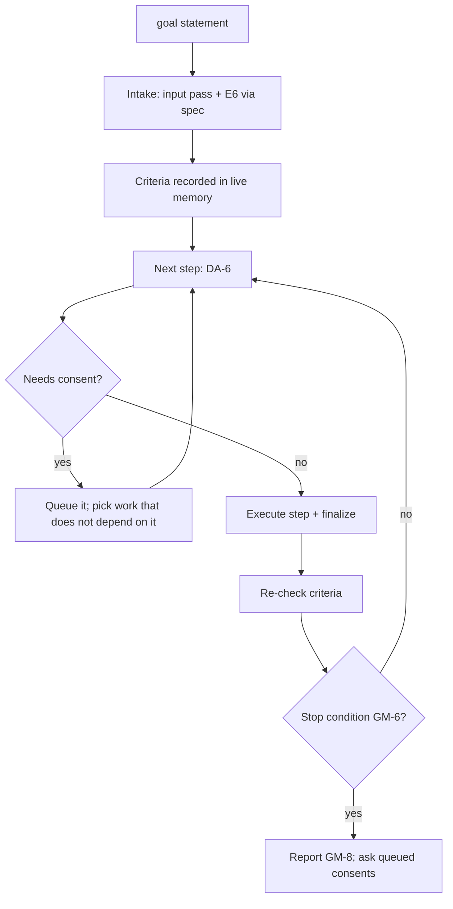

# Goal Mode: Non-Stop Pursuit of a Stated Goal

**Version:** 1.1.1
**Status:** Stable
**Layer:** concept

## Overview

`goal` takes a goal stated in plain words and drives the pipeline toward it without pausing between steps: it specifies what is missing, plans, decomposes, runs every phase, simulates, fixes what the simulation finds, and repeats until the goal's acceptance criteria hold or a closed list of stop conditions is reached. It removes the pauses between workflows, never a guard inside one: every review, consent and integrity check still applies. The goal and its criteria are recorded in live memory, so a new session continues the same goal.

## Related Specifications

- [l1-decision-autonomy.md](l1-decision-autonomy.md) - DA-6 computes the next step that goal mode executes instead of narrating; the consent entries E1, E2 and E4 stay questions.
- [l1-session-continuity.md](l1-session-continuity.md) - Live memory, the next-step computation and the resume check that carry a goal across sessions.
- [l1-idea-intake-gate.md](l1-idea-intake-gate.md) - The intake the goal statement passes once, before any work.
- [l1-plan-command.md](l1-plan-command.md) - The planning step of each iteration.
- [l1-product-simulation.md](l1-product-simulation.md) - Scenarios that verify user-facing criteria.
- [l1-fix-command.md](l1-fix-command.md) - The step that consumes simulation findings.
- [l1-command-surface.md](l1-command-surface.md) - CS-1, the command set `goal` joins.
- [l1-pipeline-stages.md](l1-pipeline-stages.md) - PS-6: `goal` is the one command that crosses stage boundaries, through the same records.

## 1. Motivation

Every workflow ends with a computed next step that is narrated (DA-6), and the user types it. For a goal that spans several phases — "the import works end to end for all three file formats" — the user's only contribution between steps is retyping what the engine already computed. The owner asks for a non-stop mode (`/magicspec goal`).

Two failure modes bound the design. A loop that also skips consent turns an assistant into an unattended process that deletes files or publishes a release on its own. A loop with no stop rule spends without converging: it keeps planning and running while nothing moves the goal closer.

The owner's list of 2026-11-11 adds two forms of the argument: a phase, or a number of tasks, besides a goal stated in words (GM-9). Both name work that is already specified and planned, so neither needs an intake.

## 2. Constraints & Assumptions

- Goal mode runs inside the host's session; it schedules nothing outside it. A host that ends the turn ends the iteration, and the next session resumes from live memory.
- The engine never commits. Goal mode leaves its changes uncommitted and lists commit suggestions per phase in its report, as each workflow does today.
- **Assumption (forecast):** a consent gate does not stop the whole mode — the action is queued and every piece of work that does not depend on it continues — because stopping at the first gate would make the mode stop in exactly the long runs it exists for, while asking at once would leave the question unanswered in an unattended run. Runner-up: stop and ask at the first gate. Override: `/magicspec spec amend l1-goal-mode.md "stop at the first consent gate"`.
- **Assumption (forecast):** three consecutive iterations without progress (GM-6) end the mode, because one or two can be spent on a fix that lands in the next iteration. Runner-up: two. Override: a bound stated in the goal ("give up after 5 rounds without progress").

## 3. Core Invariants

- **GM-1 One intake, then no questions.** `[MODIFIED]` A goal statement passes the input pass and the idea intake gate once, at the start, through the specification step; questions are allowed there and only there. A phase or a task count (GM-9) has no intake: it asks nothing at all. After the intake, the mode asks only consent questions (E1, E2, E4), and only when it stops (GM-5).
- **GM-2 Verifiable criteria.** The intake turns the goal into acceptance criteria, each verifiable by a named check: a command, a test, a simulation scenario or a specification statement whose tasks are `Done`. A criterion with no possible check is rewritten until it has one, or recorded as an `Assumption (forecast)` the report names.
- **GM-3 Recorded goal.** The goal, its criteria and each criterion's state (`open`, `met`, `blocked`) are recorded in the workspace's live memory and updated after every iteration. A resume in a new session reports the goal and continues it; `goal` with no argument continues the recorded goal; with none recorded, it says so and shows the goal form.
- **GM-4 The iteration.** Each iteration computes the next step exactly as DA-6 does and executes it instead of narrating it: `spec` for an uncovered criterion, `plan`/`task` for an unplanned one, `run` while a phase has a runnable task, `simulate` when scenarios cover a criterion, `fix` for open findings. After each step, finalization runs and the criteria are re-checked.
- **GM-5 Consent is queued, never assumed.** An action that needs consent is not performed and not skipped silently: it is queued with its reason, and the iteration continues with work that does not depend on it. The mode stops when nothing unblocked remains, and only then asks the queued questions, one at a time, in queue order.
- **GM-6 Closed stop conditions.** The mode stops on exactly one of: every criterion `met` (done); nothing unblocked remains and consents are queued (GM-5); three consecutive iterations without progress — an iteration makes progress when it changes a recorded state: a criterion's state, a task's status, a specification's status, the plan's membership or order, or a finding closed; repeating a step on unchanged input with an unchanged outcome is no progress; an objective integrity halt (checksums, drift, parity); a bound the goal states (iterations, phases or time); an interruption by the user.
- **GM-7 No guard is relaxed.** Every review gate (`spec-critic`, `planner`, `prompt-engineer`, `code-reviewer`, `test-engineer`), every Pre-flight check and every containment rule runs in goal mode exactly as outside it. The mode only removes the pause between one workflow's end and the next one's start.
- **GM-8 One report.** When the mode stops, it reports once: the stop condition, each criterion with its state and its evidence, the work done per phase with commit suggestions, the queued consents, and the one next step.
- **GM-9 Scope forms.** `[ADDED]` The argument is one of:
  1. **A goal statement** — as GM-1 to GM-8 describe.
  2. **A phase** (`goal phase-3`) — the goal is that phase `Done`: its criteria are the phase's tasks, each met when its verify line passes and its status is `Done`. The iteration runs `task` when the phase is not yet decomposed and `run` while it has a runnable task, and stops at the phase's end. A phase that does not exist in the plan is answered with one line listing the plan's phases, and nothing runs.
  3. **A number of tasks** (`goal 5 tasks`) — a bound on the work, not a goal: the mode follows the plan from its next runnable task and stops after that many tasks reach `Done`, at a task boundary, never in the middle of one. Combined with a statement or a phase (`goal phase-3 5 tasks`), it bounds that goal, as a stated bound of GM-6 does.

  A phase or a count is recorded in live memory like a statement (GM-3), so `goal` with no argument continues it in a new session. A number with no unit, or a phrase that is neither a phase nor a count, is read as a goal statement.

## 5. Detailed Design

### 5.1 Loop



### 5.2 Report Layout

```plaintext
Goal: {statement}
Stopped: {condition}
Criteria:
  [met]     {criterion} — {evidence}
  [open]    {criterion} — {what is missing}
  [blocked] {criterion} — {queued consent or blocker}
Work: Phase {N}: {summary} — commit suggestion: {message}
Queued consents: {n}
Next: {one command}
```

## 6. Implementation Notes

1. The live-memory file gains a goal block; its writer preserves it across updates and bounds it within the file's line cap.
2. The resume check reports a recorded goal in its one line.
3. The status briefing shows the goal and the criteria counts.
4. The cognitive suite gains scenarios for each stop condition.
5. Declared supersessions (`l1-coherence-check.md` CH-9): the live-memory layout and SC-2 in [l1-session-continuity.md](l1-session-continuity.md); the resume line in [l2-session-checkpoint.md](l2-session-checkpoint.md); the briefing in [l2-status-command.md](l2-status-command.md).
6. **As built (Phase 53), no requirement changed.** (a) The goal block is the section `## Goal` of `STATE.md`, between Current Position and Progress, present only while a goal is recorded, at most 28 lines, written only by `update-state` from a JSON file (`--goal-file`; `--goal-clear` removes it) through the one module that renders, parses and checks it (`scripts/lib/goal-block.js`); a goal that fails the closed schema or the bound is refused before any write with one HALT line and the finding `STATE_GOAL_REFUSED`. (b) It holds the statement, the target phase, the task limit, a stated bound, the counters `Without progress`, `Tasks done`, `Iterations`, `Phases done` and the moment `Started` (GM-6 names bounds of iterations, phases and time and a count of tasks; they need the counters), each criterion with its state and its check, and the consents queued with their reasons. (c) A phase goal records one criterion, `phase {N} is Done`, met when the phase's status is `Done` or `Done (Archived)`: the phase's tasks are its criteria (GM-9 item 2) and their workbook is the per-task record, the block being bounded; a count alone records `{N} tasks reach Done`. (d) The resume line reports a recorded goal in the same one line, a goal alone included, with `/magicspec goal` as its next step; the briefing shows one `Goal:` line under Position and recommends `/magicspec goal` first while a criterion is not met. (e) The router row has the demand `per step`, which the one parser admits and the handoff line prints as the table has it (`Next: /magicspec goal — per step reasoning`); a bare `goal` is not asked for, the body looks for the recorded goal first, in the other workspaces too (`resume-state --all --json`); a new scope over a recorded goal replaces it, with one `[DR]` naming the replaced goal. (f) Each step is read from its own body and finalizes as its own workflow: the mode finalizes as none, queues the consent entries E1, E2 and E4 in the block and asks them one at a time after its one report.

## 7. Drawbacks & Alternatives

- **Cost.** A goal can span many phases. Bounded by GM-6 and by a bound the goal may state.
- **Unattended changes.** Accepted within GM-5 and GM-7: nothing irreversible happens without a yes, and every change stays uncommitted and reviewable.
- **A host scheduler for the loop** — rejected: hosts differ; the in-session loop plus the resume record works on every host.
- **Auto-approving consent inside goal mode** — rejected: it would turn the consent entries into a setting, which DA-2 forbids.

## Canonical References

| Alias | Path | Purpose |
| --- | --- | --- |
| `[STATE]` | `skills/magicspec/templates/state.md` | Live-memory template that gains the goal block. |
| `[RESUME]` | `skills/magicspec/scripts/resume-state.js` | Resume line that reports the goal. |
| `[RULES]` | `skills/magicspec/CONSTITUTION.md` | §7, the decision posture goal mode extends. |

## Document History

| Version | Date | Author | Description |
| --- | --- | --- | --- |
| 1.1.1 | 2026-11-12 | Agent | **As built in Phase 53**, Stable retained, no requirement changed. §6 item 6 records what the build decided: the goal block (its place, bound, writer, refusal and the counters GM-6's bounds need), the one criterion of a phase goal, the resume line and the briefing, the `per step` demand and the bare `goal`, the replacement of a recorded goal. The two harness-visible additions to GM-3 (`Iterations`, `Phases done`, `Started`) were found by writing the body, not by the specification review. |
| 1.1.0 | 2026-11-11 | Agent | **Scope forms** (origin `user-stated`: the owner's list of commands of 2026-11-11 — "a phase or some number of tasks" as the argument). New GM-9: a phase makes that phase `Done` the goal, a task count bounds the work, and either may bound a statement; GM-1 states that neither has an intake. Related: `l1-pipeline-stages.md` PS-6. Amendment Rule: `Stable → RFC`. |
| 1.0.1 | 2026-10-30 | Agent | **Reality sync: the printed command form** is `/magicspec <command>` ([l1-command-surface.md](l1-command-surface.md) CS-2); the earlier colon spelling is rewritten wherever the text prints a command. No requirement changed. |
| 1.0.0 | 2026-10-29 | Agent | Created from the owner's list of ideas (non-stop mode, `/magicspec goal`). Post-Update Review: spec-critic PASS after the fixes of the review, prompt-engineer PASS-WITH-REWRITES (rewrites applied in the same pass); promoted to Stable under Trust Mode. |
