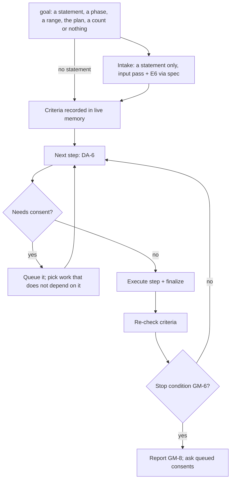

# Goal Mode: Non-Stop Pursuit of a Stated Goal

**Version:** 1.4.1
**Status:** Stable
**Layer:** concept

## Overview

`goal` takes a goal stated in plain words and drives the pipeline toward it without pausing between steps: it specifies what is missing, plans, decomposes, runs every phase, simulates, fixes what the simulation finds, and repeats until the goal's acceptance criteria hold or a closed list of stop conditions is reached. It removes the pauses between workflows, never a guard inside one: every review, consent and integrity check still applies. The goal and its criteria are recorded in live memory, so a new session continues the same goal. `[MODIFIED]` The argument is optional: a goal in words, a phase, a range of phases, the whole plan or a number of tasks; with none, the mode continues the recorded goal while it is unfinished, and otherwise runs the active phase.

## Related Specifications

- [l1-decision-autonomy.md](l1-decision-autonomy.md) - DA-6 computes the next step that goal mode executes instead of narrating; DA-10 decides the forks the mode meets and DA-2 keeps the whitelist closed (GM-11); the consent entries E1, E2 and E4 stay questions.
- [l1-session-continuity.md](l1-session-continuity.md) - Live memory, the next-step computation and the resume check that carry a goal across sessions; SC-2.1, the next-step computation the active phase of a bare `goal` agrees with.
- [l1-idea-intake-gate.md](l1-idea-intake-gate.md) - The intake the goal statement passes once, before any work.
- [l1-plan-command.md](l1-plan-command.md) - The planning step of each iteration.
- [l1-product-simulation.md](l1-product-simulation.md) - Scenarios that verify user-facing criteria.
- [l1-fix-command.md](l1-fix-command.md) - The step that consumes simulation findings.
- [l1-command-surface.md](l1-command-surface.md) - CS-1, the command set `goal` joins, and CS-9, the optional argument whose default `goal` takes (GM-9).
- [l1-pipeline-stages.md](l1-pipeline-stages.md) - PS-6: `goal` is the one command that crosses stage boundaries, through the same records; the handoff line a stage ends with (PS-4, PS-7) is, inside this mode, the input of the next iteration (GM-10).

## 1. Motivation

Every workflow ends with a computed next step that is narrated (DA-6), and the user types it. For a goal that spans several phases — "the import works end to end for all three file formats" — the user's only contribution between steps is retyping what the engine already computed. The owner asks for a non-stop mode (`/magicspec goal`).

Two failure modes bound the design. A loop that also skips consent turns an assistant into an unattended process that deletes files or publishes a release on its own. A loop with no stop rule spends without converging: it keeps planning and running while nothing moves the goal closer.

The owner's list of 2026-11-11 adds two forms of the argument: a phase, or a number of tasks, besides a goal stated in words (GM-9). Both name work that is already specified and planned, so neither needs an intake.

`[ADDED]` A third failure mode is quieter: a loop that stops itself. A message that starts no next action ends the agent's turn, and the work waits until the person types again. A model vendor's prompting guidance for a current model generation reports that on long tasks with several parts the model ends turns with progress messages — a summary that announces the next step, an offer to continue, a list of decisions, a pause at a milestone — and that an instruction naming those ends makes them rarer. This mode invites the first of them at every step: each step prints its finalization, whose last line names the next command, so the output reads as a finished stage. The mode then stops on no condition of GM-6 and without its report, and the person reads a handoff to `task` or `run` instead of `goal` (GM-10).

`[ADDED]` The owner described the mode again on 2026-11-19. With an argument it is `/magicspec spec` carried through to the end: the person hands over an idea, a brief or a reference, the engine specifies it, plans it and builds it, and asks only where `spec` asks, at the intake. With no argument the work is already begun: the person wants the phase, or a few phases, or a few tasks, carried to the end by the whole regulation with nothing typed in between. Against 1.3.1 the description exposes three gaps:

- **A bare `goal` asked.** With no goal recorded it showed the argument form, where an optional argument runs its default and says which (CS-9, DA-9). A goal that had finished stayed recorded, so a bare `goal` after a phase only read it back. The argument had no form for several phases or for the whole plan.
- **A large brief became many specification runs.** The iteration ran `spec` once per uncovered criterion, so a brief with ten criteria passed ten separate specification reviews and could end as ten fragments, not one coherent set.
- **Questions in the course of the work.** The owner allows one in the extreme case, provided the work does not stand still behind it. A single session cannot ask and go on: a question holds the turn. The forecast's answer is GM-11.

## 2. Constraints & Assumptions

- Goal mode runs inside the host's session; it schedules nothing outside it. `[MODIFIED]` A host that ends the turn on its own — a limit or an error — ends the iteration, and the next session resumes from live memory. The mode itself never ends a turn before it stops (GM-10).
- The engine never commits. Goal mode leaves its changes uncommitted and lists commit suggestions per phase in its report, as each workflow does today.
- **Assumption (forecast):** a consent gate does not stop the whole mode — the action is queued and every piece of work that does not depend on it continues — because stopping at the first gate would make the mode stop in exactly the long runs it exists for, while asking at once would leave the question unanswered in an unattended run. Runner-up: stop and ask at the first gate. Override: `/magicspec spec amend l1-goal-mode.md "stop at the first consent gate"`.
- **Assumption (forecast):** three consecutive iterations without progress (GM-6) end the mode, because one or two can be spent on a fix that lands in the next iteration. Runner-up: two. Override: a bound stated in the goal ("give up after 5 rounds without progress").
- **Assumption (forecast):** `[ADDED]` naming the four ends of GM-10 in the mode's own text is enough to keep the turn going, because the guidance this rests on reports that the model responds to an instruction that names the ends to avoid and the ends to take, and such text needs nothing a host may lack. Runner-up: a host-side continuation that, when a turn ends early, sends the open criteria back as the next message and gives up after two or three. Override: `/magicspec spec amend l1-goal-mode.md "continue through a host hook"`.
- `[ADDED]` A bare `goal` with no unfinished goal recorded takes the active phase — the first phase of the plan that the ledger does not hold as `Done` — and not the whole plan: the owner's choice of 2026-11-19 (origin `user-stated`). A phase is bounded and its cost is known from the plan, and a person who wants more types `goal plan`. Override: `/magicspec spec amend l1-goal-mode.md "a bare goal runs the whole plan"`.
- **Assumption (forecast):** `[ADDED]` the phases of a range or of the whole plan are fixed when the goal is recorded, because a goal whose extent grows while it runs has no bound for GM-6 to check; a phase that a replan adds later is outside it, and the report's next step leads to it. Runner-up: the plan as it stands at each re-check. Override: `/magicspec spec amend l1-goal-mode.md "the plan goal follows replans"`.
- **Assumption (forecast):** `[ADDED]` a clarification the person would like to give in the course of the work is not asked (GM-11), because the Consequence Forecast (DA-10) counts a question as a stall above any reversible rework and below irreversible harm, and an irreversible step is already a consent (GM-5). The premise is decided, recorded where the work lands and listed in the report with its override. Runner-up: a clarification queued like a consent and asked when the mode stops — a new entry in the closed whitelist (DA-2), so an E4 event. Override: `/magicspec spec amend l1-decision-autonomy.md "add an entry: a goal's queued clarification"`.

## 3. Core Invariants

- **GM-1 One intake, then no questions.** `[MODIFIED]` A goal statement passes the input pass and the idea intake gate once, at the start, through the specification step; questions are allowed there and only there. A phase, a range of phases, the whole plan, a task count or no argument (GM-9) has no intake: it asks nothing at all. After the intake, the mode asks only consent questions (E1, E2, E4), and only when it stops (GM-5); nothing else is asked (GM-11).
- **GM-2 Verifiable criteria.** The intake turns the goal into acceptance criteria, each verifiable by a named check: a command, a test, a simulation scenario or a specification statement whose tasks are `Done`. A criterion with no possible check is rewritten until it has one, or recorded as an `Assumption (forecast)` the report names.
- **GM-3 Recorded goal.** `[MODIFIED]` The goal, its criteria and each criterion's state (`open`, `met`, `blocked`) are recorded in the workspace's live memory and updated after every iteration. A resume in a new session reports the goal and continues it. `goal` with no argument continues the recorded goal while one of its criteria is not met; with none recorded, or with every criterion met — a finished goal is not pending — it takes the default scope of GM-9. The block also records the premises the pursuit accepted (GM-11), each with its override; when the block's bound leaves no room, the oldest premise is dropped and counted, and the write is never refused for it.
- **GM-4 The iteration.** Each iteration computes the next step exactly as DA-6 does and executes it instead of narrating it: `spec` for the uncovered criteria, `plan`/`task` for an unplanned one, `run` while a phase has a runnable task, `simulate` when scenarios cover a criterion, `fix` for open findings. After each step, finalization runs and the criteria are re-checked. `[ADDED]` A scenario finding whose repair is `Done`, while the run it was found in is still the scenario's last, goes to `simulate` for its area before `fix` can be chosen for it again: only a run rewrites a scenario's `Last run` (SM-7), so the finding closes there, or comes back with a newer run, which is a new finding for `fix`. `[ADDED]` The first `spec` run of a goal statement takes the intent statement with every criterion that no `Stable` specification states, as one run: a large brief is specified once, passes the specification review as one set and cannot end as one fragment per criterion. A later `spec` run takes the single criterion that a later check found uncovered.
- **GM-5 Consent is queued, never assumed.** An action that needs consent is not performed and not skipped silently: it is queued with its reason, and the iteration continues with work that does not depend on it. The mode stops when nothing unblocked remains, and only then asks the queued questions, one at a time, in queue order.
- **GM-6 Closed stop conditions.** The mode stops on exactly one of: every criterion `met` (done); nothing unblocked remains and consents are queued (GM-5); three consecutive iterations without progress — an iteration makes progress when it changes a recorded state: a criterion's state, a task's status, a specification's status, the plan's membership or order, or a finding closed; repeating a step on unchanged input with an unchanged outcome is no progress; an objective integrity halt (checksums, drift, parity); a bound the goal states (iterations, phases or time); an interruption by the user.
- **GM-7 No guard is relaxed.** Every review gate (`spec-critic`, `planner`, `prompt-engineer`, `code-reviewer`, `test-engineer`), every Pre-flight check and every containment rule runs in goal mode exactly as outside it. The mode only removes the pause between one workflow's end and the next one's start.
- **GM-8 One report.** `[MODIFIED]` When the mode stops, it reports once: the stop condition, each criterion with its state and its evidence, the work done per phase with commit suggestions, the queued consents, the premises it accepted with their overrides (GM-11), and the one next step.
- **GM-9 Scope forms.** `[MODIFIED]` The argument is optional and is one of:
  1. **A goal statement** — as GM-1 to GM-8 describe.
  2. **A phase** (`goal phase-3`) — the goal is that phase `Done`: its criteria are the phase's tasks, each met when its verify line passes and its status is `Done`. The iteration runs `task` when the phase is not yet decomposed and `run` while it has a runnable task, and stops at the phase's end. A phase that does not exist in the plan is answered with one line listing the plan's phases, and nothing runs.
  3. **A range of phases** (`goal phase-3..5`) — `[ADDED]` the goal is every phase of the range `Done`, taken in the plan's order, each as item 2 takes one. It holds one criterion — the range is `Done` — because the tasks of each phase are its criteria and their workbooks the per-task record; it is met when every phase of the range is `Done`. A range whose end precedes its start, or that names a phase the plan does not hold, is answered like a missing phase: one line listing the plan's phases, and nothing runs.
  4. **The whole plan** (`goal plan`) — `[ADDED]` the range from the first open phase of the plan to its last, fixed when the goal is recorded (§2). With no open phase, one line says so and nothing runs.
  5. **A number of tasks** (`goal 5 tasks`) — a bound on the work, not a goal: the mode follows the plan from its next runnable task and stops after that many tasks reach `Done`, at a task boundary, never in the middle of one. Combined with a statement, a phase, a range or the whole plan (`goal phase-3 5 tasks`), it bounds that goal, as a stated bound of GM-6 does.
  6. **No argument** — `[ADDED]` the mode continues the recorded goal while one of its criteria is not met (GM-3): the goal of the resolved workspace or, with none there, the only unfinished one among the other workspaces. With no unfinished goal recorded it takes the active phase — the phase the ledger marks `In Progress`, else the first phase of the plan, in order, that the ledger does not hold as `Done` — as the phase goal of item 2 and says in one `[DR]` line which phase it took. A finished goal that is still recorded is replaced, by this default or by any new scope, without a line: nothing in it was left unmet. With no phase to take — the plan is complete, stale or absent, or its active phase is `Blocked` — nothing runs: one line states what `Next Action` records and names its one command.

  A phase, a range, the whole plan or a count is recorded in live memory like a statement (GM-3), so `goal` with no argument continues it in a new session. A number with no unit, or a phrase that is none of these forms, is read as a goal statement. The word `plan` alone is the form of item 4 unless a workspace has that name (the workspace wins, as for any word); quoting it forces a statement.
- **GM-10 The mode does not stop itself.** `[ADDED]` While no condition of GM-6 holds, the mode never ends its turn with a message that starts no next action (a command, an edit or a check): such a message is a stop on no condition of GM-6, without the GM-8 report. It adds no obligation GM-6 and DA-6 do not already carry; it names the ends that break them. Four such ends read as reports and are never taken:
  1. A summary of a step that closes by announcing the next step instead of taking it. A step's finalization output, whose last line names the next command, is followed in the same turn by the re-check of GM-4.
  2. An offer to continue unless the person would rather not.
  3. A list of decisions for the person when none of them blocks the remaining work: an elective one is decided and narrated as a `[DR]`, one that needs consent is queued (GM-5).
  4. A pause because the turn has been long or a phase is done.

  A progress note goes in the same message as the next action. The mode ends a turn for two things only: a round of the intake survey at the start (GM-1), and the GM-8 report with its queued consents. A turn the host ends is the case of §2; the person's interruption is a stop of GM-6.
- **GM-11 A premise only the requester can confirm is decided, never asked.** `[ADDED]` After the intake (GM-1) the mode asks only the queued consents of GM-5. A fork the evidence does not settle — including a clarification the work would profit from — is decided by the Consequence Forecast (DA-10), narrated as a `[DR]`, and its premise is written where the work lands as an `Assumption (forecast)`, as outside this mode. The work does not wait for an answer, because waiting is a stall (DA-10); the one case that a wrong guess cannot be taken back is already a consent (E1, E2, E4), queued under GM-5 while the work that does not depend on it goes on. Each premise is also recorded in the goal block (GM-3) and listed in the report (GM-8) with its override, so nothing the forecast decided for the person stays out of their sight; an override is an amendment of the specification that holds the premise, made as outside this mode.

## 5. Detailed Design

### 5.1 Loop



### 5.2 Report Layout

```plaintext
Goal: {statement}
Stopped: {condition}
Criteria:
  [met]     {criterion} — {evidence}
  [open]    {criterion} — {what is missing}
  [blocked] {criterion} — {queued consent or blocker}
Work: Phase {N}: {summary} — commit suggestion: {message}
Queued consents: {n}
Assumptions: {n}
  {premise} — Override: {command}
Next: {one command}
```

`[ADDED]` The `Assumptions` line and the premise lines under it are the premises of GM-11, one line each; they are printed only when the pursuit accepted any.

## 6. Implementation Notes

1. The live-memory file gains a goal block; its writer preserves it across updates and bounds it within the file's line cap.
2. The resume check reports a recorded goal in its one line.
3. The status briefing shows the goal and the criteria counts.
4. The cognitive suite gains scenarios for each stop condition.
5. Declared supersessions (`l1-coherence-check.md` CH-9): the live-memory layout and SC-2 in [l1-session-continuity.md](l1-session-continuity.md); the resume line in [l2-session-checkpoint.md](l2-session-checkpoint.md); the briefing in [l2-status-command.md](l2-status-command.md).
6. **As built (Phase 53), no requirement changed.** (a) The goal block is the section `## Goal` of `STATE.md`, between Current Position and Progress, present only while a goal is recorded, at most 28 lines, written only by `update-state` from a JSON file (`--goal-file`; `--goal-clear` removes it) through the one module that renders, parses and checks it (`scripts/lib/goal-block.js`); a goal that fails the closed schema or the bound is refused before any write with one HALT line and the finding `STATE_GOAL_REFUSED`. (b) It holds the statement, the target phase, the task limit, a stated bound, the counters `Without progress`, `Tasks done`, `Iterations`, `Phases done` and the moment `Started` (GM-6 names bounds of iterations, phases and time and a count of tasks; they need the counters), each criterion with its state and its check, and the consents queued with their reasons. (c) A phase goal records one criterion, `phase {N} is Done`, met when the phase's status is `Done` or `Done (Archived)`: the phase's tasks are its criteria (GM-9 item 2) and their workbook is the per-task record, the block being bounded; a count alone records `{N} tasks reach Done`. (d) The resume line reports a recorded goal in the same one line, a goal alone included, with `/magicspec goal` as its next step; the briefing shows one `Goal:` line under Position and recommends `/magicspec goal` first while a criterion is not met. (e) The router row has the demand `per step`, which the one parser admits and the handoff line prints as the table has it (`Next: /magicspec goal — per step reasoning`); a bare `goal` is not asked for, the body looks for the recorded goal first, in the other workspaces too (`resume-state --all --json`); a new scope over a recorded goal replaces it, with one `[DR]` naming the replaced goal. (f) Each step is read from its own body and finalizes as its own workflow: the mode finalizes as none, queues the consent entries E1, E2 and E4 in the block and asks them one at a time after its one report.
7. `[ADDED]` **As built (Phase 65), no requirement changed.** GM-10 (1.3.0). In `workflows/goal.md`: the Scope bullet *Inside the session* separates a turn the host ends (a limit or an error) from one the mode would end; Core Invariant 4 holds the guard *The mode does not stop itself (GM-10)* — the four ends named once, the two ends the mode takes (the intake round of GM-1, the report of GM-8 with its queued consents) and the person's interruption as stop 6 of Step 6, the closed list of six unchanged; Step 5 states that the handoff line a finalization ends with is the input of the next iteration and that the re-check follows in the same turn; the checklist gains one line. The harness case *goal mode does not stop itself* (`tests/engine/shipped-text-core.js`) pins each statement, proved by eleven mutation entries; the cognitive suite gains T365 (area `goal`) and the engine's scenario S-12 a step (area `quality`). The declared supersession of the earlier bullet is carried out. The host-side continuation of §7 stays deferred.
8. `[ADDED]` **As built (Phase 67), no requirement changed apart from one clarification (c).** (a) The goal block (`scripts/lib/goal-block.js`, the `## Goal` comment of `templates/state.md`): the closed schema gains `phaseTo` (a whole number not below `phase`; a range of one phase is none), `premises` (`{premise, override}`, both texts required) and `premisesDropped`; the section renders `- **Target phase:** 3..5`, `- [premise] {premise} — {override}` after the consents and `- **Premises dropped:** {n}` last, and when the criteria and consents leave less room than the premises need the oldest give way first and are counted — with no line left even the count gives way — and the write is not refused for them; criteria and consents over the bound are refused as before. A block written before this change reads with the new fields empty. `resume-state` spells a range as `phase-3..5` through the one describer, and its `--json` carries `phase_to`. `goal plan` is recorded as the range it resolved to. (b) The body `workflows/goal.md`: Entry and the description, Argument Routing (a row each for the range and `plan`, a finished goal replaced without a line, no Input Pass for the new names and the empty argument), Core Invariant 1 (the other workspaces are looked at for an unfinished goal before any default), the GM-11 guard as its own bullet after GM-10, Step 1 (the empty argument: an unfinished goal is continued, otherwise the active phase is taken with one `[DR]` line, a finished goal replaced, and with no phase to take — the plan complete, stale or absent, or the phase `Blocked` — one line names what `Next Action` records and nothing runs), Step 3 (one criterion, `phases {A}..{B} are Done`, for a range or the whole plan, with `phase` and `phaseTo`; the goal file's `premises` and `premisesDropped`), Step 4 (the first row's one `spec` run, the phase a range takes), Step 5 (the premises recorded, never refusing the write), the report (`Assumptions`) and the checklist. (c) **The active phase is stated by the body itself**: the phase the ledger marks `In Progress`, else the first phase of the plan, in order, that the ledger does not hold as `Done` or `Done (Archived)`, a phase with no ledger row counting as not done. The specification of 1.4.0 named the phase `task` and `run` take, but `task` selects the phase to decompose and skips one already decomposed, which is the state a phase is in just after `task` — so GM-9 item 6 and §2 now name the ledger rule, a clarification and no change of intent. (d) The router row of `SKILL.md`, `workflows/help.md`, the README and `docs/goal.md` carry the optional argument ([l1-command-surface.md](l1-command-surface.md) 2.3.1). (e) Guards: the harness cases of the block (`tests/engine/state-goal.js`, `tests/engine/resume-and-checkpoint.js`), the goal body (`tests/engine/shipped-text-core.js`, whose first-row pin is restated with the range) and the router (`tests/engine/skill-folder.js`, two cases), under 54 mutation entries all caught; the cognitive cases T367 to T371 and the restated control of T333; the scenario S-14 and a step of S-12. The declared supersessions of the 1.4.0 note are carried out. The documentation sync was not run over the other pages (their stamps follow the next release's sync).

## 7. Drawbacks & Alternatives

- **Cost.** A goal can span many phases. Bounded by GM-6 and by a bound the goal may state.
- **Unattended changes.** Accepted within GM-5 and GM-7: nothing irreversible happens without a yes, and every change stays uncommitted and reviewable.
- **A host scheduler for the loop** — rejected: hosts differ; the in-session loop plus the resume record works on every host.
- **Auto-approving consent inside goal mode** — rejected: it would turn the consent entries into a setting, which DA-2 forbids.
- `[ADDED]` **A host-side continuation** — a hook that refuses an early end of a turn and sends the open criteria back as the next message, giving up after two or three — deferred: whether a hook can refuse the end of a turn differs between hosts, while GM-10 is text every host carries. A host that offers such a hook can add it at the implementation layer (the runner-up of §2).
- `[ADDED]` **The whole plan as the default of a bare `goal`** — rejected by the owner's choice of 2026-11-19: unbounded spend for the shortest form of the command; `goal plan` is one word more.
- `[ADDED]` **A clarification queued and asked when the mode stops** — the runner-up of §2 (GM-11): a new entry in a closed whitelist, for a case that DA-10 and the consent entries already settle.
- `[ADDED]` **One `spec` run per criterion at the start** — rejected for the first run (GM-4): as many reviews as criteria and a specification set that is only as coherent as its fragments; it stays for the gaps found later.

## Canonical References

| Alias | Path | Purpose |
| --- | --- | --- |
| `[STATE]` | `skills/magicspec/templates/state.md` | Live-memory template that gains the goal block. |
| `[RESUME]` | `skills/magicspec/scripts/resume-state.js` | Resume line that reports the goal. |
| `[RULES]` | `skills/magicspec/CONSTITUTION.md` | §7, the decision posture goal mode extends. |

## Document History

| Version | Date | Author | Description |
| --- | --- | --- | --- |
| 1.4.1 | 2026-11-19 | Agent | **As built in Phase 67**, Stable retained, one clarification and no requirement changed. §6 item 8, the note of what was still to build, is rewritten as built: the goal block's `phaseTo`, `premises` and `premisesDropped` and how the oldest premise gives way, the sections of the goal body, the router row, `help`, the README and the documentation page, the harness cases under 54 caught mutation entries, the cognitive cases T367 to T371, the scenario S-14 and a step of S-12; the declared supersessions are carried out. The clarification: GM-9 item 6 and §2 named the active phase as the phase `task` and `run` take, but `task` selects the phase to decompose and skips one already decomposed — the state a phase is in just after `task` — so they now state the ledger rule the body states (the phase the ledger marks `In Progress`, else the first phase of the plan that it does not hold as `Done`), and the related-specification line follows. |
| 1.4.0 | 2026-11-19 | Agent | **The argument is optional, a brief is specified once, nothing is asked in the course of the work** (origin `user-stated`: the owner's description of 2026-11-19 — an argument makes the mode `spec` carried to the end; no argument carries the begun work, a phase, a few phases or a few tasks, to its end by the whole regulation; a question in the course of the work only in the extreme case, and never at the cost of idling — and the owner's choice, in the same conversation, of the active phase as the default). GM-9 gains the range of phases, the whole plan and the empty argument (the continued goal, else the active phase, else one line), and a finished goal is replaced without a line; GM-3 records when a bare `goal` continues and the premises the pursuit accepted; GM-4's first `spec` run takes the whole intent with every uncovered criterion; GM-8 and §5.2 list the accepted premises; new GM-11 (a premise only the requester can confirm is decided, recorded and reported, never asked — the forecast's answer to the owner's wish for questions in the course of the work: DA-10 counts a question as a stall, an irreversible step is already a consent, and the queued question stays the runner-up with its override, an E4 event); §1 the three gaps, §2 the owner's choice and two forecasts, §6 item 8 the declared supersessions, §7 three alternatives. Amendment Rule round trip: RFC, Post-Update Review (coherence: 12 artifacts compared — `l1-command-surface.md`, `l1-decision-autonomy.md`, `l1-idea-intake-gate.md`, `l1-input-prompt-pass.md`, `l1-pipeline-stages.md`, `l1-session-continuity.md`, `l2-session-checkpoint.md`, `l2-status-command.md`, the constitution's C13 and C27, the router row, `workflows/goal.md` and `workflows/help.md` — 3 findings: two contradictions resolved by amending `l1-command-surface.md` 2.3.0 and `l1-decision-autonomy.md` 2.1.2, one declared as a supersession, §6 item 8; spec-critic PASS after one rewrite — the other-workspace lookup, a `Blocked` active phase and a finished goal replaced by any scope were left to the body; prompt-engineer PASS-WITH-REWRITES, the rewrite of the `Assumptions` line applied), Stable. |
| 1.3.1 | 2026-11-19 | Agent | As built in Phase 65, Stable retained, no requirement changed. §6 item 7 records the build of GM-10: the Scope bullet, the guard in Core Invariant 4, the sentence of Step 5 and the checklist line of `workflows/goal.md`; the harness case that pins each statement under eleven mutation entries, the cognitive-suite case T365 and the step added to the engine's scenario S-12. The declared supersession of the *Inside the session* bullet is carried out. |
| 1.3.0 | 2026-11-18 | Agent | **The mode does not stop itself** (new GM-10; §1 a third failure mode; §2 a turn the host ends told apart from one the mode would end, with a forecast premise; §6 item 7; §7 the host-side continuation deferred). Origin: a reference-mining pass over a model vendor's prompting guidance for a current model generation, recorded by class only — on long tasks with several parts the model ends turns with progress messages, and an instruction naming those ends makes them rarer. In this mode every step's finalization ends with a handoff line that reads as a finished stage, so a self-made end stops the goal on no GM-6 condition, without its report, under a handoff to another command. GM-10 adds no obligation GM-6 and DA-6 did not already carry. Amendment Rule round trip: RFC, Post-Update Review (coherence: 4 artifacts compared — `l1-decision-autonomy.md` DA-6, `l1-pipeline-stages.md` PS-6 and PS-7, `l2-finalize-output-contract.md`, `workflows/goal.md` — 0 blocking findings, 1 declared superseded; spec-critic PASS after one rewrite, the zero-context reading of "a message alone"; prompt-engineer PASS), Stable. |
| 1.2.0 | 2026-11-18 | Agent | **A repaired scenario finding is run again before it is repaired again** (GM-4, a specification gap closed by `/magicspec-dev fix`, feedback note n4, Phase 63): GM-4 named `simulate` and `fix` with no order between them and the goal body chose an open finding first, so after a repair the scenario's `Last run` still read `fail`, the next iteration handed the same finding to `fix`, FX-1 answered it as fixed, and three such iterations stopped the goal on no progress. The repair records the run it answered (`l1-fix-command.md` 1.3.0 FX-7), which lets the order be read from the files. Amendment Rule round trip: RFC, Post-Update Review (coherence: 4 artifacts compared — `l1-product-simulation.md` SM-7, `l1-fix-command.md` FX-7 and FX-10, `workflows/goal.md` Step 4 — 0 blocking findings; spec-critic PASS; prompt-engineer PASS), Stable. |
| 1.1.1 | 2026-11-12 | Agent | **As built in Phase 53**, Stable retained, no requirement changed. §6 item 6 records what the build decided: the goal block (its place, bound, writer, refusal and the counters GM-6's bounds need), the one criterion of a phase goal, the resume line and the briefing, the `per step` demand and the bare `goal`, the replacement of a recorded goal. The two harness-visible additions to GM-3 (`Iterations`, `Phases done`, `Started`) were found by writing the body, not by the specification review. |
| 1.1.0 | 2026-11-11 | Agent | **Scope forms** (origin `user-stated`: the owner's list of commands of 2026-11-11 — "a phase or some number of tasks" as the argument). New GM-9: a phase makes that phase `Done` the goal, a task count bounds the work, and either may bound a statement; GM-1 states that neither has an intake. Related: `l1-pipeline-stages.md` PS-6. Amendment Rule: `Stable → RFC`. |
| 1.0.1 | 2026-10-30 | Agent | **Reality sync: the printed command form** is `/magicspec <command>` ([l1-command-surface.md](l1-command-surface.md) CS-2); the earlier colon spelling is rewritten wherever the text prints a command. No requirement changed. |
| 1.0.0 | 2026-10-29 | Agent | Created from the owner's list of ideas (non-stop mode, `/magicspec goal`). Post-Update Review: spec-critic PASS after the fixes of the review, prompt-engineer PASS-WITH-REWRITES (rewrites applied in the same pass); promoted to Stable under Trust Mode. |
