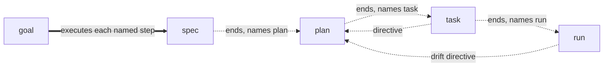

# Pipeline Stages: One Stage per Invocation, File-Borne Handoffs and Model Choice

**Version:** 1.0.1
**Status:** Stable
**Layer:** concept

## Overview

The pipeline `spec` → `plan` → `task` → `run` is a sequence of separate stages, and every invocation of a pipeline command performs exactly one of them. A stage ends by recording, in the workspace's files, everything the next stage needs and by naming the next command; it does not start that command itself. The boundary is what lets a person — or a host acting for them — start the next stage in a fresh session or with a different model, chosen for how much reasoning the stage needs. `goal` is the one command that chains stages, and it crosses the same boundaries through the same records.

## Related Specifications

- [l1-plan-command.md](l1-plan-command.md) - The split of planning from decomposition whose boundary this specification makes a real one (PL-4, PL-5, PL-8).
- [l1-goal-mode.md](l1-goal-mode.md) - The one command that chains stages (PS-6).
- [l1-command-surface.md](l1-command-surface.md) - The command table that carries each command's reasoning demand (CS-14).
- [l1-session-continuity.md](l1-session-continuity.md) - The live memory and the next-step computation that carry a handoff.
- [l1-decision-autonomy.md](l1-decision-autonomy.md) - DA-6: the next step is computed and narrated, never asked.
- [l1-engine-core.md](l1-engine-core.md) - The pipeline and the automatic execution of the constitution's C9 that this specification bounds.

## 1. Motivation

The owner's list of 2026-11-11 reverses an earlier choice: planning was folded into `task`, and use of the engine has shown that splitting development into stages is the better process — among other reasons, so that the person can switch models by hand, or ask the host to switch them, according to how much reasoning each stage needs, and spend fewer tokens on the stages that need less. The owner asks that the split of the old `task` be thought through seriously.

A split into commands is not yet a split into stages. Today three bodies start the next stage on their own: `spec` invokes `task` after a dispatch, `analyze` invokes task generation after a reverse-engineering dispatch, and `task` runs planning inside itself when the plan is stale (`l1-plan-command.md` 1.0.1, PL-4). Each of these chains runs in the model and the context of the stage that started it, so a person who wants a stronger model for planning, or a cheaper one for decomposition, never gets the moment to switch. And a stage that relies on what an earlier stage said in the conversation, rather than on what it wrote, gives a different result when it is started in a new session — which is exactly what switching a model often means.

## 2. Constraints & Assumptions

- The engine does not switch models and cannot: a skill has no control over the model the host runs. It only names each stage's reasoning demand (PS-4); the person or the host decides.
- The boundary adds no question. A stage ends with a narrated next step (DA-6), never with a prompt.
- Every guard inside a stage is unchanged; this specification moves where a stage ends, not what it checks.
- **Assumption (forecast):** a stage ends instead of chaining by default, and `goal` is the chaining mode, because the owner's two statements of 2026-11-11 — stages to switch models between, and `goal` to run non-stop — describe exactly that division; if the default were the chain, the switch would need an interruption at the right moment. Runner-up: chain by default, with a setting to stop at boundaries. Override: `/magicspec spec amend l1-pipeline-stages.md "chain stages by default"`.
- **Assumption (forecast):** three reasoning levels — `deep`, `standard`, `light` — are enough, and the assignment of §5.2 is the engine's, because a finer scale would name differences no host can act on. Runner-up: a per-task level set by the planner. Override: `/magicspec spec amend l1-pipeline-stages.md "per-task reasoning level"`.
- <!-- TBD: whether a host that exposes a per-invocation model setting should read the demand from the command table automatically, once such a host interface exists. -->

## 3. Core Invariants

- **PS-1 One stage per invocation.** An invocation of `spec`, `plan`, `task` or `run` performs that command's stage and ends. It never starts a later stage of the pipeline in the same invocation. Exactly two things continue past a boundary: `goal` (PS-6), and a request whose own words ask for the following stage too ("specify this and plan it") — then the next stage starts, and the narration says the request asked for it. A body that needs a write only another command may make — `fix` opening a maintenance phase through the planning command (`l1-fix-command.md` §6) — calls that write as a step of its own stage; it does not run the other command's whole stage.
- **PS-2 File-borne handoff.** When a stage ends, everything the next stage needs is in the workspace's files: the artifacts the stage wrote, the decisions it took (as `[DR]` lines and forecast premises in the artifacts they govern), any directive it leaves for the next stage, and live memory's `Next Action` naming the next command with its argument. Nothing the next stage needs exists only in the conversation. The test: the next stage started in a new session, by another model, reaches the same result as the same stage started in the conversation that ran the previous one.
- **PS-3 Bounded read set.** Each stage reads what its row of §5.1 lists and no more than its steps require, so a stage started cold loads only its own inputs. A stage never re-reads the previous stage's inputs to reconstruct a decision that stage should have written down. A missing record is a PS-2 defect of the earlier stage: the stage names it as a finding in its report and proceeds on what the files state, or, when what is missing is its input itself, ends with a backward handoff (PS-5) — it never fills the gap by guessing.
- **PS-4 Reasoning demand.** Every command declares one reasoning demand: `deep` for stages whose output is a judgement others build on (understanding intent, ordering work, finding a cause), `standard` for stages that apply a settled plan, `light` for reports and mechanical passes. The handoff line names the demand of the next command: `Next: /magicspec task — standard reasoning`. The demand is advice. The engine never asks the person to switch, never refuses to run under any model, and never prints the demand as a warning.
- **PS-5 Backward handoff carries its reason.** A stage that finds its input unusable — `task` finding that the plan cannot be decomposed as it stands, `run` finding drift — does not repair the earlier stage's files (each file keeps its one owner, PL-1). It ends, recording a directive for the earlier stage in plain words — what was found and where — and the next step names that stage with the directive as its argument: `/magicspec plan "{directive}"`. The earlier stage reads the directive as its input; nothing of it is lost to a session change.
- **PS-6 `goal` crosses boundaries the same way.** `goal` executes the next step instead of naming it, but every step it takes ends at its own boundary and leaves the PS-2 records before the next one starts. A goal interrupted at any boundary resumes from the files — in a new session and with another model — exactly as a typed command would.
- **PS-7 The boundary is not a pause.** Ending a stage asks nothing and waits for nothing: the stage finalizes, records, narrates its next step and its demand in one line, and the invocation is over. Whether the next command is typed at once, after a model switch or in another session is the person's choice.

## 5. Detailed Design

### 5.1 Stages, Inputs and Outputs

| Stage | Reads | Writes | Next on success | Next on a backward finding |
| --- | --- | --- | --- | --- |
| `spec` | the idea, the constitution, the registry, the specifications on the idea's topic | specifications, the registry | `plan` | — |
| `plan` | the registry, the Stable specifications' headers, overviews and invariants, the constitution, the plan with its backlog, a directive left for it | the plan | `task` | `spec amend`, named in the plan's report, when a specification must change before it can be planned |
| `task` | the plan's active (or next) phase, the specifications that phase holds, the constitution | the task ledger, the phase workbooks | `run` | `plan "{directive}"` (PL-8) |
| `run` | the active phase workbook, the sections of the specifications its tasks cite, the product's code | product code, the workbook's state, the phase journals | `run` while tasks remain; then the step live memory computes (SC-2): `task` for an undecomposed next phase, `run` for a decomposed one | `plan "{directive}"` (PL-6) |

Live memory and the changelog are written by finalization at the end of every stage, as today.

### 5.2 Reasoning Demand per Command

| Demand | Commands |
| --- | --- |
| `deep` | `spec`, `plan`, `fix`, `analyze` |
| `standard` | `task`, `run`, `simulate`, `rule` |
| `light` | `status`, `help`, `graph`, `migrate`, `sync` |

`goal` has no demand of its own: each of its steps carries the demand of the command it runs.

### 5.3 Flow



Dotted arrows are handoffs a person starts; the double arrow is `goal`, which takes each of them itself.

### 5.4 Handoff Line

```plaintext
Next: /magicspec {command} {argument} — {demand} reasoning
```

One line, printed once, after the finalization output and before the completion checklist; the same command and argument are what live memory's `Next Action` records.

## 6. Implementation Notes

1. The bodies of `spec` (Dispatching from Raw Input, Post-Update) and `analyze` (its Zero-Prompt Handoff after a dispatch) stop invoking the next stage and print the handoff line instead.
2. `task` stops running planning inside itself (PL-4 in [l1-plan-command.md](l1-plan-command.md) 2.0.0).
3. The router's command table gains the demand column (CS-14); the handoff line reads it from there.
4. The finalize next-step computation emits the demand with the command, so the line and `Next Action` agree.
5. The cognitive suite gains a cold-start scenario per boundary: the next stage started from the files alone reaches the recorded next step.
6. Declared supersessions (`l1-coherence-check.md` CH-9): the Zero-Prompt Handoff of `workflows/spec.md` and `workflows/analyze.md`; the auto-handoff wording of the constitution's C9 ("executes the full SDD lifecycle autonomously"), which becomes "executes each stage autonomously; `goal` chains them" — amended through `/magicspec rule` (origin `user-stated`) when the boundary ships, with the shipped constitution template mirrored; the handoff rows of [l1-plan-command.md](l1-plan-command.md) (PL-4, PL-5); the auto-handoff descriptions in [l1-engine-core.md](l1-engine-core.md) and [l1-session-continuity.md](l1-session-continuity.md) SC-2 (the computed step is unchanged; only who starts it moves).

## 7. Drawbacks & Alternatives

- **One more typed command per stage.** Accepted: it is the moment the owner asks for; `goal` removes it for whoever does not want it.
- **A setting that chooses chain or stop** — rejected for now: the two owner statements already divide the cases between two commands, and a setting would add a third behaviour to test without a case that needs it.
- **The engine choosing the model** — impossible from a skill, and a host-specific mechanism would bind a technology-neutral concept to one host.
- **A per-task reasoning level** — the forecast's runner-up (§2); a planner's estimate per task would be a new judgement with no check that it was right.

## Canonical References

| Alias | Path | Purpose |
| --- | --- | --- |
| `[SPEC]` | `skills/magicspec/workflows/spec.md` | The Zero-Prompt Handoff PS-1 replaces. |
| `[ANALYZE]` | `skills/magicspec/workflows/analyze.md` | The reverse-engineering handoff PS-1 replaces. |
| `[TASK]` | `skills/magicspec/workflows/task.md` | The in-body planning PL-4 removes. |
| `[ROUTER]` | `skills/magicspec/SKILL.md` | The command table that gains the demand. |
| `[RULES]` | `.magicspec/RULES.md` | C9, amended when the boundary ships. |

## Document History

| Version | Date | Author | Description |
| --- | --- | --- | --- |
| 1.0.1 | 2026-11-11 | Agent | Clarification patch, Stable retained (as built in Phase 49; the requirement moved with the amendment that declared it, this record follows). **The handoff line as built:** `finalize.js` builds `Next: /magicspec {command} {argument} — {demand} reasoning` from the persisted `Next Action` — the first `/magicspec <command>` it names, the workspace and a quoted directive as the argument, an alias read as its command and printed by its own name — and the demand is read from the router's table through the one parser (`lib/hosts.js`, `readCommands`), never from a copy; it is printed once, as the last line of the `### Next step` block, after the unchanged `Next Action` text; a `Next Action` that names no command or one the router does not list gets no line, and an unreadable router costs the line and never the finalization. The five pipeline bodies say so in their finalization step. **Each body's read set** is one `**Reads**` line equal to its row of §5.1 and the sentence that a missing record of an earlier stage is reported as a finding and never guessed. **Delivered supersessions (§6 item 6):** the Zero-Prompt Handoff of `spec.md` and `analyze.md` names the next stage and starts nothing; the constitution's C9 reads that the agent executes each stage autonomously and `goal` chains them (constitution 1.19.0, the shipped template word for word); a stage found in a cold session reaches the recorded next step from the files alone (harness and the cognitive suite scenarios T283 to T290). |
| 1.0.0 | 2026-11-11 | Agent | Created from the owner's list of commands of 2026-11-11 (origin `user-stated`): stages split so that a model can be switched between them, `goal` as the non-stop mode. One stage per invocation, file-borne handoffs, a bounded read set, a reasoning demand per command, backward handoffs with a directive. |
