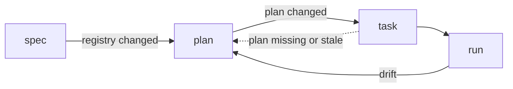

# Planning Command: Plan and Replan

**Version:** 1.0.0
**Status:** Draft
**Layer:** concept

## Overview

Splits planning from task decomposition. `plan` owns the strategic plan — which specifications are built in which phase, in what order, and what waits in the backlog — and is the one command for replanning: reordering, inserting or postponing phases, and revalidating the plan after the registry or the rules change. `task` keeps the tactical layer — atomic tasks, tracks, verify lines and their recorded state — and runs `plan` itself when the plan is missing or stale, so a user who never types `plan` loses nothing.

## Related Specifications

- [l1-engine-core.md](l1-engine-core.md) - The pipeline this splits into four steps, and RE-2's planning guarantees.
- [l1-coherence-check.md](l1-coherence-check.md) - CH-5, the plan check that runs before the plan is written.
- [l1-command-surface.md](l1-command-surface.md) - CS-1, the command set `plan` joins.
- [l1-session-continuity.md](l1-session-continuity.md) - SC-2, the next-step computation whose planning step becomes `plan`.
- [l1-product-simulation.md](l1-product-simulation.md) - SM-3, the scenarios planning asks for per phase.
- [l2-role-cards-execution.md](l2-role-cards-execution.md) - The `planner` card, active in `plan`.

## 1. Motivation

The owner's flowchart draws the pipeline as specification → `/magicspec:plan` (plan) → `/magicspec:task` (tasks) → `/magicspec:run`, and the list of 2026-10-29 asks for `plan` as the command for planning and replanning.

Today one workflow does both jobs. `task` writes `PLAN.md` (phases → specifications), `TASKS.md` and every phase workbook in one pass; replanning is a mode of it (`task update`), and a request such as "postpone phase 4" is a guided-planning directive mixed in the same argument grammar as "decompose phase-2". The consequences are measurable in this repository: the plan has grown to 131 KB because every pass rewrites it beside the tasks, a strategic change cannot be made without regenerating the task layer, and the post-run replan rule sends the user to `task` for a decision that is about order, not about tasks.

## 2. Constraints & Assumptions

- The two commands write disjoint files: `plan` writes `PLAN.md`; `task` writes `TASKS.md` and the phase workbooks. Live memory is updated by finalization, as for every workflow.
- No guard is lost in the split: every Pre-flight check, the stabilization batch, the C6 selection and Bootstrap rules, the cycle guards and the quarantine rules keep exactly one owner.
- **Assumption (forecast):** `task` absorbs `plan` when the plan is missing or stale instead of refusing, because refusing would break every existing habit and handoff that names `task`. Runner-up: `task` stops and names `plan`. Override: `/magicspec:spec amend l1-plan-command.md "task refuses a stale plan"`.

## 3. Core Invariants

- **PL-1 Ownership.** `plan` owns the plan: phase membership, phase order, the backlog and its dispositions, the dependency matrix between specifications, the planner audit and the plan check (CH-5). `task` owns decomposition: task identifiers, tracks, verify lines, validation tasks, the tracking entries and their state transitions. Neither writes the other's files.
- **PL-2 Guard ownership.** Pre-flight, Pre-Planning Stabilization, C6 selection with the Bootstrap Exception, the hard-dependency cycle guard, the cross-workspace parity checks and the quarantine decision for a specification (C12, demoted, phantom) belong to `plan`. Applying a quarantine to tasks — blocking, releasing, preserving recorded state — belongs to `task`.
- **PL-3 Replanning is `plan`.** A directive about order or membership ("postpone", "move before", "split phase", "only the new specifications") is a `plan` argument; a directive about decomposition ("decompose phase-2", "smaller tasks") is a `task` argument. `plan` with no argument revalidates the whole plan against the current registry and rules.
- **PL-4 Stale plan.** The plan is stale when the registry or the constitution changed after the plan was written, or a Stable specification is in neither the plan nor the backlog. `task` invoked on a missing or stale plan runs `plan` first in the same invocation and narrates it; on a current plan it decomposes directly.
- **PL-5 Handoffs.** `spec` hands off to `plan`; `plan` hands off to `task` when it changed anything the active or next phase holds; `task` hands off to `run` as today. Each handoff is narrated, never asked.
- **PL-6 One replan step.** After `run`, a drift signal leaves the user exactly one visible next step: `/magicspec:plan` — it hands off to `task` itself. The rule that `analyze` and `spec` are never proactively offered after a run is unchanged.
- **PL-7 Recorded state survives replanning.** Moving a phase, postponing a specification or reordering never resets a task's recorded state; a task whose specification leaves the active plan is blocked with its reason, as a demoted specification's tasks are today.

## 5. Detailed Design

### 5.1 Split of the Planning Workflow

| Today's `task` step | Owner after the split |
| --- | --- |
| Pre-flight checks | `plan` |
| Pre-Planning Stabilization | `plan` |
| Analyze relations, draft plan, dependency matrix | `plan` |
| Planning Audit (planner) + plan check | `plan` |
| Execution mode | `task` |
| Decompose into tasks; task instruction review | `task` |
| Sync: quarantine decision per specification | `plan` |
| Sync: blocking, releasing and preserving task entries | `task` |
| Plan write-back | `plan` (`PLAN.md`); `task` (`TASKS.md`, workbooks) |

### 5.2 Flow

### 5.3 Argument Grammar

| Input | Result |
| --- | --- |
| `plan` | Revalidate the whole plan (today's `task update`) |
| `plan {workspace}` | Same, scoped to one workspace |
| `plan "{order or membership directive}"` | Guided replanning |
| `task "{decomposition directive}"` | Guided decomposition of the active phase |
| `task update` | Kept as an alias: `plan` then `task` |

## 6. Implementation Notes

1. A new workflow body for `plan`, built from the steps §5.1 assigns to it; `task.md` keeps the rest and gains PL-4.
2. The always-on rules' replan section and its module name `/magicspec:plan`; finalization accepts `--workflow=plan`.
3. The live-memory next-step computation names `/magicspec:plan` where it names planning today.
4. The suite's planning scenarios are split the same way; none is dropped.

## 7. Drawbacks & Alternatives

- **One more pipeline step.** Mitigated by PL-4 and PL-5: the user can keep typing `task`.
- **`plan` as an alias of `task update`** — rejected: it would keep both jobs in one pass, which is the cause of the plan's growth and of strategic changes rewriting tasks.
- **Moving the whole Sync step to `task`** — rejected: whether a specification belongs in the active plan is a planning decision; only its effect on tasks is tactical.

## Canonical References

| Alias | Path | Purpose |
| --- | --- | --- |
| `[TASK]` | `skills/magicspec/workflows/task.md` | The workflow split by §5.1. |
| `[REPLAN]` | `skills/magicspec/references/rules/replan.md` | The replan step PL-6 renames. |
| `[PLANNER]` | `skills/magicspec/roles/planner.md` | The audit `plan` activates. |
| `[FLOWCHART]` | `.drafts/flowchart.md` | The owner's pipeline drawing. |

## Document History

| Version | Date | Author | Description |
| --- | --- | --- | --- |
| 1.0.0 | 2026-10-29 | Agent | Created from the owner's list of ideas (`/magicspec plan` for planning and replanning) and the pipeline of `.drafts/flowchart.md`. |
