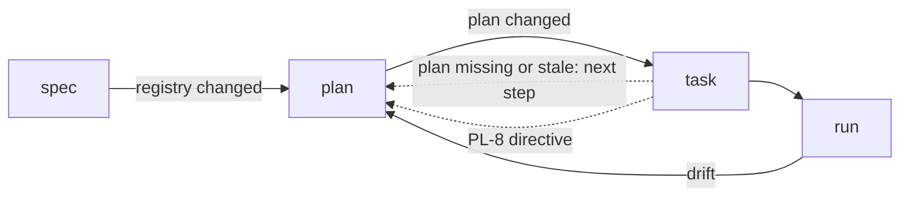

# Planning Command: Plan and Replan

**Version:** 2.0.0
**Status:** Stable
**Layer:** concept

## Overview

Splits planning from task decomposition. `plan` owns the strategic plan — which specifications are built in which phase, in what order, and what waits in the backlog — and is the one command for replanning: reordering, inserting or postponing phases, and revalidating the plan after the registry or the rules change. `task` keeps the tactical layer — atomic tasks, tracks, verify lines and their recorded state. The two are separate stages ([l1-pipeline-stages.md](l1-pipeline-stages.md)): each ends at its own boundary and names the next, so a different model can take the next stage; `task` on a missing or stale plan ends with `/magicspec plan` as its next step, and a plan that cannot be decomposed as it stands goes back to `plan` with a directive saying why.

## Related Specifications

- [l1-engine-core.md](l1-engine-core.md) - The pipeline this splits into four steps, and RE-2's planning guarantees.
- [l1-coherence-check.md](l1-coherence-check.md) - CH-5, the plan check that runs before the plan is written.
- [l1-command-surface.md](l1-command-surface.md) - CS-1, the command set `plan` joins.
- [l1-session-continuity.md](l1-session-continuity.md) - SC-2, the next-step computation whose planning step becomes `plan`.
- [l1-product-simulation.md](l1-product-simulation.md) - SM-3, the scenarios planning asks for per phase.
- [l2-role-cards-execution.md](l2-role-cards-execution.md) - The `planner` card, active in `plan`.
- [l1-pipeline-stages.md](l1-pipeline-stages.md) - The stage boundary between `plan` and `task` (PS-1, PS-2, PS-5).

## 1. Motivation

The owner's flowchart draws the pipeline as specification → `/magicspec plan` (plan) → `/magicspec task` (tasks) → `/magicspec run`, and the list of 2026-10-29 asks for `plan` as the command for planning and replanning.

Today one workflow does both jobs. `task` writes `PLAN.md` (phases → specifications), `TASKS.md` and every phase workbook in one pass; replanning is a mode of it (`task update`), and a request such as "postpone phase 4" is a guided-planning directive mixed in the same argument grammar as "decompose phase-2". The consequences are measurable in this repository: the plan has grown to 131 KB because every pass rewrites it beside the tasks, a strategic change cannot be made without regenerating the task layer, and the post-run replan rule sends the user to `task` for a decision that is about order, not about tasks.

### 1.1 A Real Boundary `[ADDED]`

The owner's list of 2026-11-11 states why the split matters: folding planning into `task` was a mistake, and splitting development into stages is the better process, among other reasons so that the person can switch models — by hand, or by asking the host — according to the quality of reasoning a stage needs, and spend fewer tokens where less is needed. The owner asks that the split be thought through seriously.

Version 1.0.1 split the files and the guards but kept one path that undoes the split: `task` ran `plan` inside itself whenever the plan was missing or stale (PL-4), in the same model and context. That is the moment a stronger model is most useful — the plan has to change — and the one where the person never got to choose it. Version 2.0.0 makes the boundary real in both directions: forward, `task` names `plan` instead of running it; backward, a decomposition that finds the plan wrong hands it back with the finding (PL-8).

## 2. Constraints & Assumptions

- The two commands write disjoint files: `plan` writes `PLAN.md`; `task` writes `TASKS.md` and the phase workbooks. Live memory is updated by finalization, as for every workflow.
- No guard is lost in the split: every Pre-flight check, the stabilization batch, the C6 selection and Bootstrap rules, the cycle guards and the quarantine rules keep exactly one owner.
- **Assumption (forecast):** `task` on a missing or stale plan ends and names `/magicspec plan` instead of planning inside itself, because the owner's statement of 2026-11-11 asks for exactly that moment to switch models, and the cost of the habit it breaks is one line telling the person which command to type. Runner-up: `task` absorbs `plan`, as 1.0.1 did. Override: `/magicspec spec amend l1-plan-command.md "task absorbs a stale plan"`.
- Inside `goal`, the boundary is crossed by the mode itself (`l1-pipeline-stages.md` PS-6): `task` still ends, and `goal` starts `plan` as its next step.

## 3. Core Invariants

- **PL-1 Ownership.** `plan` owns the plan: phase membership, phase order, the backlog and its dispositions, the dependency matrix between specifications, the planner audit and the plan check (CH-5). `task` owns decomposition: task identifiers, tracks, verify lines, validation tasks, the tracking entries and their state transitions. Neither writes the other's files.
- **PL-2 Guard ownership.** Pre-flight, Pre-Planning Stabilization, C6 selection with the Bootstrap Exception, the hard-dependency cycle guard, the cross-workspace parity checks and the quarantine decision for a specification (C12, demoted, phantom) belong to `plan`. Applying a quarantine to tasks — blocking, releasing, preserving recorded state — belongs to `task`.
- **PL-3 Replanning is `plan`.** A directive about order or membership ("postpone", "move before", "split phase", "only the new specifications") is a `plan` argument; a directive about decomposition ("decompose phase-2", "smaller tasks") is a `task` argument. `plan` with no argument revalidates the whole plan against the current registry and rules.
- **PL-4 Stale plan.** `[MODIFIED]` The plan records the registry and constitution versions it was written against. It is stale when either has changed since, or a Stable specification is in neither the plan nor the backlog. `task` invoked on a missing or stale plan decomposes nothing, writes nothing, and ends with `/magicspec plan` as its next step, naming why the plan is stale (which version changed, which specification is unplanned); on a current plan it decomposes directly.
- **PL-5 Handoffs.** `[MODIFIED]` `spec` names `plan` as its next step; `plan` names `task` when it changed anything the active or next phase holds, otherwise the step the plan state computes; `task` names `run`. Each handoff is a recorded and narrated next step with its reasoning demand (`l1-pipeline-stages.md` PS-1, PS-4) — never asked, and started by the person, by `goal`, or by a request whose own words asked for the next stage (PS-1), never by the stage on its own.
- **PL-6 One replan step.** After `run`, a drift signal leaves the user exactly one visible next step: `/magicspec plan` — it hands off to `task` itself. The rule that `analyze` and `spec` are never proactively offered after a run is unchanged.
- **PL-7 Recorded state survives replanning.** Moving a phase, postponing a specification or reordering never resets a task's recorded state; a task whose specification leaves the active plan is blocked with its reason, as a demoted specification's tasks are today.
- **PL-8 Decomposition hands findings back.** `[ADDED]` When decomposition finds that a phase cannot be decomposed as planned — a specification too large for one phase, a dependency between specifications the plan does not state, a phase order that the tasks' dependencies contradict, a specification whose content leaves a task without a verifiable outcome — `task` changes nothing in the plan (PL-1). It decomposes the phases the finding does not touch, records the finding as a replan directive in plain words (what, where, and the change it suggests), and ends with `/magicspec plan "{directive}"` as its next step (`l1-pipeline-stages.md` PS-5). `plan` takes the directive as its argument; a finding that needs a specification change is routed by `plan` to `/magicspec spec amend` in its own report.
- **PL-9 Each stage is complete on its own.** `[ADDED]` `plan` ends with a plan that `task` can decompose without reading what `plan` read: each phase names its specifications, the order and its reason, the dependencies that order rests on, and the backlog with each item's disposition. `task` ends with tasks that `run` can execute without reading the plan: each task names the specification section it implements and its verify line. A stage that has to re-derive the previous stage's reasoning has found a defect of that stage's record (PS-2).

## 5. Detailed Design

### 5.1 Split of the Planning Workflow

| Today's `task` step | Owner after the split |
| --- | --- |
| Pre-flight checks | `plan` |
| Pre-Planning Stabilization | `plan` |
| Analyze relations, draft plan, dependency matrix | `plan` |
| Planning Audit (planner) + plan check | `plan` |
| Execution mode | `task` |
| Decompose into tasks; task instruction review | `task` |
| Sync: quarantine decision per specification | `plan` |
| Sync: blocking, releasing and preserving task entries | `task` |
| Plan write-back | `plan` (`PLAN.md`); `task` (`TASKS.md`, workbooks) |

### 5.2 Flow

### 5.3 Argument Grammar

| Input | Result |
| --- | --- |
| `plan` | Revalidate the whole plan (today's `task update`) |
| `plan {workspace}` | Same, scoped to one workspace |
| `plan "{order or membership directive}"` | Guided replanning |
| `task "{decomposition directive}"` | Guided decomposition of the active phase |
| `task update` | Kept as an alias of `plan`; it ends naming `task`, like `plan` (PS-1) |

## 6. Implementation Notes

1. A new workflow body for `plan`, built from the steps §5.1 assigns to it; `task.md` keeps the rest, gains PL-4 and PL-8 (the stale-plan stop and the replan directive), and loses the in-body planning pass.
2. The always-on rules' replan section and its module name `/magicspec plan`; finalization accepts `--workflow=plan`.
3. The live-memory next-step computation names `/magicspec plan` where it names planning today.
4. The suite's planning scenarios are split the same way; none is dropped.
5. The router's `task` row stops saying "planning first when the plan is stale" ([l1-command-surface.md](l1-command-surface.md) §5.1).
6. Declared supersessions (`l1-coherence-check.md` CH-9): the pipeline and RE-2 in [l1-engine-core.md](l1-engine-core.md); SC-2's planning step in [l1-session-continuity.md](l1-session-continuity.md); the replan rule (always-on rules §5); `--workflow=plan` in [l2-engine-finalization.md](l2-engine-finalization.md); and the constitution's C24 rows for the planner and the task instruction review, which name `task.md` — amended through `/magicspec rule` (origin `user-stated`) when the command ships.

## 7. Drawbacks & Alternatives

- **One more pipeline step.** `[MODIFIED]` Accepted: the step is the boundary the owner asks for. A person who types `task` on a stale plan gets one line naming `plan`; a person who wants no stops uses `goal`.
- **`task` absorbing a stale plan** — the 1.0.1 behaviour and now the forecast's runner-up (§2): it removes the boundary exactly when planning has to happen.
- **`plan` as an alias of `task update`** — rejected: it would keep both jobs in one pass, which is the cause of the plan's growth and of strategic changes rewriting tasks.
- **Moving the whole Sync step to `task`** — rejected: whether a specification belongs in the active plan is a planning decision; only its effect on tasks is tactical.

## Canonical References

| Alias | Path | Purpose |
| --- | --- | --- |
| `[TASK]` | `skills/magicspec/workflows/task.md` | The workflow split by §5.1. |
| `[REPLAN]` | `skills/magicspec/references/rules/replan.md` | The replan step PL-6 renames. |
| `[PLANNER]` | `skills/magicspec/roles/planner.md` | The audit `plan` activates. |
| `[FLOWCHART]` | `.drafts/flowchart.md` | The owner's pipeline drawing. |

## Document History

| Version | Date | Author | Description |
| --- | --- | --- | --- |
| 2.0.0 | 2026-11-11 | Agent | **A real boundary** (origin `user-stated`: the owner's list of commands of 2026-11-11 — stages split so that models can be switched between them). Breaking: PL-4 no longer runs `plan` inside `task`; a missing or stale plan ends `task` with `/magicspec plan` as the next step. PL-5: handoffs are named and recorded, never started by the stage that names them. New PL-8 (decomposition findings go back to `plan` as a directive) and PL-9 (each stage's output is complete for the next one). `task update` becomes an alias of `plan`. The forecast of §2 is reversed; its former winner is the runner-up. Amendment Rule: `Stable → RFC`. |
| 1.0.1 | 2026-10-30 | Agent | **Reality sync: the printed command form** is `/magicspec <command>` ([l1-command-surface.md](l1-command-surface.md) CS-2); the earlier colon spelling is rewritten wherever the text prints a command. No requirement changed. |
| 1.0.0 | 2026-10-29 | Agent | Created from the owner's list of ideas (`/magicspec plan` for planning and replanning) and the pipeline of `.drafts/flowchart.md`. Post-Update Review: spec-critic PASS after the fixes of the review, prompt-engineer PASS-WITH-REWRITES (rewrites applied in the same pass); promoted to Stable under Trust Mode. |
