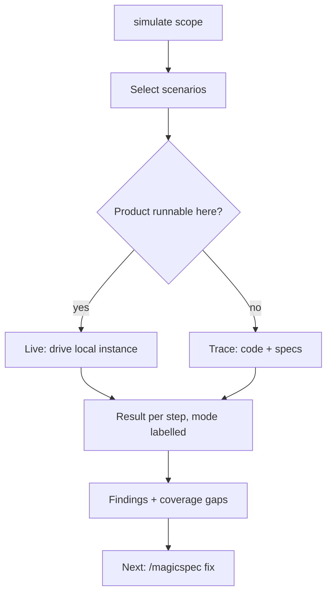

# Product Simulation: Scenarios, the Simulate Command and the Simulator-Tester

**Version:** 1.1.2
**Status:** Stable
**Layer:** concept

## Overview

The engine keeps, beside the product's code, written scenarios of users interacting with the product, and executes them by an AI acting as those users. Scenarios are written from the specifications while the work is planned, kept current by every task that changes user-facing behaviour, and run on demand by `simulate`, which drives the running product where it can and traces the code where it cannot, labelling which. Every failed step becomes a finding for `fix`. The `simulator-tester` role writes and runs them.

## Related Specifications

- [l1-plan-command.md](l1-plan-command.md) - Planning asks for scenarios per phase (SM-3).
- [l1-fix-command.md](l1-fix-command.md) - Consumes simulation findings (SM-7).
- [l1-goal-mode.md](l1-goal-mode.md) - Uses scenarios as checks of user-facing criteria.
- [l1-role-system.md](l1-role-system.md) - Registers the `simulator-tester` role.
- [l1-sdd-reference-containment.md](l1-sdd-reference-containment.md) - Scenarios are SDD artifacts; the product never references them.
- [l1-interface-design.md](l1-interface-design.md) - Interface states and accessibility requirements that interface scenarios cover.
- [l1-command-surface.md](l1-command-surface.md) - CS-1, the command set `simulate` joins.
- [l2-test-suite.md](l2-test-suite.md) - The cognitive suite the engine's own scenarios stand beside (§5.4).

## 1. Motivation

Tests check the code against the developer's understanding at the time the code was written; nothing in the pipeline checks the product against the user's journey through it. The task-level QA gate (`test-engineer`) verifies one task's `Verify` line; a feature assembled from ten tasks can pass all ten and still fail the user at the seam between them.

The owner asks for three things together: files that simulate the user's interaction with the product, created in parallel with the code; scenarios written while planning, for AI-driven testing, by a simulator-tester role; and `/magicspec simulate` to exercise the product's functions and mechanics. The engine already does this for itself — the developer-only `magicspec-dev:test` simulates the engine against its own scenario suite — and its record shows the value: its passes found defects that the script harness passed. Nothing comparable exists for the product a consumer project builds.

## 2. Constraints & Assumptions

- Scenarios describe behaviour, not implementation: no code, no selectors tied to markup, no internal function names — the product's observable surface only.
- Live execution happens only against a local or disposable instance of the product. No scenario step touches a production system, real money, real messages to real people or real accounts.
- **Assumption (forecast):** scenarios live in the state folder (`.magicspec/{workspace}/simulations/`), not among the product's test files, because they are instructions for an agent, written from the specifications, and containment keeps SDD artifacts out of the product. Runner-up: a product test folder. Override: `/magicspec spec amend l1-product-simulation.md "scenarios in the product tree"`.
- **The engine's own repository (the owner's decision, 2026-11-18)** `[MODIFIED]`: the engine is a product like any other, and its scenario files live where every project keeps them, `.magicspec/engine/simulations/`, run by `simulate` and kept by SM-3 and SM-4 as written. The cognitive suite (`tests/suite.md` and `tests/suite/`, run by the maintenance test command `/magicspec-dev:test`) stays where it is and does not stand for them: the suite checks the engine's own text, a scenario checks the engine from its user's side (§5.4). This replaces the forecast of 1.0.2, under which the suite stood for the scenario files. That forecast left `simulate` in this repository with nothing to run, and its handoff for a missing scenario came back to it unchanged: planning listed the suite, which `simulate` does not read.
- **Assumption (forecast):** where the product cannot be run in the session, `simulate` traces the code instead of skipping, and labels the result, because a labelled weaker check is worth more than none and the label keeps it from being mistaken for a live one. Runner-up: skip and report. Override: `simulate --live-only`.

## 3. Core Invariants

- **SM-1 Scenario contract.** A scenario names: who acts (a role or persona, from anonymous visitor to administrator, as the product has them); the preconditions; numbered steps, each a user action with its expected observable outcome; the specification statements it verifies; and its variants (edge input, error path, permission boundary, interruption). It records its last run: date, product version, mode, result per step.
- **SM-2 Written from the specifications.** Scenarios are derived from the specifications' stated behaviour, not from the code, so that they test intent. A step whose expectation no specification states is a coverage gap, reported as a finding (FX-4, specification gap) rather than invented.
- **SM-3 Planned with the work.** For every phase that adds or changes user-facing behaviour, planning lists the scenarios to write or update, and the phase's validation tasks include writing them. A phase with user-facing behaviour and no scenario is a planning finding.
- **SM-4 Kept with the code.** A task that changes user-facing behaviour updates the affected scenarios in the same task, as it updates tests. A scenario that no longer matches the specification it cites is a finding of its own (`scenario out of date`).
- **SM-5 Two execution modes, always labelled.** `simulate` runs a step **live** when the product can be started and driven in the session (a command run, a request sent, an interface operated through a tool the host provides); otherwise it **traces** the step through the code and the specifications. Every result carries its mode, and a traced pass is reported as weaker evidence than a live one.
- **SM-6 Safety.** A step with an external side effect (sending, paying, deleting data outside a disposable instance) is never run live without E1 consent; a step against anything other than a local or disposable instance is never run live.
- **SM-7 Findings, not patches.** `simulate` changes no product code. Each failed or inconclusive step becomes a finding with the scenario, the step, the expected and the observed outcome and the mode; the run ends with exactly one next step, `/magicspec fix` with the findings, when there are any.
- **SM-8 The role.** `simulator-tester` (reviewer) writes scenarios at planning time and in tasks that change user-facing behaviour, and executes them in `simulate`. It is distinct from `test-engineer`, which gates one task against its `Verify` line; the simulator-tester judges user journeys across tasks and phases.
- **SM-9 Coverage report.** `simulate` reports which specification statements about user-facing behaviour no scenario verifies.

## 5. Detailed Design

### 5.1 Scenario Layout

```plaintext
.magicspec/{workspace}/simulations/
└── {area}.md
    # {Area}
    ## S-{n}: {title}
    Actor: {role}       Verifies: {spec}.md §{section}, ...
    Preconditions: ...
    Steps:
      1. {action} → expect: {observable outcome}
      2. ...
    Variants: edge | error | permission | interruption
    Last run: {date} · v{version} · {live|traced} · {pass|fail per step}
```

**As built (Phase 52).** The `Last run` record is the date and the product's version, then one line per step — `- Step {n}: {pass, fail, inconclusive or skipped} · {live or traced}`, and for a failed or inconclusive step `— observed: {the outcome}` (`templates/simulation.md`). What is open is read from these lines: a run replaces a scenario's lines, so `finalize` (the next step after a run is `fix` while any `fail` or `inconclusive` line stands) and `fix` (the suggestions of its argument form) read the scenario files and keep no store of their own (`lib/simulation-findings.js`).

### 5.2 Run



### 5.3 Arguments

| Input | Result |
| --- | --- |
| `simulate` | Every scenario of the workspace |
| `simulate {area}` | One scenario file |
| `simulate "{feature or spec}"` | Scenarios that verify it |
| `simulate --live-only` | Steps that cannot run live are skipped and listed |

### 5.4 The Engine's Own Scenarios `[ADDED]`

In the engine's repository the product is the engine, and its user is a developer working in a project where the engine is installed. The scenarios and the cognitive suite stand side by side and divide the work:

| | Scenarios (`.magicspec/engine/simulations/`) | Cognitive suite (`tests/suite.md`, `tests/suite/`) |
| --- | --- | --- |
| Judged against | What a specification states (`Verifies`, SM-2) | What a workflow body says, under a synthetic state |
| Seen from | The user's side: the command typed, the lines printed, the project files that change | The engine's side: the step, the guard, the role card |
| Unit | A journey across commands and the seams between stages | One guard or one step per case |
| Run by | `simulate`; findings go to `fix` (SM-7), in this repository to its maintenance form (`l1-fix-command.md` FX-10) | `/magicspec-dev:test`, which repairs a failure and adds its regression case in the same run |
| Recorded in | Each scenario's `Last run` | The run's report |

- **No restatement.** A scenario does not restate a suite case. Where both touch one behaviour, the scenario checks the journey that reaches it and the case checks the guard; a step that would only repeat a case is left out.
- **Journeys, not guards.** An engine scenario spans at least two commands, or one command and what a later session reads from the files it left: the seams the suite, one guard per case, does not walk (§1).
- **A disposable instance is a copy.** A step runs live only in a project created for the run that holds its own copy of the engine folder, never in this repository's own workspace, whose files are the project's record (SM-6). Observed: a fixture driven through the repository's own scripts wrote a stray workspace into the repository's state folder, because the scripts find the project from where they are installed.
- **The judge is not the producer.** A step whose outcome the agent composes from a workflow body — not a line a script prints — is traced, or run live by a fresh agent given only the scenario and its preconditions; the agent that judges the outcome would otherwise be the one producing it.
- **What the set covers.** The scenarios cover what the L1 specifications state a person sees or does across commands; planning names the area files and the scenario titles (SM-3).

## 6. Implementation Notes

1. A new workflow body for `simulate`, a scenario template, and the `simulator-tester` card (`l2-role-cards-review.md`).
2. Planning and execution workflows gain SM-3 and SM-4 at their validation-task and task-completion steps.
3. The developer-only `magicspec-dev:test` is unaffected: it simulates the engine, this simulates a product. Its old body name lingers in the constitution: C24's dev-only row names `simulate.md`, and `docs/simulate.md` documents the developer workflow. Before the product's `simulate` body ships, that row is renamed to the maintenance workflow (`/magicspec rule`) and the document is renamed, so that one name means one workflow.
4. `simulate` writes only scenario files (their `Last run` fields) and finalizes like the other writing workflows.
5. `[ADDED]` In the engine's repository the first scenario files are written by the phase that plans them (SM-3, §5.4). Phase entries written under the 1.0.2 forecast that name `tests/suite.md` as their scenarios stay as written: they are history.

   **As built (Phase 60).** Five area files in `.magicspec/engine/simulations/` — `pipeline` (S-1 to S-3), `intake` (S-4 to S-6), `session` (S-7 and S-8), `routing` (S-9 and S-10), `quality` (S-11 and S-12) — twelve scenarios and forty steps, numbered across the files so no identifier repeats. Each step ends with a tag: `(printed)` for an outcome observed directly (a line an engine script prints, or a file's presence, absence or unchanged content) and `(composed)` for text the agent writes from a workflow body, so a run chooses live or traced without reading code. Each scenario's preconditions open with the disposable project (a scratch directory outside the repository, its own copy of the engine folder, initialised there) and each has a variant; every `Verifies` cites a section that exists in a specification. Scenarios that would only repeat a case of the suite were reshaped into journeys, and the steps that pass a case's guard on the way to a seam stay as the entry of the journey. `Last run` reads never in every scenario, so the first `/magicspec simulate` is the run. The artifact index has no kind for `simulations/`, so `memory-query` does not find the scenario files, as in every project. One bullet of `docs/dev-test.md` says where the scenarios live and how the work divides with the suite.

   **Finding resolved (1.1.2).** SM-7 ends a failed `simulate` run with `/magicspec fix` as its one next step, and the finalization prints it; `l1-fix-command.md` FX-10 made `/magicspec-dev fix` the entry for error feedback about the engine in this repository without naming a scenario finding. `l1-fix-command.md` 1.2.0 settles it: in this repository a failed or inconclusive step of the engine's own scenarios enters through the maintenance `fix` (FX-10, its scenario-finding item), carried by the repository's own text; SM-7 and the printed step are unchanged, as no shipped text names the maintenance command.

## 7. Drawbacks & Alternatives

- **Scenario upkeep cost.** Bounded by SM-4 (updated in the task that changes the behaviour, when the context is fresh).
- **Generating end-to-end test code instead** — rejected as the primary mechanism: it binds scenarios to one test framework and one surface; a scenario written as behaviour can still be turned into such a test by a task.
- **Running only live** — rejected for products that cannot run in the session (a mobile app, a device target); the trace still catches journey gaps against the specifications.

## Canonical References

| Alias | Path | Purpose |
| --- | --- | --- |
| `[DEV-SIM]` | `skills/magicspec-dev/workflows/test.md` | The engine's own simulation workflow; precedent for scenario-driven review. |
| `[TEST-ENGINEER]` | `skills/magicspec/roles/test-engineer.md` | The task gate SM-8 distinguishes from. |
| `[COGNITIVE-SUITE]` | `tests/suite.md` | The engine's regression suite of its own text, which the engine's scenarios stand beside (§5.4). |

## Document History

| Version | Date | Author | Description |
| --- | --- | --- | --- |
| 1.1.2 | 2026-11-18 | Agent | Clarification, no requirement changed: the open finding of §6 item 5 is resolved by `l1-fix-command.md` 1.2.0 — in this repository a failed step of the engine's own scenarios enters through the maintenance `fix` (FX-10), and SM-7 prints `/magicspec fix` as before; the `Run by` row of §5.4 names that route. |
| 1.1.1 | 2026-11-18 | Agent | As built in Phase 60, Stable retained, no requirement changed. §6 item 5 records the five scenario files of the engine (`pipeline`, `intake`, `session`, `routing`, `quality`: twelve scenarios, forty steps), the `(printed)` and `(composed)` tags of their steps, the disposable-project preconditions, the reshaping of scenarios that would have repeated a case of the suite, and an open finding for `/magicspec spec amend l1-fix-command.md`: SM-7 hands a failed scenario step to `/magicspec fix` while FX-10 makes `/magicspec-dev fix` the entry for error feedback about the engine here, and neither names the other for a scenario finding. |
| 1.1.0 | 2026-11-18 | Agent | **The engine's scenarios in `simulations/`, beside the cognitive suite**: the owner's decision after the first `simulate` run in this repository found no scenario to run and a check of moving the suite under it found the suite a different instrument (363 cases, 18 citing a specification; judged against the workflow text, with its own repair loop). §2 replaces the 1.0.2 forecast (the suite stood for the scenario files) with that decision; new §5.4 divides the work between the scenarios (judged against the specifications, journeys across commands, live only on a copy of the engine, never judged by their own producer) and the suite (judged against the workflow text, one guard per case, repaired in its own run); §6 item 5; `l2-test-suite.md` in Related Specifications and Canonical References. No invariant changed. Amendment Rule round trip: RFC, Post-Update Review (coherence: 9 artifacts compared, 0 findings; spec-critic PASS; prompt-engineer PASS-WITH-REWRITES, one sentence of §5.4 rewritten in the pass), Stable. |
| 1.0.2 | 2026-11-12 | Agent | As built in Phase 52, Stable retained, no requirement changed. §5.1 records the `Last run` record as built (the date and the product version, then one line per step with its result, its mode and, for a failed or inconclusive step, the observed outcome; what is open is read from those lines by `finalize` and `fix`, which keep no store), and §2 records the forecast that settles SM-3 for this repository: the engine's cognitive suite stands for its scenario files. The `simulate.md` row of C24 and the developer document were renamed first (§6 item 3), as required. |
| 1.0.1 | 2026-10-30 | Agent | **Reality sync: the printed command form** is `/magicspec <command>` ([l1-command-surface.md](l1-command-surface.md) CS-2); the earlier colon spelling is rewritten wherever the text prints a command. No requirement changed. |
| 1.0.0 | 2026-10-29 | Agent | Created from the owner's list of ideas (simulation files created in parallel with the code, `/magicspec simulate`, scenarios written at planning time, a simulator-tester role). Post-Update Review: spec-critic PASS after the fixes of the review, prompt-engineer PASS-WITH-REWRITES (rewrites applied in the same pass); promoted to Stable under Trust Mode. |
