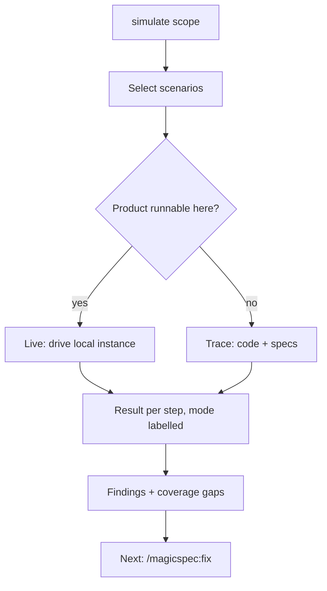

# Product Simulation: Scenarios, the Simulate Command and the Simulator-Tester

**Version:** 1.0.0
**Status:** Stable
**Layer:** concept

## Overview

The engine keeps, beside the product's code, written scenarios of users interacting with the product, and executes them by an AI acting as those users. Scenarios are written from the specifications while the work is planned, kept current by every task that changes user-facing behaviour, and run on demand by `simulate`, which drives the running product where it can and traces the code where it cannot, labelling which. Every failed step becomes a finding for `fix`. The `simulator-tester` role writes and runs them.

## Related Specifications

- [l1-plan-command.md](l1-plan-command.md) - Planning asks for scenarios per phase (SM-3).
- [l1-fix-command.md](l1-fix-command.md) - Consumes simulation findings (SM-7).
- [l1-goal-mode.md](l1-goal-mode.md) - Uses scenarios as checks of user-facing criteria.
- [l1-role-system.md](l1-role-system.md) - Registers the `simulator-tester` role.
- [l1-sdd-reference-containment.md](l1-sdd-reference-containment.md) - Scenarios are SDD artifacts; the product never references them.
- [l1-interface-design.md](l1-interface-design.md) - Interface states and accessibility requirements that interface scenarios cover.
- [l1-command-surface.md](l1-command-surface.md) - CS-1, the command set `simulate` joins.

## 1. Motivation

Tests check the code against the developer's understanding at the time the code was written; nothing in the pipeline checks the product against the user's journey through it. The task-level QA gate (`test-engineer`) verifies one task's `Verify` line; a feature assembled from ten tasks can pass all ten and still fail the user at the seam between them.

The owner asks for three things together: files that simulate the user's interaction with the product, created in parallel with the code; scenarios written while planning, for AI-driven testing, by a simulator-tester role; and `/magicspec simulate` to exercise the product's functions and mechanics. The engine already does this for itself — the developer-only `magicspec-dev:test` simulates the engine against its own scenario suite — and its record shows the value: its passes found defects that the script harness passed. Nothing comparable exists for the product a consumer project builds.

## 2. Constraints & Assumptions

- Scenarios describe behaviour, not implementation: no code, no selectors tied to markup, no internal function names — the product's observable surface only.
- Live execution happens only against a local or disposable instance of the product. No scenario step touches a production system, real money, real messages to real people or real accounts.
- **Assumption (forecast):** scenarios live in the state folder (`.magicspec/{workspace}/simulations/`), not among the product's test files, because they are instructions for an agent, written from the specifications, and containment keeps SDD artifacts out of the product. Runner-up: a product test folder. Override: `/magicspec:spec amend l1-product-simulation.md "scenarios in the product tree"`.
- **Assumption (forecast):** where the product cannot be run in the session, `simulate` traces the code instead of skipping, and labels the result, because a labelled weaker check is worth more than none and the label keeps it from being mistaken for a live one. Runner-up: skip and report. Override: `simulate --live-only`.

## 3. Core Invariants

- **SM-1 Scenario contract.** A scenario names: who acts (a role or persona, from anonymous visitor to administrator, as the product has them); the preconditions; numbered steps, each a user action with its expected observable outcome; the specification statements it verifies; and its variants (edge input, error path, permission boundary, interruption). It records its last run: date, product version, mode, result per step.
- **SM-2 Written from the specifications.** Scenarios are derived from the specifications' stated behaviour, not from the code, so that they test intent. A step whose expectation no specification states is a coverage gap, reported as a finding (FX-4, specification gap) rather than invented.
- **SM-3 Planned with the work.** For every phase that adds or changes user-facing behaviour, planning lists the scenarios to write or update, and the phase's validation tasks include writing them. A phase with user-facing behaviour and no scenario is a planning finding.
- **SM-4 Kept with the code.** A task that changes user-facing behaviour updates the affected scenarios in the same task, as it updates tests. A scenario that no longer matches the specification it cites is a finding of its own (`scenario out of date`).
- **SM-5 Two execution modes, always labelled.** `simulate` runs a step **live** when the product can be started and driven in the session (a command run, a request sent, an interface operated through a tool the host provides); otherwise it **traces** the step through the code and the specifications. Every result carries its mode, and a traced pass is reported as weaker evidence than a live one.
- **SM-6 Safety.** A step with an external side effect (sending, paying, deleting data outside a disposable instance) is never run live without E1 consent; a step against anything other than a local or disposable instance is never run live.
- **SM-7 Findings, not patches.** `simulate` changes no product code. Each failed or inconclusive step becomes a finding with the scenario, the step, the expected and the observed outcome and the mode; the run ends with exactly one next step, `/magicspec:fix` with the findings, when there are any.
- **SM-8 The role.** `simulator-tester` (reviewer) writes scenarios at planning time and in tasks that change user-facing behaviour, and executes them in `simulate`. It is distinct from `test-engineer`, which gates one task against its `Verify` line; the simulator-tester judges user journeys across tasks and phases.
- **SM-9 Coverage report.** `simulate` reports which specification statements about user-facing behaviour no scenario verifies.

## 5. Detailed Design

### 5.1 Scenario Layout

```plaintext
.magicspec/{workspace}/simulations/
└── {area}.md
    # {Area}
    ## S-{n}: {title}
    Actor: {role}       Verifies: {spec}.md §{section}, ...
    Preconditions: ...
    Steps:
      1. {action} → expect: {observable outcome}
      2. ...
    Variants: edge | error | permission | interruption
    Last run: {date} · v{version} · {live|traced} · {pass|fail per step}
```

### 5.2 Run



### 5.3 Arguments

| Input | Result |
| --- | --- |
| `simulate` | Every scenario of the workspace |
| `simulate {area}` | One scenario file |
| `simulate "{feature or spec}"` | Scenarios that verify it |
| `simulate --live-only` | Steps that cannot run live are skipped and listed |

## 6. Implementation Notes

1. A new workflow body for `simulate`, a scenario template, and the `simulator-tester` card (`l2-role-cards-review.md`).
2. Planning and execution workflows gain SM-3 and SM-4 at their validation-task and task-completion steps.
3. The developer-only `magicspec-dev:test` is unaffected: it simulates the engine, this simulates a product. Its old body name lingers in the constitution: C24's dev-only row names `simulate.md`, and `docs/simulate.md` documents the developer workflow. Before the product's `simulate` body ships, that row is renamed to the maintenance workflow (`/magicspec:rule`) and the document is renamed, so that one name means one workflow.
4. `simulate` writes only scenario files (their `Last run` fields) and finalizes like the other writing workflows.

## 7. Drawbacks & Alternatives

- **Scenario upkeep cost.** Bounded by SM-4 (updated in the task that changes the behaviour, when the context is fresh).
- **Generating end-to-end test code instead** — rejected as the primary mechanism: it binds scenarios to one test framework and one surface; a scenario written as behaviour can still be turned into such a test by a task.
- **Running only live** — rejected for products that cannot run in the session (a mobile app, a device target); the trace still catches journey gaps against the specifications.

## Canonical References

| Alias | Path | Purpose |
| --- | --- | --- |
| `[DEV-SIM]` | `skills/magicspec-dev/workflows/test.md` | The engine's own simulation workflow; precedent for scenario-driven review. |
| `[TEST-ENGINEER]` | `skills/magicspec/roles/test-engineer.md` | The task gate SM-8 distinguishes from. |

## Document History

| Version | Date | Author | Description |
| --- | --- | --- | --- |
| 1.0.0 | 2026-10-29 | Agent | Created from the owner's list of ideas (simulation files created in parallel with the code, `/magicspec simulate`, scenarios written at planning time, a simulator-tester role). Post-Update Review: spec-critic PASS after the fixes of the review, prompt-engineer PASS-WITH-REWRITES (rewrites applied in the same pass); promoted to Stable under Trust Mode. |
