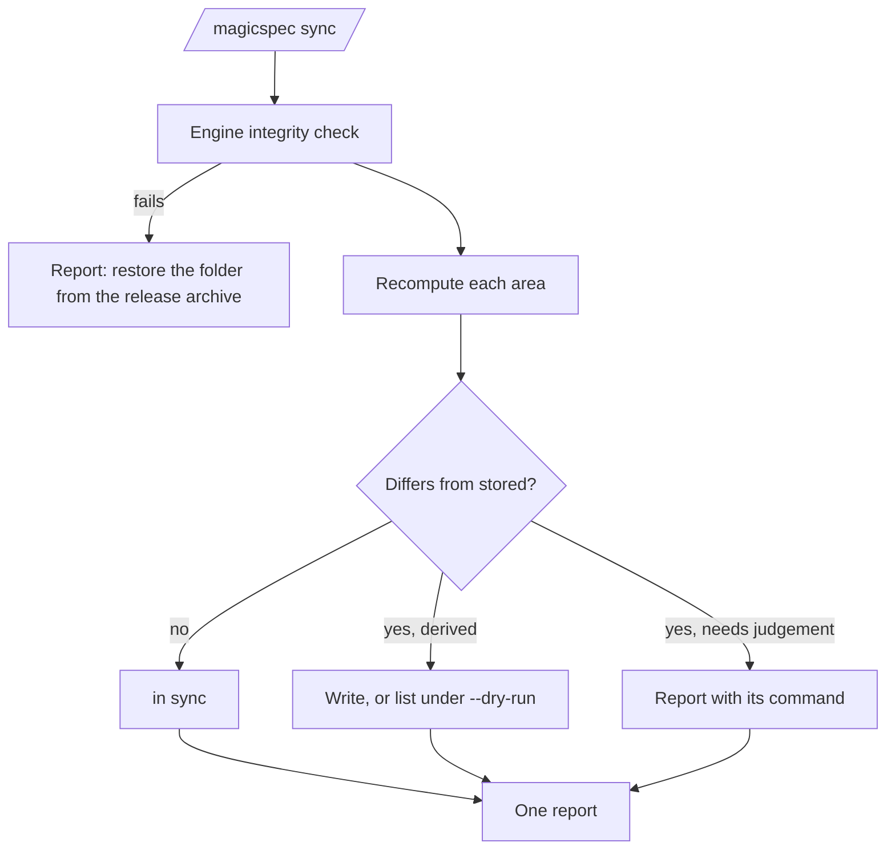

# Sync Command: Bringing Derived State up to Date

**Version:** 1.1.0
**Status:** Stable
**Layer:** concept

## Overview

`sync` brings every piece of a project's state that is computed from other files back in line with its sources — the registries' aggregates, the always-on rule projection and the host copies of the installed engine, the specification graph and its wiki, live memory's progress lines, the version anchors the project declares and the derived blocks the project registered in its documentation. It writes only what can be recomputed without a judgement. Where two sources disagree and a judgement is needed, it reports the disagreement and names the one command that resolves it. A second run with nothing changed writes nothing. In the engine's own repository, the maintenance command of the same name runs this pass and adds the engine-only steps.

## Related Specifications

- [l1-command-surface.md](l1-command-surface.md) - CS-1, the command set `sync` joins, and its row of the command table.
- [l1-skill-packaging.md](l1-skill-packaging.md) - The projections generated from the skill folder, which `sync` regenerates through the shipped generator.
- [l1-session-continuity.md](l1-session-continuity.md) - Live memory, whose engine-owned progress lines `sync` recomputes.
- [l1-sdd-reference-containment.md](l1-sdd-reference-containment.md) - What a derived block in a product file may never contain (SY-6).
- [l2-spec-graph-memory.md](l2-spec-graph-memory.md) - The graph and wiki refresh `sync` triggers.
- [l1-pipeline-stages.md](l1-pipeline-stages.md) - PS-4, the `light` demand of a mechanical pass.

## 1. Motivation

The owner's list of 2026-11-11 asks for `sync` as a user command, for the synchronization of versions, documentation and the like. Today the only synchronization command is the maintenance command of the engine's repository (`/magicspec-dev sync`), which no project that installs the engine has. A project's derived state goes stale in ways no pipeline command repairs:

- After the person replaces the skill folder with a new release, the always-on rule projection and the host copies still carry the earlier release's text; every session then loads rules the installed engine no longer has.
- After a specification file is edited outside the workflows, or a workflow is interrupted between writes, the registry's aggregate counts, the global registry's rows and the progress lines of live memory disagree with the files they summarize.
- The graph and its wiki are refreshed only by the workflows that changed a specification, so an edit outside them leaves navigation pointing at stale structure.
- A project version written in several places (a manifest, a README badge, a changelog heading) is bumped in one of them by finalization and left behind in the others.

Constitution C2 forbids new workflow commands unless explicitly authorized; the owner's list names `sync` and is the authorization.

## 2. Constraints & Assumptions

- `sync` never writes inside the skill folder; it regenerates host copies only through the generator the engine ships (`init`'s projection step), never by editing them.
- It changes no requirement, so it does not finalize: no version bump of the project, no changelog entry. What it wrote is its own report.
- It deletes nothing (SY-5).
- **Assumption (forecast):** `sync` rewrites derived state and reports every disagreement that needs a judgement instead of resolving it — a specification header that differs from its registry row is an unreviewed external edit (`spec.md` Version Drift Guard), and picking a winner silently would bury it. Runner-up: reconcile drift by "the file header wins". Override: `/magicspec spec amend l1-sync-command.md "sync reconciles drift by the file header"`.
- **Assumption (forecast):** documentation is synchronized only inside blocks the project registered as derived, because the rest of a document is someone's prose and no rule tells which sentence follows which source. Runner-up: a content check of documentation against the specifications, which is a judgement and belongs to `analyze`. Override: `/magicspec spec amend l1-sync-command.md "sync checks documentation content"`.
- **Assumption (forecast):** a project registers its version anchors and derived documentation blocks in a `sync` section of `workspace.json`, beside the settings finalization already reads there, with the entry grammar of §5.5. Runner-up: a file of its own in the state folder (one more file and one more owner to learn for two keys, and a cost of changing later that is a move of two keys either way). Override: `/magicspec spec amend l1-sync-command.md "sync registers in its own file"`.

## 3. Core Invariants

- **SY-1 Derived state only.** `sync` writes exactly the state that is fully computed from other files: the aggregate fields and rows of the registries (counts, the global registry's workspace rows), the always-on rule projection and the host copies of the installed engine, the specification graph and wiki, the engine-owned progress lines of live memory, the declared version anchors (SY-4) and the registered derived blocks of documentation (SY-6). It never writes a requirement, a specification's version or status, a rule, a task's state, a plan, a decision, or the `**Engine Version:**` snapshot — `analyze` stays its sole writer.
- **SY-2 Disagreement is reported, not settled.** A difference that needs a judgement — a specification header against its registry row, a status mismatch, a registered block whose source is missing, an installed engine whose integrity check fails — is listed with its location and the one command that resolves it (`/magicspec spec`, `/magicspec analyze`, restoring the folder from the release archive). `sync` continues with the rest and changes nothing at that location.
- **SY-3 Idempotent.** Running `sync` twice with no source change between the runs writes nothing on the second run and reports the project as in sync. A derived value is rewritten only when its recomputed content differs from what is stored; a timestamp alone is never a difference.
- **SY-4 Declared version anchors.** The project's version is propagated from the version file finalization writes into the places the project declared as anchors, and nowhere else. `sync` never searches the project for strings that look like a version.
- **SY-5 No deletion.** A derived file that no source produces any more — a host copy for a host the project no longer uses, a wiki page of a removed specification — is reported with the command that removes it; `sync` itself removes nothing (C9 gate 1).
- **SY-6 Registered blocks, contained.** In a documentation file, `sync` rewrites only the content between the markers of a block the project registered, and nothing outside them. The registration lives in the state folder; the markers in a product file carry a neutral key, and the generated content passes the containment rule (`l1-sdd-reference-containment.md`) — no task identifier, phase, registry name, specification file name or state-folder path enters a product file through `sync`.
- **SY-7 Preview.** `sync --dry-run` performs every computation and lists every write it would make, writing nothing. A run without it writes without asking: every write is derived and is undone by the next run on the restored sources.
- **SY-8 One report.** The run ends with one report: what was written, what was already in sync, every disagreement with its command, every stale derived file with its command, and the next step. With nothing to write and nothing to report, it says so in one line.
- **SY-9 The engine repository's extension.** In the engine's own repository (the developer predicate), `/magicspec-dev sync` runs this pass as its project-metadata stage and adds the stages only that repository has: the engine meta update (C14), the manifest anchor, the hardlink check, the contribution guide and the documentation sync notes. The shipped command never performs an engine-only stage and never requires the maintenance tooling.

## 5. Detailed Design

### 5.1 Areas

| Area | Source | Derived state |
| --- | --- | --- |
| `registry` | specification files, workspace registries | aggregate counts, the global registry's workspace rows |
| `projections` | the installed skill folder | the always-on rule projection, the host copies |
| `graph` | specifications, registries | the specification graph and wiki |
| `state` | task ledger, phase workbooks | live memory's engine-owned progress lines |
| `versions` | the version file finalization writes | the declared anchors |
| `docs` | the registered sources | the registered blocks |

### 5.2 Argument Grammar

| Input | Result |
| --- | --- |
| `sync` | every area, every registered workspace |
| `sync {area}` | that area only |
| `sync {workspace}` | every area, that workspace |
| `sync --dry-run` (with any of the above) | the same computation, no write |

### 5.3 Report Layout

```plaintext
[Sync] {w} written · {u} in sync · {d} disagreements · {s} stale
  written   {area}: {file} — {what changed}
  disagree  {location} — {difference} → /magicspec {command}
  stale     {file} — no source → {command that removes it}
Next: /magicspec {command} — {demand} reasoning
```

### 5.4 Flow



An integrity failure skips only the `projections` area — regenerating copies from a corrupted folder would spread the corruption; the other areas still run.

### 5.5 Registration

The `sync` section of `workspace.json` holds two lists, both optional; an absent section declares nothing.

```plaintext
"sync": {
  "versions": [
    { "file": "package.json", "json": "version" },
    { "file": "README.md", "marker": "version", "format": "v{version}" }
  ],
  "docs": [
    { "file": "docs/guide.md", "marker": "overview", "from": "docs/overview.md", "fromMarker": "overview" }
  ]
}
```

- A `versions` entry names a project-relative `file` and exactly one of `json` (a dotted key path whose value is a string) and `marker` (a neutral key); `format` applies to a marker and contains `{version}` (default `{version}`). The version written is the one the version file finalization keeps holds (`finalization.versionPath`).
- A `docs` entry names the `file` and `marker` of the block and the `from` file that fills it, whole or, with `fromMarker`, from that file's own block of that key.
- A marker is a lowercase key of letters, digits and hyphens; in a product file it reads `<!-- sync:{key} -->` … `<!-- /sync:{key} -->` and carries nothing about the SDD (SY-6).
- Every path stays inside the project. An entry that cannot be used — an unknown key, a path that leaves the project, both or neither of `json` and `marker`, a malformed list — is one disagreement with its place and the command that resolves it (edit the section), never an exception, and the valid entries still run (SY-2).

## 6. Implementation Notes

1. A new workflow body `workflows/sync.md` and an executor subcommand that computes the areas; the body adds nothing a script can compute.
2. The `projections` area calls the existing projection generator; the `graph` area calls `export-wiki`.
3. The maintenance pipeline (`scripts/sync.js`) replaces its own project-meta stage with a call to the shipped subcommand (SY-9) and keeps its engine-only stages; the call is the sanctioned direction (L2 calling L1).
4. `sync` joins the finalization exemptions of the always-on rules beside `help` and `migrate`, and the drift-check exemptions: a drift line before `sync` would announce what its report already covers.
5. The constitution's C2 records the command when it ships, through `/magicspec rule` (origin `user-stated`).
6. The read-only caution of the always-on rules forbids writing the host copies by hand; regenerating them through the shipped generator is the engine's own act, as `init`'s already is. The caution gains that sentence when `sync` ships, and its prohibition of hand edits stays word for word (the shipped guard is never weakened, C28 item 5).
7. **As built (Phase 55).** The areas run in the order registry, state, projections, versions, docs, graph. Three writers the areas could have reused write more than SY-3 and SY-5 allow, so each area computes first, compares with what is stored and writes only the difference: the graph area renders the wiki into a scratch folder with `export-wiki --out` and copies only the pages whose bytes differ (`export-wiki` itself prunes and rewrites every page on each run), the state area runs `update-state --auto-progress` only when the recomputed counters differ (it stamps `Updated` on every write), and the projections area rewrites a stale rule copy or managed block itself and never calls the projection refresh (which deletes retired command entries). An integrity failure skips only the projections area. A cache its owner prunes under the retention contract — the graph extraction cache, the artifact index's rows for a vanished file — is not a derived file in the sense of SY-5.
8. **The preview reaches the build too.** The wiki is rendered by a graph build that writes its extraction cache into the project, so the extraction cache honors `MAGIC_DRY_RUN` (no folder created, no entry saved or pruned) and the graph area sets it for the build of a preview (SY-7).
9. **The containment check is written once.** No script implemented the reference rule (ventilation runs it as a cognitive scan), so the shipped pass carries it for the one place it generates text: a task identifier, a phase designator (the file form and the prose `Phase N`, refused conservatively because generated text cannot apply the rule's judgement), an SDD system file, a specification file name and a path into the state folder refuse the write and are reported.
10. **The maintenance pipeline's project-state step is the shipped pass.** The earlier updater also bumped the registries' version lines and appended history rows; neither is derived state (SY-1), so both ended with it, the updater was removed, and the registries' versions and history are authored with the specifications.

## 7. Drawbacks & Alternatives

- **Overlap with `analyze`.** Accepted and bounded: `sync` writes what needs no judgement and stops where a judgement starts; `analyze` judges and writes nothing derived.
- **Folding `sync` into every workflow's finalization** — rejected: finalization runs after a workflow and covers what it changed; the drift `sync` repairs comes from edits made outside every workflow.
- **Reconciling drift automatically** — the forecast's runner-up (§2).

## Canonical References

| Alias | Path | Purpose |
| --- | --- | --- |
| `[DEV-SYNC]` | `skills/magicspec-dev/workflows/sync.md` | The maintenance pipeline that SY-9 extends. |
| `[SYNC-SCRIPT]` | `scripts/sync.js` | The maintenance orchestrator whose project-meta stage moves to the shipped pass. |
| `[EXPORT-WIKI]` | `skills/magicspec/scripts/export-wiki.js` | The graph and wiki refresh of the `graph` area. |

## Document History

| Version | Date | Author | Description |
| --- | --- | --- | --- |
| 1.1.0 | 2026-11-12 | Agent | **As built in Phase 55; the registration form decided.** The open question of §2 is closed by a forecast: a `sync` section of `workspace.json` (§5.5), with the entry grammar, the neutral `sync:{key}` markers and the rule that a malformed entry is one disagreement; the runner-up (a file of its own) and its override are recorded. §6 items 7 to 10 record the as-built decisions: the area order and compare-before-write for the three writers that would otherwise write on every run, the preview reaching the graph build's extraction cache, the containment check written once in the shipped pass, and the retirement of the maintenance updater's version and history writes. Amendment Rule: `Stable → RFC`; re-promoted `Stable` after the Post-Update Review (`@role:spec-critic`, coherence check against the command surface, session-continuity and reference-containment specifications: no ordering conflict, contradiction, duplicate definition or interaction gap; `@role:prompt-engineer`: PASS). |
| 1.0.0 | 2026-11-11 | Agent | Created from the owner's list of commands of 2026-11-11 (origin `user-stated`): `sync` as a user command for versions, documentation and other derived state; the maintenance command of the same name becomes its extension in the engine's repository. |
