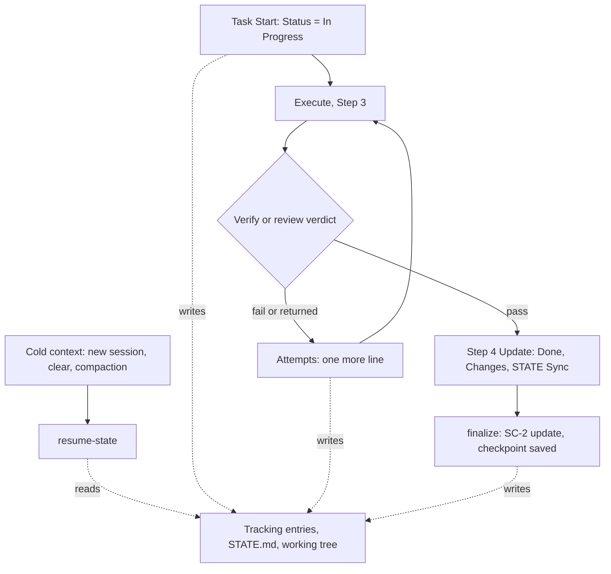

# Session Checkpoint Contract

**Version:** 1.2.1
**Status:** Stable
**Layer:** implementation
**Implements:** l1-session-continuity.md

## Overview

Implementation contract for the automatic-checkpoint invariants of [l1-session-continuity.md](l1-session-continuity.md): SC-1.3, SC-6 (with SC-6.1), SC-7, SC-8 and SC-9. It specifies the deliverables that let a session be ended at any checkpoint and resumed from persisted state alone, with no guarantee that depends on a typed command: a task-start record, the `Attempts` field, one shared resume-detection script and its call sites, the checkpoint claim in finalize output, the retirement of the fill-percentage triggers, and the removal of one dead field and one phantom command. It also fixes the regression coverage the previous pause/handoff path never had. Version 1.2.0 adds SC-10 and SC-11: the invocation record written at each body's named checkpoints, and the `resume` command that acts on it.

## Related Specifications

- [l1-session-continuity.md](l1-session-continuity.md) - Parent concept: SC-1.3, SC-6..SC-9 and the audit (§1.5) this contract answers.
- [l2-engine-finalization.md](l2-engine-finalization.md) - Owns the state-update step whose output §5.5 amends (§5.1 there).
- [l2-finalize-state-accuracy.md](l2-finalize-state-accuracy.md) - Owns the task-level readers (SC-2.1(c), §9 there) that the `Attempts` field must stay inert to.
- [l2-status-command.md](l2-status-command.md) - Read-only briefing; its in-flight branch defers to the resume predicate (§5.3).
- [l2-workflow-wrappers.md](l2-workflow-wrappers.md) - Internal-module versus wrapper distinction; owns the `PHANTOM_COMMAND` check (§6.1 there).
- [l2-test-suite.md](l2-test-suite.md) - Carries the coverage mandate whose case list is §6 here.
- [l1-scan-input-hygiene.md](l1-scan-input-hygiene.md) - SH-1/SH-5: tracking entries are read through the one shared strip.
- [l1-decision-autonomy.md](l1-decision-autonomy.md) - DA-9: the resume line is a declarative narration, never a question.

## 1. Motivation

The audit recorded in [l1-session-continuity.md](l1-session-continuity.md) §1.5 leaves eight defects at the implementation surface. Each maps to exactly one fix below:

| Defect | Where it lives | Fix |
| --- | --- | --- |
| Fill-percentage triggers the agent cannot measure | `context.md` (Context Budget Guard, POOR Auto-Halt), `task.md`, `docs/task.md` | §5.6 |
| `/magic.pause` advertised though it is not a command | eight lines: `context.md` ×2, `pause.md`, `run.md`, `task.md`, `templates/handoff.json`, `docs/run.md`, `docs/task.md` | §5.7 |
| Resume triggered by file presence; prose copies disagree on when a resume completes | `context.md` §4, `pause.md` Resume Protocol, `status.md`, [l2-status-command.md](l2-status-command.md) §5.3 | §5.3 |
| No step records a task as in flight | `run.md` Step 3 | §5.1 |
| No place for an abandoned approach | phase tracking entry | §5.2 |
| No cold-context check when a session does not open with a `/magicspec <command>` command | `skills/magicspec/CONSTITUTION.md` | §5.4 |
| Finalize never says a checkpoint exists | `finalize.js` | §5.5 |
| A `STATE.md` field with no writer | `templates/state.md` | §5.7 |

## 2. Constraints & Assumptions

- **No guarantee behind a typed command** (SC-5 and SC-11 are the two C2 exceptions; `resume` acts on what the automatic check reports, it carries no guarantee of its own). `[MODIFIED]` `resume-state` and `checkpoint` are internal executor subcommands: reachable through `executor.js`'s generic dispatch, referenced only from engine prose, never advertised to the user.
- **Layer placement** (`AGENTS.md` §1.3 classification): `resume-state.js` is named by L1 entry points (`context.md`, `status.md`, `skills/magicspec/CONSTITUTION.md`), so it is L1 and lives in `skills/magicspec/scripts/`. Its closure (`lib/phase-files.js`, `lib/scan-hygiene.js`, `lib/git-utils.js`) stays inside `skills/magicspec/`, and it references nothing under `dev/`.
- **Read-only.** `resume-state` writes no artifact, so the read-only `/magicspec status` can call it (SC-4). Its one non-fatal condition — a registered workspace's `STATE.md` that exists but cannot be read — is recorded through the shared collector like every engine finding (DG-1: `warning`, code `RESUME_STATE_UNREADABLE`) and printed to stderr; a missing `STATE.md` is a fresh workspace, not a finding. The sink is runtime state under `.magicspec/.cache/`, not an artifact, and DG already accepts that read-only commands emit; a clean run writes nothing at all. The script never exits non-zero and never blocks a workflow.
- **Engine Improvement.** Every `skills/magicspec/` change below is C14-governed. `skills/magicspec/CONSTITUTION.md` is outside C14 and is a hardlinked pair with `.agents/rules/magicspec.md`: after editing it, run the hardlink validator (`[C-001]`).
- **Layout.** The canonical two-level layout (`tasks/phase-{N}.md` holding the tracking entries) is assumed; the legacy flat layout (entries in `TASKS.md`) is read by the same three-tier lookup the `Next Action` computation already uses.
- **Agent-executed steps** (Task Start, `Attempts`) are prose the agent follows; nothing can force them. §8 records the residual.

## 4. Invariant Compliance

| L1 Invariant | Implementation |
| --- | --- |
| SC-1.3 No Dead Fields | §5.7 removes `Last Session Ended` from the template; every remaining label maps to a writer; asserted by H8. |
| SC-6 Cold-Start Sufficiency | The task-start record (§5.1), `Attempts` (§5.2) and the shared predicate (§5.3) put every recorded fact where a fresh session finds it; verified end to end by C1 and C2. |
| SC-6.1 Checkpoint Claim | §5.5; pinned by H9, with the honesty case C5. |
| SC-7 Observable Triggers | §5.6 retires the tiers and the POOR auto-pause and adds post-compaction re-grounding; pinned by H10(b) and C3. |
| SC-8 Dead-End Record | §5.2; pinned by H7 and C4. |
| SC-9 Resume From Recorded State | (a) §5.1 · (b), (d), (e), (f) §5.3 · (c) §5.4 and §5.6 · (h) §5.11; pinned by H1–H6, H13 and C1–C3. |
| SC-10 Invocation Checkpoint | §5.9 (the record and its writer), §5.10 (the checkpoints per body); pinned by H11, H12, H14, H15 and C6. `[ADDED]` |
| SC-11 The Resume Command | §5.11; pinned by H13, H15 and C6–C8. `[ADDED]` |

## 5. Detailed Design

### 5.0 Flow



### 5.1 Task-Start Record (SC-9(a))

`skills/magicspec/workflows/run.md` gains a **Task Start** step, executed after Step 2 (Select) and before Step 3 activates the executor:

1. Set the selected task's tracking entry `Status` to `In Progress`. A task whose entry already reads `In Progress` is being resumed, not started: the step changes nothing. Step 2 (Select) reaches such a task first — it takes a task left `In Progress` by an earlier session, one no track of the current invocation is executing, before any `Todo` task — so the resume line and the task the run starts are the same task.
2. Read the entry's `Attempts` (§5.2) and its `Handoff` field before an approach is chosen.

The checklist line stays `- [ ]`. The `Next Action` computation and archival eligibility both key on the open checkbox, and a `[/]` marker would make an in-flight task invisible to both (no shipped workbook uses one). C10 names `[/]` as an example marker, not a requirement, and SC-1.1 already makes the tracking entry's `Status` authoritative beside the checklist, so this does not amend C10. The `Done`, `Blocked [!]` and `Cancelled` transitions are unchanged and each leaves the in-flight state; `STATE.md` writes keep their existing moments (STATE Sync, Step 4). In Parallel mode (C3) several entries may read `In Progress` at once, and Task Start writes are edits to the shared workbook, so they fall under the existing Parallel Constraint (serialize tasks that modify the same file).

### 5.2 The `Attempts` Field (SC-8)

A nested list on the tracking entry:

```plaintext
- **Attempts:**
  - {what was tried} → {why it failed}
```

- **Created on first use.** Absent means none; the template documents the field without a live empty line, so generated entries carry no noise.
- **One physical line per entry.** No raw tool output: command, exit status and at most three findings, compressed into the line (Evidence Capsule, `context.md` Read Hygiene).
- **Events (closed list):** (1) a Verify or QA failure (Step 3.5), recorded before the task is set `Blocked [!]`; (2) a review verdict that returns work to Step 3 (3.4, 3.4b), with the reviewer's reason; (3) an approach the executor discards or reverts. Whatever precedes a `Blocked [!]` transition also stays in `Notes`, as today.
- **Bounded:** at most five entries; a sixth removes the oldest, because the newest failures are the ones a resuming session is most likely to re-enter. The cap bounds storage and changes no behavior.
- **Read** at Task Start (§5.1) and at every return to Step 3. Re-attempting a recorded approach requires a one-line statement of what changed, written into the new entry as `retry: {difference}`.
- **Parser safety.** Entries are indented list items. Every reader of tracking-entry fields is anchored at column 0 (`isTaskExcluded` in `finalize.js`, the `Next Action` computation, the archival checks) and reads through the SH-1 strip, so an entry that quotes a field label (`**Status:** Blocked`, `**Assignment:** User`) changes nothing (H7). The block reader `isTaskExcluded` uses is private to `finalize.js` today; it is extracted to `lib/` so that `resume-state` and finalize read entries through **one** implementation (SH-5) instead of two that drift.
- **Promotion.** An anti-pattern that would recur across tasks goes to `Blocking Constraints` through the existing `update-state --constraint-title --constraint-desc` (SC-1.2: that section is never pruned, so promotion is deliberate).
- **Preservation.** Any workflow that rewrites a tracking entry (plan regeneration in `task.md`) MUST carry `Attempts` and an `In Progress` status over for every task ID that survives the rewrite; §7 row 6 verifies this.

### 5.3 Resume Detection: `resume-state` (SC-9(b), (d)–(f))

```plaintext
node skills/magicspec/scripts/executor.js resume-state [--workspace=<name> | --all] [--json]
```

```plaintext
for each workspace in scope (the resolved workspace, or every registered one under --all):
    read STATE.md                      absent -> skipped; unreadable -> skipped + finding
    flight  = tracking entries with Status == In Progress in the live phase
              workbooks (tasks/; archived phases hold no open work), or in
              TASKS.md for the legacy flat layout - read through the SH-1 strip
    goal    = the ## Goal block of STATE.md (lib/goal-block.js), when it names a goal
    if flight is empty and no goal is recorded: skip this workspace                          # silence
    changed = read-only change listing (git diff --name-only HEAD + untracked),
              excluding .magicspec/ (the bookkeeping this line already reports);
              null when the directory is not a repository
    emit one line
```

Output is nothing when no workspace has work in flight; otherwise one line per workspace, at most three workspaces and then `+{n} more`:

```plaintext
▶ Resume [{workspace}]: {T-ID} {title} in flight — {k} dead end(s) recorded, {m} file(s) modified. Next: {next action}
```

A recorded goal (GM-3) adds `; goal {scope} — {met} met, {open} open, {blocked} blocked[, {k} consent(s) queued]` to the line, and with no task in flight the line is `▶ Resume [{workspace}]: goal {scope} — … Next: /magicspec goal`; the scope is spelled as the commands spell it (`"{statement}"`, `phase-3`, `5 tasks`). Variants: several in-flight tasks name at most three, then `+{n} more`; the file count is omitted when `changed` is null. `--json` returns `{ "in_flight": bool, "workspaces": [{ "workspace", "source": "in-progress", "tasks": [{ "id", "title", "attempts" }], "changed_files": n | null, "next_action" }] }` `[REFERENCE]`. The exit code is always 0. **Scope (C15):** a caller that has resolved a workspace — every `/magicspec <command>` context load — passes `--workspace`, and the script reads that workspace only; only the session-start rule (§5.4), which runs before any workspace is resolved, passes `--all`. The scope flag is explicit because of what the executor does with `--workspace`: it consumes the flag itself, hands the resolved workspace on as `MAGIC_DESIGN_DIR`, and substitutes the registry default when the flag is absent — so the script cannot tell "omitted" from "defaulted" and could not treat the absence of `--workspace` as "every workspace". Without either flag the script reads the workspace the executor resolved; under direct invocation an explicit `--workspace` wins over `--all`.

Call sites, each replacing prose that decides the same question independently:

| Surface | Obligation |
| --- | --- |
| `context.md` §4 Resume Detection | Run the script with `--workspace`; relay its line; keep the Memory Fence. No snapshot is loaded or consumed: the snapshot flow is retired (§5.8). |
| `skills/magicspec/CONSTITUTION.md` §10 | §5.4. |
| `status.md` degraded states | The in-flight branch calls the script (read-only); [l2-status-command.md](l2-status-command.md) §5.3 is amended accordingly. |
| `pause.md` | Deleted (§5.8); no surface states a resume rule there any more. |

### 5.4 Session-Start Rule (SC-9(c))

`skills/magicspec/CONSTITUTION.md` gains **§10 Session Resume Check**, alongside §1 (upgrade detection) and with the same shape:

- **Trigger (observable):** the agent is about to make its first tool call and holds no `STATE.md` for the workspace in its current context — a new session, a cleared one, a compaction. Once per cold context. A `/magicspec <command>` invocation already performs the check in its context load (§5.3) and does not repeat it.
- **Action:** run `resume-state --all` (no workspace is resolved yet, §5.3); relay a printed line verbatim as one informational line; proceed with the user's request (narrated, never asked). Silent when the script prints nothing. A missing or failing script counts as silence: the rule fails open and never halts a session.
- **Exemptions:** `MAGIC_RESUME_CHECK=0` disables the rule; `/magicspec status` renders the same information in its own briefing.
- `skills/magicspec/CONSTITUTION.md` §8 (Completion Protocol) gains the matching checklist item.

### 5.5 Checkpoint Claim (SC-6.1)

`finalize.js` reports the outcome of the SC-2 state update. On a **successful** update, the `STATE.md` row of the significant-path summary reads `updated (SC-2) — checkpoint saved`, and the skip path prints the single line `[state] STATE.md updated — checkpoint saved.` (today a successful update prints nothing on that path). The words `checkpoint saved` appear only on success: not under `--dry-run`, and not when the update fails (`STATE_UPDATE_SKIPPED`). The claim is not part of the terminal block ([l2-engine-finalization.md](l2-engine-finalization.md) §8), so the digest → next-step order is unaffected. User-facing docs gain one sentence: after a workflow reports `checkpoint saved`, ending the session loses nothing.

### 5.6 Budget Guard Rewrite (SC-7)

`context.md` keeps its `Context Budget Guard` heading and its `Read Hygiene` subsection (Stale tool output, Evidence Capsule, Cache-Prefix Invariant) unchanged, because other engine text cites them by name. It loses the four-tier percentage table, the `[Budget] … at 63%` narration and the `POOR Auto-Halt` subsection, and gains **Post-Compaction Re-grounding**: when the context begins with a summary standing in for earlier turns, treat it as a cold context, run resume detection and re-read `STATE.md` and the active task entry before continuing, and take constraints, dead ends and position from those files rather than from the summary. A usage figure may be quoted only when the host supplied it. `task.md` carries the identical construct twice over: the single-line `DEGRADING/POOR` note this section named originally, **and its own separate four-row percentage table** (0–30/30–50/50–70/70%+, thresholds already drifted from `context.md`'s own 0–40/40–60/60–75/75%+) that this section did not name but retires all the same — both are the tiered-narration mechanism SC-7 removes, not two different things. `docs/task.md` is rewritten to match.

### 5.7 Template and Surface Cleanup (SC-1.3)

- `skills/magicspec/templates/state.md` drops `**Last Session Ended:**`. Existing `STATE.md` files keep the line until their next structural rewrite; the engine never reads it. The implementing task removes it from this repository's own file.
- `/magic.pause` stops being advertised. `context.md` (two lines) and `task.md` are rewritten by §5.6; the Trigger line of `pause.md` becomes "Trigger: an explicit user statement that the session is ending or being cleared", so the fill-percentage trigger goes (SC-7); the Pause Propagation notice in `run.md` loses "(Pause: /magic.pause)"; the `description` in `templates/handoff.json` no longer names a command; `docs/run.md` and `docs/task.md` are corrected. The check that keeps this from recurring is `PHANTOM_COMMAND` ([l2-workflow-wrappers.md](l2-workflow-wrappers.md) §6.1).
- The pause snapshot is retired, not kept: §5.8.

### 5.8 Retirement of the Pause Snapshot (SC-9(g))

The decision and its evidence are in SC-9(g). What is removed: `skills/magicspec/pause.md`; `skills/magicspec/templates/handoff.json`; `update-state.js`'s `--handoff` flag (the `Handoff File` pointer is no longer patched — an existing line is left untouched and never read); the `Handoff File` line of `templates/state.md`; `resume-state.js`'s paused branch (`Status: Paused` is no longer an input); `context.md` §4's snapshot-loading and consumption bullets; `status.md`'s paused bullet; the `pause.md` entry in the internal-module list of [l2-workflow-wrappers.md](l2-workflow-wrappers.md) §6 item 3 and any `docs/` mention; and the harness cases that pin the pointer field's patching and the paused variant. Ending a session needs no act: SC-6 carries it. Compatibility: no project has produced a snapshot, and an existing `HANDOFF.json` or `Status: Paused` is inert; the checksum manifest regeneration drops the two deleted files. Deployment is a deletion and is verified by a repository-wide search for the removed names (`pause.md`, `HANDOFF`, `--handoff`, `Handoff File`) returning only the specification history and this section.

### 5.9 The Invocation Record (SC-10) `[ADDED]`

One file per workspace, `.magicspec/.cache/invocation/{workspace}.json`, under the engine's untracked runtime folder (the folder `finalize-state.json` and `feedback.json` already live in; the repository's ignore rules already cover it, and `init` adds no rule). It is written only by a new internal subcommand, `checkpoint`, and removed by `finalize`.

```plaintext
node skills/magicspec/scripts/executor.js checkpoint --workspace=<name> --start --command=<command> [--argument="<text>"]
node skills/magicspec/scripts/executor.js checkpoint --workspace=<name> --step="<step>" [--files=<a,b>] [--answer="<question> => <answer>"]... [--decision="<line>"]...
node skills/magicspec/scripts/executor.js checkpoint --workspace=<name> --clear
```

```json
{
  "workspace": "engine",
  "command": "spec",
  "argument": "periodic snapshots …",
  "parent": null,
  "session": "d32839a5-…",
  "started": "2026-11-27T09:10:00Z",
  "updated": "2026-11-27T09:24:00Z",
  "steps": [{ "step": "intake", "files": [], "at": "…" }, { "step": "dispatch", "files": ["specifications/l1-x.md"], "at": "…" }],
  "answers": [{ "question": "…", "answer": "…" }],
  "decisions": ["[DR] …"]
}
```

`[REFERENCE]` Rules of the writer:

- **`--start`** replaces any record of the workspace. Inside `goal` (and inside `fix`, which runs `run`'s steps as its own) the inner command does not start a record of its own: it writes its steps into the outer one, its name prefixed to the step (`run: T-3A01 done`), and `parent` stays the outer command — so a resume re-enters the outer command, which re-enters its step.
- **`--step`** appends; `--files` are paths relative to the project root, deduplicated across steps; `--answer` and `--decision` append to their lists. Every value is bounded (an argument or an answer to 2,000 characters, a decision to one line, at most 200 files and 50 steps — the oldest step entries beyond it are folded into one `earlier` entry that keeps their files), so the file stays small whatever the invocation does.
- **`session`** is the host's session identifier when the host exposes one in the environment (Claude Code: `CLAUDE_CODE_SESSION_ID`), otherwise `null`; it is informational, never a key.
- **Writes are atomic** (a temporary file renamed over the record), so a crash during a checkpoint leaves the previous record, never a torn one. A failing write prints one warning to stderr and exits 0: a checkpoint never blocks a workflow.
- **`--clear`**, and `finalize` after a successful state update (the same moment the checkpoint claim of §5.5 is earned), remove the record. `finalize --dry-run` and a failed state update leave it. A body that ends on a HALT, a refusal or a cancelled form without finalizing runs `checkpoint --clear` as its last step; a clear it misses costs one false resume line, and the `resume` that follows re-enters the command, which halts the same way and clears.
- **Opt-out**: with finalization disabled (`MAGIC_FINALIZE=0`, or `finalization.enabled: false` in `workspace.json`) every `checkpoint` call exits 0 having written nothing (SC-10(c)); `MAGIC_RESUME_CHECK=0` does not stop the writes, only the session-start check that reads them.
- **Product isolation**: the record holds paths and short text only, never file content or tool output; its path is under the state folder, so the containment rule covers it ([l1-sdd-reference-containment.md](l1-sdd-reference-containment.md)).

### 5.10 Checkpoint Steps per Body (SC-10(b), (e)) `[ADDED]`

Each body names its checkpoints in its own steps, as one line `Checkpoint: {step}` — the closed list below, the record's start in the context load of every mutating body:

| Body | Checkpoints after the start |
| --- | --- |
| `spec` | `intake` (after Step 0.5, with every survey answer and the argument-form choice), `dispatch` (after the Dispatch Notice: the mapping as one decision line), `written` (after each batch of specification and registry writes, with the files), `review` (after the Post-Update Review, with the verdicts as decisions) |
| `plan` | `stabilized`, `written` (the plan file), `audited` |
| `task` | `selected` (the phase), `written` (the ledger and the workbook) |
| `run` | none of its own: the task events (§5.1, §5.2) are its checkpoints, and the record keeps only the argument and the phase |
| `fix` | `reproduced`, `classified`, `repaired`, `regression` |
| `simulate` | one per scenario run, with its verdict as a decision |
| `rule` | `admitted`, `written` |
| `analyze` | `audited` (the report), `dispatched` (each batch, with the files) — only when it dispatches |
| `migrate` | none: `--apply` has its own resumption ([l2-sdd-document-set-engine.md](l2-sdd-document-set-engine.md) §5.5); the record keeps only the argument |
| `goal` | one per step it runs, named by the command it ran; the goal block stays the goal's own record ([l1-goal-mode.md](l1-goal-mode.md) GM-3) |

A 4.0 workspace keeps the same record: its bodies name the same checkpoints where their steps match (`spec` intake, record and place; `run` the `Now` and `Done` lines as its task events).

### 5.11 The `resume` Command (SC-11) `[ADDED]`

A new body `skills/magicspec/workflows/resume.md` and a router row (`resume`, group `quality & automation` — its fourth command, so the group still fits a four-choice form — argument *a workspace*, *optional — the workspace the chain resolves; with nothing to resume there, every registered workspace*, demand `per step`, the value `lib/hosts.js` already accepts for a command that runs another). The body:

1. Runs `resume-state --workspace={ws} --json` (or `--all` when the argument is absent and the resolved workspace reports nothing) and takes the first item in SC-11's order.
2. **Interrupted invocation**: checks each recorded step's files against the working tree — a file recorded as written that is now missing, or whose specification or task the recorded argument names and that no longer exists, is a stale record (SC-11(d)): one line, `checkpoint --clear`, nothing runs. Otherwise narrates one line, `[Resume] /magicspec {command} {argument} — from {step after the last checkpoint} (interrupted {age} ago)`, reads `workflows/{command}.md` in full and follows it with the recorded argument, skipping the steps up to the last recorded checkpoint and taking the recorded answers and decisions as given. The re-entered body starts no new record: it continues the recorded one.
3. **Task in flight** → `workflows/run.md` with that task's identifier; **recorded goal** → `workflows/goal.md` with no argument.
4. **Nothing** → `Nothing to resume.` and, when live memory records one, `Next: {Next Action}`; nothing runs, no finalize.
5. Finalization is that of the command continued; `resume` itself writes nothing.
6. **On a 4.0 workspace** the body carries the section every other body carries ([l2-sdd-document-set-engine.md](l2-sdd-document-set-engine.md) §5.4): the task in flight is the `- Now:` line of `memory/state.md` and the recorded goal is `memory/goal.md`; the invocation record is the same.

`resume-state` gains the interrupted-invocation branch (SC-9(h)), first in its output: `▶ Resume [{workspace}]: /magicspec {command} {argument} interrupted at {step} ({age} ago) — /magicspec resume`, the argument shortened to 60 characters; every other variant of the line gains the closing `— /magicspec resume`. `--json` gains `"invocation": { "command", "argument", "last_step", "age_minutes", "session" }` for a workspace with a record. A record with no step yet reads `interrupted at start`.

## 6. Regression Coverage

Harness (`tests/engine.js`), deterministic:

| # | Case | Pins |
| --- | --- | --- |
| H1 | `Status: Active`, pointer `none`, no in-flight entry, a stale `HANDOFF.json` present → empty stdout, exit 0. Negative control: the shipped presence trigger fires here. | SC-9(b) |
| H2 | One task `In Progress`, two-level layout → one line naming its ID and title, its dead-end count and the modified-file count (`.magicspec/` excluded); identical for LF and CRLF fixtures. | SC-9(d), (e) |
| H3 | Two tasks in flight → both named; four → three named plus `+1 more`. | SC-9(f) |
| H4 | `Status: Paused` alone (a hand-set value) → silent; a stale `HANDOFF.json` with pointer `none` → silent; `update-state --handoff` → refused like any unknown flag. | SC-9(b), SC-9(g) |
| H5 | Fixture outside a repository → line without a file count, exit 0. | SC-9(e) |
| H6 | A clean run leaves every file in the fixture, including `.magicspec/.cache`, byte-identical; a fixture with an unreadable `STATE.md` records exactly one `RESUME_STATE_UNREADABLE` warning and writes nothing else. | read-only, DG-1 |
| H7 | Fixture pair identical except one entry whose `Attempts` quotes `**Status:** Blocked` and `**Assignment:** User` → `computeNextAction` output identical for both; `resume-state` counts the attempt and does not treat the task as Blocked. | SC-8 parser safety |
| H8 | Every field label in `templates/state.md` maps to a key of `update-state`'s field map, and the template has no `Last Session Ended`. | SC-1.3 |
| H9 | `checkpoint saved` is printed on both finalize exit paths after a successful update, and absent under `--dry-run` and when the state update is forced to fail (a directory at the `STATE.md` path). Wording pinned. | SC-6.1 |
| H10 | Shipped text: (a) nothing names `/magic.pause` as a command; (b) `context.md` has no percentage tier table and no `at {n}%` narration; (c) `run.md` has the Task Start step and all three `Attempts` events; (d) `skills/magicspec/CONSTITUTION.md` has §10 and `MAGIC_RESUME_CHECK=0`. | SC-7, SC-9 |
| H11 | `checkpoint --start`, two `--step` calls with files, answers and decisions → the record holds them in order, files deduplicated; a second `--start` replaces it; bounds hold (51 steps fold the oldest into `earlier`, its files kept). `[ADDED]` | SC-10(a), (b), (d) |
| H12 | `finalize` after a successful state update removes the record; under `--dry-run` and with the state update forced to fail it stays. `[ADDED]` | SC-10(c) |
| H13 | A record present and nothing in flight → `resume-state` prints the interrupted-invocation line first, with the age; with a task in flight as well, both are named, the invocation first; every variant ends with `— /magicspec resume`. `[ADDED]` | SC-9(h), SC-11(f) |
| H14 | A write forced to fail (a directory at the record path) → one stderr warning, exit 0; a crash simulated between the temporary write and the rename leaves the previous record readable. `[ADDED]` | SC-10(d) |
| H15 | Shipped text: every mutating body names its checkpoints of §5.10; the router has the `resume` row; `help` lists it. `[ADDED]` | SC-10(b), SC-11 |

Cognitive suite (`tests/suite.md`), the guarantees no script can hold — landed as T220–T224 (T213–T219 were already assigned to other cases by the time these were written; do not repeat a specific range here, `tests/suite.md`'s own closing line is the source of truth per [l2-test-suite.md](l2-test-suite.md)):

| # | Case | Pins |
| --- | --- | --- |
| C1 | Cold start: a task `In Progress` with two dead ends and three modified files; the first message is unrelated → one resume line, the request is executed, the dead ends are not retried without a stated difference. | SC-6, SC-8, SC-9 |
| C2 | Cold start with "continue" → the recorded `Next Action` is executed; no question is asked (C25). | SC-9(d) |
| C3 | The context begins with a summary → `STATE.md` and the active entry are re-read; no fill percentage is cited. | SC-7 |
| C4 | Step 3.5 failure → one `Attempts` line in the required shape before `Blocked [!]`; a sixth entry drops the oldest. | SC-8 |
| C5 | Finalize with `STATE.md` unwritable → the agent relays the warning and does not tell the user it is safe to clear. | SC-6.1 |
| C6 | `spec` interrupted after the intake survey was answered and one of three specifications written; a cold session types `/magicspec resume` → the survey is not asked again, the written specification is not rewritten, the two others are written with the recorded answers. `[ADDED]` | SC-10, SC-11(a) |
| C7 | An interrupted `migrate` that had asked its consent question → `resume` asks it again before any apply. `[ADDED]` | SC-11(a) |
| C8 | `resume` with nothing recorded → one line and the recorded `Next`; nothing runs, no finalize. `[ADDED]` | SC-11(c) |

The full assertion list for each case lives here; [l2-test-suite.md](l2-test-suite.md) carries only the mandate.

## 7. Implementation Notes

**As built in Phase 88** `[ADDED]` (engine 4.0.x):

- The writer is `scripts/checkpoint.js` over `scripts/lib/invocation.js`, which also gives `finalize` and `resume-state` the one reading of the record; `checkpoint` is in the command table and in the executor's move-safe set, because the record lives in the runtime folder and not in the workspace being moved.
- **Nesting is explicit** (§5.9): a command run by `goal` or `fix` calls `--start --nested`; the writer cannot tell an abandoned `goal` record from a running one, so a plain `--start` always replaces. A nested step carries the inner command's name as a prefix, except a step named after that command (`goal`'s own marker).
- A `--files` path is kept relative to the project root; one outside it is reported and dropped. A file written again belongs to the latest step.
- `finalize` removes the record only when its owner (`parent`, else `command`) is the finalized workflow. `goal`, `analyze` and `migrate` clear their own record; the move from the earlier layout records none, because writing it would create the new state folder beside the old one.
- With an interrupted invocation on a line, the line adds no `Next: /magicspec goal`: the resume command takes the invocation first.
- The 4.0 section of `spec` names its checkpoints `intake`, `record` and `place`.
- Coverage: H11, H12 and H14 in `tests/engine/checkpoint.js` (with the nesting, opt-out and refusal cases), H13 in `tests/engine/resume-and-checkpoint.js`, H15 and the reserved-forms case in `tests/engine/shipped-text-core.js`; the cognitive cases C6 to C8 are T372 to T374; the scenarios are S-21, S-22 and a variant of S-4.
- Rows 14 to 18, 21 and 22 of the 1.2.0 deployment table are built; rows 19 and 20 (the constitution and the always-on rule) follow as the phase's constitution task.

Deployment inventory, routed to `/magicspec task engine`; every row outside `.magicspec/` is beyond `/magicspec spec`'s write scope:

| # | Touch-point | Change |
| --- | --- | --- |
| 1 | `skills/magicspec/scripts/lib/` (new module) | Extract the tracking-entry block reader from `finalize.js`; `finalize.js` imports it (§5.2). |
| 2 | `skills/magicspec/scripts/resume-state.js` (new) | §5.3. |
| 3 | `skills/magicspec/workflows/run.md` | Task Start step (§5.1); the `Attempts` events at 3.4, 3.4b, 3.5 and on discard; Invariant 2.5's Paused clause is removed (§5.8); the Pause Propagation notice loses the phantom hint. |
| 4 | `skills/magicspec/references/context.md` | §4 rewrite; Budget Guard rewrite (§5.6). |
| 5 | `skills/magicspec/workflows/status.md`; `skills/magicspec/pause.md` deleted | §5.3, §5.8. |
| 6 | `skills/magicspec/workflows/task.md` | The `DEGRADING/POOR` tier note **and** the file's own separate four-row percentage table (§5.6) — both retired, not only the note; verify that plan regeneration preserves `Attempts` and `In Progress` (§5.2) and amend it if it rewrites entries. |
| 7 | `skills/magicspec/templates/state.md`, `phase.md`; `handoff.json` deleted | §5.7; document the optional `Attempts` in the phase template without a live line. |
| 8 | `skills/magicspec/scripts/finalize.js` | §5.5. |
| 9 | `skills/magicspec/workflows/analyze.md` | `PHANTOM_COMMAND` ([l2-workflow-wrappers.md](l2-workflow-wrappers.md) §6.1). |
| 10 | `skills/magicspec/CONSTITUTION.md` and `.agents/rules/magicspec.md` | §10 and the §8 item; validate the hardlink pair afterwards. |
| 11 | `docs/run.md`, `docs/task.md`, `docs/status.md`, `docs/README.md` | Phantom hints, tier note, resume, the checkpoint sentence (documentation parity). |
| 12 | `tests/engine.js`, `tests/suite.md` | §6. |
| 13 | `.magicspec/engine/STATE.md` | Drop the stale `Last Session Ended` line. |

Order: row 1, then row 2 with H1–H7, then rows 3–9 in one C14 pass, then row 8 with H9, then 10, then 11–13. Rows 3–9 change workflow bodies, so a single `update-engine-meta` pass tags them.

Deployment of 1.2.0 (SC-10, SC-11), routed to `/magicspec plan engine`: `[ADDED]`

| # | Touch-point | Change |
| --- | --- | --- |
| 14 | `skills/magicspec/scripts/checkpoint.js` (new, `// @ts-check`) | §5.9, with H11 and H14. |
| 15 | `skills/magicspec/scripts/finalize.js` | Removes the record after a successful state update (H12). |
| 16 | `skills/magicspec/scripts/resume-state.js` | The interrupted-invocation branch, the closing `— /magicspec resume` on every variant, the `invocation` object in `--json` (H13); the harness cases that pin the existing line wording follow. |
| 17 | `skills/magicspec/workflows/*.md` (the ten bodies of §5.10), `references/context.md` | The start in the context load; the `Checkpoint:` lines (H15). |
| 18 | `skills/magicspec/workflows/resume.md` (new), `skills/magicspec/SKILL.md` | §5.11; the router row. |
| 19 | `.magicspec/RULES.md` C2 and the shipped constitution template | `resume` joins the command set as it ships — through `/magicspec rule` (origin `user-stated`) in the same delivery. |
| 20 | `skills/magicspec/CONSTITUTION.md` §10 and `.agents/rules/magicspec.md` | The resume line names `/magicspec resume`; validate the hardlink pair afterwards. |
| 21 | `docs/` (the command list, `status`, the session pages) | Documentation parity for `resume` and the record. |
| 22 | `tests/engine/`, `tests/suite/` | §6 H11–H15, C6–C8. |

## 8. Drawbacks & Alternatives

- **A script rather than prose** for detection: chosen. The predicate is mechanical, has to run at every cold context, and already had three disagreeing prose copies; a script is testable (H1–H6) and read-only. The cost is one more subcommand and a reader to keep aligned with finalize's, which the extraction in §5.2 removes. **Extending `check-prerequisites`** instead was rejected: it is a validator that records diagnostics (a write), and `/magicspec status` must stay write-free.
- **A rolling handoff file** was rejected in [l1-session-continuity.md](l1-session-continuity.md) §5; nothing here reintroduces one.
- **Residual: agent discipline.** Task Start and `Attempts` are steps the agent performs; a skipped one degrades to today's behavior and the harness cannot force it. What the design removes is the dependence on a *measurement* (SC-7), not on the agent following its own workflow.
- **A task abandoned mid-flight keeps announcing itself** at every cold context until it is completed, blocked or cancelled. This is deliberate: it is unfinished work, and silence would be the failure.
- **The all-workspace default** costs one small read per registered workspace and avoids guessing which workspace a session is about.

## Canonical References

| Alias | Path | Purpose |
| --- | --- | --- |
| `[RESUME]` | `skills/magicspec/scripts/resume-state.js` | The shared detection predicate (implementation deliverable) |
| `[RUN]` | `skills/magicspec/workflows/run.md` | Task Start step and the `Attempts` events (SC-8, SC-9(a)) |
| `[CONTEXT]` | `skills/magicspec/references/context.md` | Resume Detection, Budget Guard, Read Hygiene |
| `[STATUS]` | `skills/magicspec/workflows/status.md` | Read-only briefing; in-flight branch |
| `[STATE-TPL]` | `skills/magicspec/templates/state.md` | STATE.md structure contract (SC-1.3) |
| `[PHASE-TPL]` | `skills/magicspec/templates/phase.md` | Tracking-entry schema |
| `[FIELDS]` | `skills/magicspec/scripts/update-state.js` | The writer table every template field must map to |
| `[FINALIZE]` | `skills/magicspec/scripts/finalize.js` | State-update outcome and the checkpoint claim |
| `[RULES]` | `skills/magicspec/CONSTITUTION.md` | Always-loaded rules; §10 Session Resume Check |
| `[HARNESS]` | `tests/engine.js` | Deterministic regression harness (§6, H1–H10) |
| `[SUITE]` | `tests/suite.md` | Cognitive regression suite (§6, C1–C5) |
| `[CHECKPOINT]` | `skills/magicspec/scripts/checkpoint.js` | The invocation-record writer (SC-10, §5.9) |
| `[INVOCATION]` | `skills/magicspec/scripts/lib/invocation.js` | The one reading and writing of the record |
| `[RESUME-BODY]` | `skills/magicspec/workflows/resume.md` | The `resume` command (SC-11, §5.11) |

## Document History

| Version | Date | Author | Description |
| --- | --- | --- | --- |
| 1.2.1 | 2026-11-27 | Agent | As built in Phase 88, Stable retained, no requirement changed: §7 records the script and library, the explicit `--nested` start, the path rule, which command removes a record, the resume line beside a goal, the 4.0 step names and the coverage; the Canonical References lose their *to be built* and gain the library. |
| 1.2.0 | 2026-11-27 | Agent | **The invocation record and `resume`**, implementing [l1-session-continuity.md](l1-session-continuity.md) 2.8.0 SC-10, SC-11 and SC-9(h) (origin `user-stated`: the owner's list of 2026-11-27). New §5.9 (one untracked record per workspace under `.magicspec/.cache/invocation/`, written by a new `checkpoint` subcommand — start, step, clear — atomic, bounded, nested commands writing into the outer record; removed by `finalize` when the checkpoint claim is earned), §5.10 (the closed list of checkpoints per body), §5.11 (the `resume` body and router row; `resume-state`'s new first branch and closing hint). §2's constraint on commands follows SC-5 and SC-11; §4 maps the two invariants; §6 gains H11–H15 and C6–C8; §7 the deployment rows 14–22. Stable retained after the Amendment Rule round trip (Post-Update Review). |
| 1.1.6 | 2026-11-12 | Agent | As built in Phase 53, Stable retained (the requirement moved with the goal mode specification that declared it, CH-9, and this record follows). §5.3: `resume-state` also reads the goal block and reports a recorded goal in the one line, a goal alone included, with `/magicspec goal` as its next step; silence needs no task in flight and no recorded goal; `--json` gains a `goal` object only for a workspace that records one, and `in_flight` still means a task in flight. |
| 1.1.5 | 2026-10-30 | Agent | **Reality sync: the printed command form** is `/magicspec <command>` ([l1-command-surface.md](l1-command-surface.md) CS-2); the earlier colon spelling is rewritten wherever the text prints a command. No requirement changed. |
| 1.1.4 | 2026-10-28 | Agent | Reality sync for the state folder rename: the folder is `.magicspec/` in all engine, maintenance and workspace text. No requirement changed. |
| 1.1.3 | 2026-10-28 | Agent | Reality sync for the maintenance layout: the maintenance folders (`scripts/`, `tests/`, `skills/magicspec-dev/`) and the `/magicspec-dev:` command names follow the move out of `dev/` and the dotted names. No requirement changed. |
| 1.1.2 | 2026-10-28 | Agent | Reality sync for the single-skill layout: engine paths and command names follow `skills/magicspec/` and the `/magicspec:` form. No requirement changed. |
| 1.1.1 | 2026-10-01 | Agent | Clarification patch, Stable retained (descriptions follow behavior; no requirement added). §5.1 records that Step 2 (Select) takes a task left `In Progress` by an earlier session before any `Todo` task: before this, `run.md` Select located only a `Todo` task, so a run that started next to an independent `Todo` task would pass over the very task the resume line had just named, and a phase whose last open task was the in-flight one matched no Select branch. Found by a `/magic.dev.simulate` Improv run (engine 2.1.129). |
| 1.1.0 | 2026-09-30 | Agent | **§5.8 Retirement of the Pause Snapshot** implementing [l1-session-continuity.md](l1-session-continuity.md) 2.5.0 SC-9(g): the resume predicate loses its paused branch (pseudo-code, variants line, `--json` `source`), the `context.md`/`status.md`/`pause.md` call-site rows and deployment rows 3, 5 and 7 follow, H4 is restated (a hand-set `Paused` is silent; `--handoff` refused), `[PAUSE]` leaves the Canonical References and §5.7's last bullet points at §5.8. Amendment Rule applied — reverted to `RFC`, re-promoted to `Stable` after the Post-Update Review in the same invocation. |
| 1.0.2 | 2026-09-28 | Agent | Reality-sync corrections, patch, no status transition (R42, Retro L2 Session 13): §5.6 and §7 row 6 named only `task.md`'s single `DEGRADING/POOR` note as the thing SC-7 retires there, when `task.md` also carried its own separate four-row percentage table (already-drifted thresholds from `context.md`'s) — both are named now, since both were in fact retired. §6's proposed case range `T213–T217` is removed rather than corrected to the range actually assigned (`T220–T224`): [l2-test-suite.md](l2-test-suite.md) v1.19.0 stopped recording specific ranges here for the same reason a range proposed at plan time cannot be trusted at read time — cases land wherever the suite's IDs are free when they're written, and this very entry exists because the first guess was wrong once already. |
| 1.0.1 | 2026-09-21 | Agent | Correction found while implementing §5.3, patch, no status transition: the all-workspace scope is now the explicit `--all` flag, not the absence of `--workspace`. The executor consumes `--workspace` and defaults the workspace when it is absent, handing the result on only as `MAGIC_DESIGN_DIR`, so the script cannot distinguish "omitted" from "defaulted" — the 1.0.0 wording (§5.3 usage, pseudo-code header and C15 scope paragraph; §5.4 action) described a behavior no script behind `executor.js` can have. The rule that a caller with a resolved workspace stays inside it, and that only the session-start rule reads every workspace, is unchanged; only its spelling moved. The planning-time note that the derived variable "must be ignored" was the same misreading in the other direction: it is precisely how a resolved workspace reaches the script. |
| 1.0.0 | 2026-09-20 | Agent | Initial version. Implementation contract for the automatic-checkpoint invariants of [l1-session-continuity.md](l1-session-continuity.md) 2.3.0 (SC-1.3, SC-6, SC-6.1, SC-7, SC-8, SC-9), written after the user ruled out any new command and asked for everything to run under the hood. Deliverables: a task-start record in `run.md` (no step recorded a task as in flight); the `Attempts` field, the one section of the external six-section handoff practice with no carrier; a single read-only `resume-state` script replacing three prose copies of the resume rule that disagreed about when a resume completes; a cold-context session rule in `rules/magic.md`; a checkpoint claim in finalize output that is made only when the state update succeeded; retirement of the fill-percentage tiers in favor of post-compaction re-grounding; removal of the dead `Last Session Ended` field and the eight advertisements of the non-command `/magic.pause`. §6 fixes the coverage the previous pause/handoff path never had (harness H1–H10, cognitive C1–C5) and §7 the thirteen-row deployment inventory routed to `/magic.task engine`. Post-Update Review (5-lens) and Instruction Quality Pass found defects in the first draft, all fixed before promotion: the script's all-workspace default would have read outside a resolved workspace (C15), now scoped by `--workspace` except at session start; the claim that it records no diagnostics contradicted DG-1, now stated as one recorded warning with a clean run writing nothing; the resume-completion moment was ambiguous, now consumption at load; H8 asserted an init-provisioning exception the field map does not need, H9's fixture was platform-fragile (an unwritable file, now a directory at the state path); the session-start trigger said "first substantive action", now the first tool call; a line-number reference into `pause.md` would have gone stale. Status `Draft → Stable` via Trust Mode (C9) after the L1 parent was promoted. |
