# 🪄 Magic Spec — The SDD Operating System

Magic Spec is an agentic, Specification-Driven Development (SDD) workflow system. It acts as an operating system for AI coding agents, enforcing a rigorous, structured pipeline that ensures **no code is written until a specification is defined, reviewed, and planned.**

## 🧭 Core Philosophy

1. **Specs First, Code Later**: The AI agent is strictly forbidden from writing implementation code from raw user input. All ideas must first be synthesized into a Specification (`.magicspec/{workspace}/specifications/*.md`).
2. **Deterministic Process**: The system enforces a strict pipeline: *Thought → Spec → Task → Run → Code*.
3. **Governance via Rules**: All logic is governed by a central rulebook (`.magicspec/RULES.md`), which acts as the project's living constitution, and enforced by rigorous **Code Quality & Engineering Standards** (SOLID, DRY, KISS, YAGNI) during execution.
4. **Resilience & Integrity**: Continuous validation via SHA256 checksums and automated versioning (C14).
5. **Continuous Self-Improvement**: Built-in auto-retrospectives analyze actual usage data after every phase.

> For a deep dive into the SDD philosophy — Two-Layer Specification Model, Integrity by Design, Silent Orchestration, and the Self-Improving Feedback Loop — see [**SDD Philosophy**](conception.md).

## 🔗 The Workflow Pipeline

Magic operates through **3 core workflows** and **5 auxiliary workflows**, forming a complete lifecycle from raw idea to implemented code.

```mermaid
graph TD
    IDEA["💡 Idea"] --> INIT{"🏗️ Auto-Init"}
    INIT -->|.magicspec/ exists| SPEC
    INIT -->|.magicspec/ missing| CREATE["Create .magicspec/ structure"] --> SPEC
    INIT -.->|"existing code detected"| ANALYZE["🔬 Analyze"]
    ANALYZE -->|"proposals approved"| SPEC
    SPEC["📋 Specification"] <--> RULE["📜 Rule"]
    SPEC --> TASK["🗺️ Task & Plan"]
    TASK --> RUN["⚡ Run"]
    RUN --> CODE["🚀 Code"]
    RUN -.->|"auto: phase done"| RETRO["🔍 Retrospective"]
    RETRO -.->|Feedback loop| SPEC

    style INIT fill:#1e1e2e,stroke:#fab387,stroke-dasharray: 5 5
    style ANALYZE fill:#1e1e2e,stroke:#74c7ec,stroke-dasharray: 5 5
    style RULE fill:#1e1e2e,stroke:#9399b2,stroke-dasharray: 3 3
    style RETRO fill:#1e1e2e,stroke:#9399b2,stroke-dasharray: 3 3
```



### Core Workflows

| # | Workflow | Primary File | Purpose | Documentation |
| ---: | --- | --- | --- | --- |
| **1** | **Specification** | `spec.md` | Converts thoughts into structured specs. Manages lifecycle (Draft → RFC → Stable). | [Detailed Guide](spec.md) |
| **2** | **Task** | `task.md` | Reads Stable specs, builds dependency graphs, and decomposes them into atomic tasks in `PLAN.md` and `TASKS.md`. | [Detailed Guide](task.md) |
| **3** | **Run** | `run.md` | Executes tasks sequentially or in parallel. Triggers automatic retrospectives at phase completion. | [Detailed Guide](run.md) |

### Auxiliary Workflows

| Workflow | Primary File | Purpose | Documentation |
| --- | --- | --- | --- |
| **Rule** | `rule.md` | Manages the project constitution (`RULES.md`). Add/Amend/Remove project conventions. | [Detailed Guide](rule.md) |
| **Retrospective** | `retrospective.md` | Collects metrics and generates recommendations. Level 1 (Snapshot) vs Level 2 (Full). | [Detailed Guide](retrospective.md) |
| **Analyze** | `analyze.md` | Audits project health (Ventilation); bootstraps specs from code; detects coverage gaps and drift. | [Detailed Guide](analyze.md) |
| **Status** | `status.md` | Read-only resume briefing: position, progress, blockers, and the one next command. Writes nothing. | [Detailed Guide](status.md) |
| **Graph** | `graph.md` | Builds the Specification Knowledge Graph: god nodes, orphaned files, community detection, wiki export. | [Detailed Guide](graph.md) |

## 🏗️ Architecture & Directory Structure

Once installed, Magic Spec sets up a clear separation of concerns in your project:

```plaintext
your-project/
├── .agents/skills/magicspec/ # ⚙️ SDD Engine, one skill (a host reads its own folder: a link to it)
│   ├── SKILL.md            #    Router: command grammar and command table
│   ├── workflows/          #    One body per command (spec, task, run, ...)
│   └── scripts/            #    Initialization & health-check scripts
└── .magicspec/             # 📦 Project State & Artifacts (Generated)
    ├── workspace.json      #    Workspace routing config
    ├── INDEX.md            #    Global registry (lists the workspaces)
    ├── RULES.md            #    Global constitution (The Rules)
    └── {workspace}/        #    One folder per workspace (default name: main)
        ├── INDEX.md        #    Specification registry
        ├── RULES.md        #    (Optional) Workspace conventions
        ├── STATE.md        #    Live memory (session continuity)
        ├── PLAN.md         #    The implementation roadmap
        ├── TASKS.md        #    Task ledger, with tasks/phase-N.md workbooks
        └── specifications/ #    Directory for all .md spec files
```

> **Advanced Routing**: For large mono-repos, Magic Spec supports **Magic Workspaces**. By defining a `workspace.json`, you can host multiple isolated design environments (e.g. `.magicspec/core/`, `.magicspec/web/`) that all share the same `skills/magicspec/` engine without colliding.
>
> ```json
> {
>   "default": "core",
>   "workspaces": {
>     "core": { "description": "Backend services", "scope": ["src/core", "src/api"] },
>     "web":  { "description": "Web client",      "scope": ["src/web"] }
>   }
> }
> ```
>
> `default` selects the workspace when a command is given no argument. `scope` bounds every scan — analysis, coverage, and community detection ignore paths outside it. Omit `scope` to let a workspace see the whole project. Every command accepts a workspace name as its first argument to override the default (`/magicspec task web`).

**`.gitignore`**: When Magic Spec is used as an installed dependency, add the skill folder and the files `init --host` generated from it (the lines `init` prints) to your `.gitignore`. To vendor the engine instead, omit those entries.

## 🚀 Usage Guide

Talk to your AI agent (Cursor, Windsurf, Claude, etc.) using the following natural language triggers:

### 1. Authoring Specifications
>
> *"Analyze this idea and create a new specification."*
The agent will run the **Specification** workflow, creating a file in `.magicspec/specifications/` and updating the `INDEX.md`.

### 2. Planning Implementation
>
> *"Build an implementation plan for the stable specs."*
The agent will run the **Task** workflow, generating a phased `PLAN.md` and decomposing it into atomic units in `TASKS.md`.

### 3. Executing Tasks
>
> *"Start the implementation from the next task."*
The agent will run the **Run** workflow, picking the most prioritized task and implementing it.

All three core workflows support **argument routing** to scope operations to a specific workspace or provide directives:

```bash
/magicspec spec engine "new features"      # Author specs in "engine" workspace
/magicspec task engine                     # Plan only for the "engine" workspace
/magicspec task "decompose phase-2"        # Guided planning with focus
/magicspec run engine "phase-1"            # Execute phase 1 in "engine" workspace
/magicspec analyze "check API coverage"    # Focused analysis on a specific area
```

## ⚖️ Consistency & Safety

Magic Spec includes built-in "Pre-flight" checks:

- **Consistency Check**: Before planning, the engine verifies that specifications match the actual file structure and project configuration. **After updating the engine, it is highly recommended to run the `/magicspec analyze` command to ensure full synchronization.**
- **Engine Integrity**: All core logic files are validated against their stored hashes before execution.
- **Quarantine Cascade (C12)**: Implementation tasks are automatically halted if their conceptual foundation (L1 Spec) is no longer stable.
- **Session Isolation (Phase Gates - C17)**: To prevent context bleed-over and hallucinations, major workflow transitions enforce a **Hard Stop**. You must physically open a "New Chat" in your IDE to proceed between Spec → Task → Run. Simply telling the AI to "forget" does not reliably clear its memory.
- **Agent Memory (STATE.md)**: A live project state digest read first in every session. Tracks position, decisions, blockers, and constraints. Checkpointed automatically after every workflow: when a workflow reports `checkpoint saved`, ending the session loses nothing. Work left in flight (a task marked `In Progress`) is reported in one line at the start of the next session, with the dead ends already recorded against it.
- **Task Verification**: No task is marked complete without a confirmed completion checklist.

## 🔍 Self-Improving Engine (Retrospective)

The Retrospective system is Magic's heartbeat. It detects:

- **Recurring Bottlenecks**: Patterns that slow down development across phases.
- **Context Friction**: Redundant steps or complex rules that waste agent "brain" capacity.
- **Zombie Specs**: Outdated or inconsistent specifications.

It runs **automatically** after every phase completion, providing the user with a table of metrics and actionable recommendations to improve the workflow.

[Main Repository](https://github.com/teratron/magic-spec) | [Distribution Guide](distribution.md) | [Developing the Engine](development.md) | [Context Economy](context-economy.md) | [Engine Integrity (Checksums)](checksums.md)
