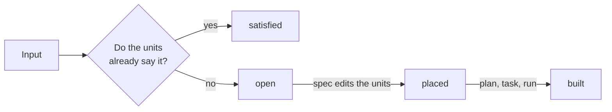

# The 4.0 Document Set

A workspace can keep its design in one of two layouts. The 3.x layout holds specifications, a plan and a task ledger. The 4.0 layout holds a **document set**: small addressed units from which the engine computes, for every task, exactly what its builder has to read. Both layouts are supported, one per workspace. A workspace is in the 4.0 layout when its entry in `.magicspec/workspace.json` carries `"format": "4"`; every other workspace stays as it is.

## The ideas behind it

- **One task, one pack.** A builder reads the pack computed for its task and nothing else of the documents.
- **One fact, one address.** Every fact lives in one unit with a stable address (a rule is `R1`, a behaviour of the component `hello` is `hello.1`, a task is `M2.T1`). Everything else refers to it.
- **Two layers.** The *neutral* layer says what the product is and does, and names no technology. The *stack* layer says how one stack realizes it. Changing the stack means a new stack layer and new tasks.
- **Every check can be observed.** A requirement has an `Accept` line, a task a `Done when` with the way to observe it, a milestone an `Observed by`.
- **The documents stay out of the product.** No address or path of the set is written into code, comments, tests or commit messages. A component's key is the one exception, where the stack layer uses it as a file, module or test name.

## What a workspace holds

```plaintext
.magicspec/
├── workspace.json               # the workspaces; "format": "4" marks a document set
├── INDEX.md                     # one row per workspace
└── {workspace}/
    ├── product.md               # purpose, scope, glossary, components, decisions, external needs
    ├── rules.md                 # how work is done on any stack
    ├── plan.md                  # milestones and the backlog
    ├── changes.md               # every change after the first version
    ├── spec/{key}.md            # the behaviour of one component
    ├── stack/{stack}/
    │   ├── profile.md           # the stack's tools, notions, own components and vocabulary
    │   ├── rules.md             # rules of this stack
    │   ├── deps.md              # external libraries, pinned
    │   ├── bind/{key}.md        # names, signatures and paths of one component
    │   └── tasks/M{n}.md        # the tasks of one milestone
    ├── memory/
    │   ├── state.md             # what is being built, what is done, what is next, what is open
    │   ├── decisions.md         # decisions taken while building
    │   ├── map.md               # what exists where, at which revision
    │   └── goal.md              # the goal a `goal` run pursues
    ├── simulations/{area}.md    # scenarios of a person using the product
    └── archives/                # retrospectives, reports and the files of an earlier layout
```

`product.md`, `rules.md`, `plan.md` and `spec/` are the neutral layer. Each document is written from a template of the engine folder (`templates/set/`), which states the form of its units. Not every file exists from the first day: a set gains its stack layer when the stack is known, its task files milestone by milestone, and its changes after the first version.

## Which command writes what

The pipeline is the same four stages, one stage per command, and each ends by naming the next.

| Stage | Reads | Writes |
| --- | --- | --- |
| `/magicspec spec` | the request, the set | `product.md`, `rules.md`, `spec/`, the stack's `profile.md`, `rules.md`, `deps.md` and `bind/`; later, `changes.md` and the units a change alters |
| `/magicspec plan` | the set | `plan.md`: the milestones, their order and priority, the backlog; the `From` line of each rule; the milestone under a change's `Built by` |
| `/magicspec task` | the next milestone | `stack/{stack}/tasks/M{n}.md`, then the pack of each task to check its size and open questions |
| `/magicspec run` | the pack of one task | the product's code, `memory/state.md`, `memory/decisions.md`; at a milestone's end `memory/map.md` and the status of the changes it built |

The other commands work on the same files:

| Command | On a document set |
| --- | --- |
| `fix` | records the defect as a change of kind `fix` in `changes.md`; `plan`, `task` and `run` then build it |
| `rule` | adds, amends or withdraws a rule unit of the set |
| `goal` | records the goal in `memory/goal.md` and drives the pipeline until it stops |
| `simulate` | writes and runs the scenarios in `simulations/` |
| `analyze` | audits the set against the code; on a workspace with code and no `product.md`, writes a set from the code |
| `status` | reads only |
| `graph` | shows the units and the references between them |
| `sync` | recomputes the next task in `memory/state.md` and reports the checker's findings |
| `migrate --to 4` | moves a 3.x workspace to this layout ([Migrating](migration.md#from-3x-to-40)) |

## Starting a workspace on 4.0

1. Add the workspace to `.magicspec/workspace.json` with the format set. Its folder needs nothing in it yet:

   ```json
   {
     "default": "app",
     "workspaces": {
       "app": { "description": "The product", "scope": ["src"], "format": "4" }
     }
   }
   ```

2. Give the idea to the specification stage: `/magicspec spec app "{your idea}"`.

The first run writes the neutral layer, has it reviewed by a reader of another stack so that no concept of one technology stays in it, and, when the stack is named, writes the stack layer. It ends by naming `/magicspec plan`. A question that is left unanswered becomes an `- Open:` line on the unit it concerns; a task that would need it is reported as not ready.

To move an existing 3.x workspace instead, see [Migrating](migration.md#from-3x-to-40).

## The checker

`check-docs` reads a set without a model: unresolved and duplicate addresses, neutral units that use the stack's words, priorities that contradict the order, components without an owner, packs over their budget, changes without a status or evidence, and more. A set with findings is not handed to a builder. The pipeline stages run it themselves; to run it by hand:

```bash
node <skills folder>/magicspec/scripts/executor.js check-docs --workspace={workspace}
```

A finding is one line on standard output, and the command exits 1:

```plaintext
tasks/M2.md: M2.T1 Context names hello.9, which is not defined
```

The summary goes to standard error. A clean set exits 0:

```plaintext
13 addresses, 1 tasks, largest pack 116 tokens, 0 findings
```

On a workspace that is not in the 4.0 format the command exits 0 with one line:

```plaintext
[check-docs] old is not a 4.0 workspace (no "format": "4" in workspace.json).
```

## The pack

`pack {task}` computes what the builder of one task reads: the task, the units its fields name, one level of the units those refer to, the names it uses, and the files the earlier tasks created. `/magicspec task` runs it for every task it writes; `/magicspec run` runs it before building.

```bash
node <skills folder>/magicspec/scripts/executor.js pack M2.T1 --workspace=docs
```

```plaintext
M2.T1: pack 116 / 10000 tokens (5 units, 0 by reference); done before 0 tokens; file 257 tokens
  written to .magicspec/.cache/packs/docs/M2.T1.md
```

The file starts with the rule that keeps the documents out of the product, followed by the stack's tools when the stack profile names them:

```plaintext
No address or path of these documents is written into anything this task creates; a component key is written only where the bindings use it as a name.
```

The budget is for the units the pack computes. A task over it is split. The pack is a cache: `clean-cache` removes it and the next run writes it again.

## Recording a milestone as built

When every `must` and `should` task of a milestone is done and its `Observed by` holds on what was built, `/magicspec run` records it with `mark-built`: the `Done` line in `memory/state.md`, a row of `memory/map.md` for each new component, and the status `built` for the changes the milestone builds.

```plaintext
M2 built: map 1 rows, 0 changes built, 0 Was lines removed
```

A milestone that `plan.md` does not hold is refused, and nothing is written:

```plaintext
[mark-built] M9 is not a milestone of plan.md.
```

## How a change moves

After the first version, nothing is edited in place. Every later input (a request, a defect report, a release note) is a change in `changes.md` with a kind (addition, revision, fix, withdrawal, stack or clarification) and a status:



1. **Record.** `spec` compares the end state the input asks for with the units. When they already state it, the change is `satisfied` and no work follows. Otherwise it is recorded `open` before any unit is touched; an input that fits several places stays `open` with a question.
2. **Place.** `spec` edits the units at a new revision (`Rev`), keeps the text of the built revision beside it (`Was`) until the change is built, and sets the status `placed`. `plan` adds the milestone that builds it, `task` writes that milestone's tasks.
3. **Build.** `run` builds the milestone, and `mark-built` sets the change `built`, records the new revisions in the map and removes the `Was` lines.

A `clarification` describes what the code already does, so it is `built` at once. A status never goes back. `check-log` checks that over the committed history of `changes.md`:

```plaintext
check-log: 1 changes, no status out of order
```

```plaintext
changes.md: C1 was placed before open
```

The first line is a history in order; the second is the finding for a change that went back. With no committed history the command says so and exits 0:

```plaintext
check-log: changes.md has no committed history; nothing to check.
```

[Documentation Index](README.md) | [Migrating](migration.md) | [Specification](spec.md) | [Run](run.md)
