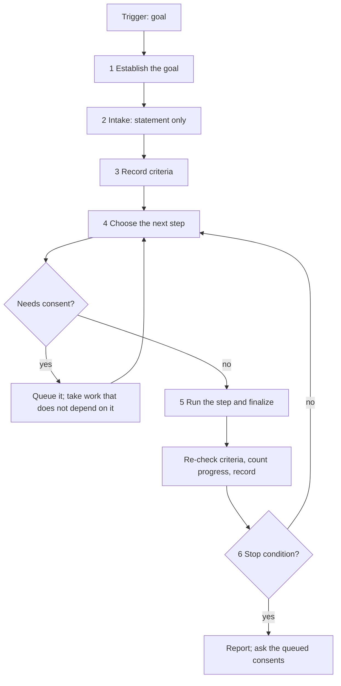

# Goal Workflow

Drives the pipeline toward a goal without the pauses between its stages. Every other command performs one stage and names the next; this one takes each computed next step itself — `spec`, `plan`, `task`, `run`, `simulate`, `fix` — until the goal's acceptance criteria hold or one of a closed list of stop conditions is reached. It removes the pause between one workflow's end and the next one's start, never a guard inside a workflow: every review, pre-flight check, containment rule and consent entry applies as it does outside this mode. The goal and its criteria are recorded in the workspace's live memory (`STATE.md`, section `## Goal`), so a new session continues the same goal.

**Contents:**

- Entry
- Argument Routing
- Core Invariants (Mandatory)
- Workflow: Pursuit
- Report
- On a 4.0 Workspace
- Goal Completion Checklist
- Handoffs

## Entry

**Triggers:** *"Work toward this goal"*, *"Keep going until it works"*, *"Do all of it without stopping"*, *"Pursue this goal"*, *"Run the phase to the end"*, *"Do the next five tasks"*, *"Continue the goal"*, *"Goal"*.

**Trigger:** `/magicspec goal [scope]`. The scope is optional. Arguments:

- *(empty)* — continue the recorded goal while one of its criteria is not met; otherwise run the active phase (Step 1), asking nothing
- `"{statement}"` — a goal in words
- `phase-{N}` — that phase of the plan, run to `Done`
- `phase-{A}..{B}` — those phases of the plan, in order, each run to `Done`
- `plan` — every phase the plan holds open, in order
- `{N} tasks` — a bound on the work: follow the plan from its next runnable task and stop after that many tasks reach `Done`
- `"{statement}" {N} tasks` or `phase-{N} {N} tasks` — a goal or a phase, bounded by a task count; a range and `plan` take the count the same way
- `{workspace} …` — any of the above in a specific workspace

Examples: `/magicspec goal "the import works end to end for all three file formats"`, `/magicspec goal phase-3`, `/magicspec goal phase-3..5`, `/magicspec goal plan`, `/magicspec goal 5 tasks`, `/magicspec goal phase-3 5 tasks`, `/magicspec goal`.

**Scope:**

- **Ownership**: this workflow writes the goal block of `STATE.md` and nothing else of its own. Every other file is written by the step it runs, under that step's rules.
- **Reads**: `STATE.md`, the registry, the plan and the workbooks, the findings of simulation runs, and the body of each step it is about to run.
- **Inside the session**: the mode schedules nothing outside the host's session. A host that ends the turn on its own — a limit or an error — ends the iteration, and the next session continues from the recorded goal. The mode itself never ends a turn before it stops (GM-10).
- **Never commits**: changes stay uncommitted and reviewable. The report lists a commit suggestion per phase as text, never as an action.
- **Finalization**: this workflow does not finalize as itself. Each step finalizes as its own workflow (`finalize --workflow={step}`), as it does outside this mode.

## Argument Routing

Read the argument into a scope before anything is written. The tokens `phase-{N}`, `phase-{A}..{B}`, `plan` and `{N} tasks` (also `{N} task`) are names and counts, not prose.

| Input | Detection | Result |
| --- | --- | --- |
| *(empty)* | No argument | **Continue, else the active phase**: the recorded goal while one of its criteria is not met; with none, or with a finished one, the active phase as a phase goal, one `[DR]` line naming it (Step 1). Nothing is asked |
| `phase-{N}` | The token matches `phase-` and a number | **Phase**: the goal is that phase `Done`. A phase the plan does not hold is answered with one line listing the plan's phases, and nothing runs |
| `phase-{A}..{B}` | The token matches `phase-`, a number, `..` and a number | **Range**: the goal is every phase of the range `Done`, in the plan's order, one criterion. A range that ends before it starts, or names a phase the plan does not hold, is answered like a missing phase: one line listing the plan's phases, and nothing runs |
| `plan` | The single word `plan` | **Plan**: the range from the first open phase of the plan to its last, read when the goal is recorded. With no open phase one line says so and nothing runs |
| `{N} tasks` | A number and the unit `task` or `tasks` | **Count**: a bound on the work, not a goal; the mode stops at a task boundary after N tasks reach `Done`, never in the middle of one |
| `phase-{N} {N} tasks` | A phase and a count | **Phase, bounded**: the phase, stopping at its end or at the count, whichever comes first (a range and `plan` are bounded the same way) |
| `"{statement}"` | Quoted text, or text that is none of the above and names no workspace | **Statement**: a goal in words |
| `"{statement}" {N} tasks` | A statement and a count | **Statement, bounded**: the count bounds that goal, as a bound the goal states does |
| `{workspace} …` | First token is a workspace | **Scoped**: the same, in that workspace |

> **A number with no unit**, or a phrase that is none of these forms, is read as a goal statement.
> **A recorded goal and a new scope**: a new scope given while a goal is recorded replaces it, narrated as one `[DR]` line naming the replaced goal (`[DR] Replacing the recorded goal "{old}" ({n} criteria not met) — a goal is started by stating it. (Override: /magicspec goal "{old}")`); the work already done stays in the specifications, the plan and the workbooks. A finished goal (every criterion `met`) that is still recorded is replaced without a line, by the default or by any new scope: nothing in it was left unmet.
> **Disambiguation**: a single unquoted word that matches a workspace name → workspace takes priority (the word `plan` included: `goal {workspace} plan` names both); force a statement by quoting it.

**Input Pass**: when the input carries prose — a directive, a report, a goal, the person's message that accompanies the command — run the Input Pass of `roles/prompt-engineer.md` (`@role:prompt-engineer`, section `## Input Pass`) first and act on its intent statement; arguments that are only names, flags or paths run no pass. A finding is resolved by the Consequence Forecast or a `<!-- TBD: … -->` marker where the work lands and narrated as one `[DR]` line, never asked (IP-5). A goal statement runs the pass, which feeds the intake (Step 2); a phase and a count are names and run none, and so do a range, `plan` and the empty argument.

## Core Invariants (Mandatory)

1. **Context (Zero-Prompt)**: Apply [context.md](../references/context.md) as a whole — every section applies unless it names other workflows. Choose the workspace first, by the engine's chain (`context.md` §Workspace Resolution Chain): run `node scripts/executor.js resolve-workspace --command goal [--workspace {name}] --text "{request}"` (`--workspace` only when the invocation names a registered workspace; `{request}` is the rest of the argument, and when it is empty `--text` is left out: the script refuses an empty value), take its `Workspace:` line as the active workspace and print its `Narration:` line once. A bare `goal` whose resolved workspace records no unfinished goal looks at the others before any default applies: `node scripts/executor.js resume-state --all --json` lists the workspaces with a recorded goal, and exactly one with a criterion not `met` is the active workspace (`[DR] Continuing the goal of {name} — the only one recorded. (Override: /magicspec goal {other} …)`).
   - **Checkpoints**: this run's record starts in the context load (`context.md` §Post-Resolution step 5) and each `Checkpoint:` line below is one `checkpoint --step` call. Every step this mode runs starts with `--nested`, so its checkpoints land in this record, and `goal` clears the record with its report. A run that ends on a HALT, a refusal or a cancelled form ends with `node scripts/executor.js checkpoint --workspace={active-workspace} --clear`.
2. **Rules First**: read the constitution (`RULES.md`, global and workspace) and `STATE.md` before anything else; `Blockers` and `Blocking Constraints` are acknowledged as in `run.md`.
3. **Auto-Init**: if `.magicspec/` or system files are missing, silently execute `references/init.md` (do not prompt the user).
4. **Logic Guards**:
   - **One intake, then no questions (GM-1)**: a goal statement passes the Input Pass and the idea intake gate once, at the start (Step 2); questions are allowed there and only there. A phase, a range, `plan`, a count or no argument has no intake and asks nothing. After the intake the mode asks only the consent questions of its stop (the Report), and only when it stops.
   - **Consent is queued, never assumed (GM-5)**: an action that needs consent (E1 a destructive or irreversible action, E2 an external release artifact, E4 a constitutional amendment) is neither performed nor silently skipped. It is queued with its reason in the goal block, the work that depends on it is set `Blocked [!]` with the reason `waiting for consent: {action}`, and the iteration continues with work that does not depend on it.
   - **No guard is relaxed (GM-7)**: every review gate (`spec-critic`, `planner`, `prompt-engineer`, `code-reviewer`, `test-engineer`), every Pre-flight check, every HALT and every containment rule of a step runs as it does outside this mode. The mode adds nothing but the removal of the pause.
   - **The files carry the state (PS-6)**: each step ends at its own stage boundary and leaves the records the next one reads. The next step is computed from the files after each one, never from what was in mind when the previous step began. A goal interrupted at any boundary resumes from the files.
   - **The step is its body**: to run a step, read `workflows/{step}.md` in full and follow it with the argument the iteration gives it. This workflow re-implements no step, so a change to a body reaches goal mode with no edit here.
   - **Closed stop conditions (GM-6)**: the mode stops on exactly one of the six conditions of Step 6 and on nothing else.
   - **The mode does not stop itself (GM-10)**: while no stop condition holds, a turn is never ended with a message that starts no next action (a command, an edit or a check) — such a message is a stop on no condition of GM-6, without the report. Four ends read as reports and are never taken: a summary of a step that closes by announcing the next step instead of taking it; an offer to continue unless the person would rather not; a list of decisions for the person when none of them blocks the remaining work (an elective one is decided and narrated as a `[DR]`, one that needs consent is queued (GM-5)); a pause because the turn has been long or a phase is done. A progress note goes in the same message as the next action. The mode ends a turn for two things only: a round of the intake survey at the start (GM-1), and the report of Step 6 with its queued consents (GM-8). The person's interruption is the stop of Step 6 condition 6.
   - **A premise only the requester can confirm is decided, never asked (GM-11)**: after the intake only the consents queued under GM-5 are asked, and only when the mode stops. A fork the evidence does not settle — a clarification the work would profit from included — is decided by the Consequence Forecast (DA-10) and narrated as a `[DR]`; its premise is written where the work lands as an `Assumption (forecast)`, as outside this mode, and recorded in the goal block with its override (Step 5). The work does not wait for an answer: waiting is a stall, and the one case a wrong guess cannot be taken back is already a consent, queued under GM-5 while the work that does not depend on it goes on.
   - **Containment**: the goal block is an SDD artifact; nothing written into the product's tree names it, a criterion, a task or a specification (`CONSTITUTION.md` §6).
5. **Engine Integrity (C14)**: if this skill folder is modified → `node scripts/executor.js update-engine-meta`.

## Workflow: Pursuit



### Steps

1. **Establish the goal**: read `STATE.md`'s `## Goal` section (`templates/state.md` documents its layout).
   - *(empty)* with an unfinished goal recorded (a criterion not `met`; a goal with no criteria yet counts as not met) → **continue**: report the goal and its criteria counts in one line (`Continuing: goal {scope} — {met} met, {open} open, {blocked} blocked`) and go to Step 4. A recorded goal is re-checked first (Step 5, criteria).
   - *(empty)* with no unfinished goal recorded → **the active phase**: take the active phase as a phase goal — the phase the ledger (`TASKS.md`) marks `In Progress`; otherwise the first phase of the plan, in order, that the ledger does not hold as `Done` or `Done (Archived)` (a phase with no ledger row yet counts as not done, and the rows of Step 4 decompose it) — a finished goal that is still recorded is replaced by it, with no line, and narrate `[DR] Taking phase {N} — the active phase; no unfinished goal is recorded. (Override: /magicspec goal plan)`. With no phase to take — the plan is complete, stale or absent (the pre-flight below, run first for this branch, reports `SYNC_GAP`, `ORPHANED_SPEC` or a missing plan), or the phase is `Blocked` — nothing runs: print one line with what `Next Action` records and the one command it names, and end; no goal is recorded and no report is printed. Otherwise build the goal object as for `phase-{N}` below.
   - A new scope → build the goal object: `statement`, `phase` and `taskLimit` from the argument — `phase` and `phaseTo` from a range, or from `plan` (the first and the last open phase of the plan, read now) — (a phase the plan lacks, or an inverted range, ends here, Argument Routing), a `bound` when the statement states one (iterations, phases, time, or rounds without progress), the counters at zero and `started` set to the date and time of the invocation. A phase the plan holds and a count give no criteria yet: the phase's criteria are its tasks (Step 3).
   - Run the pre-flight once: `node scripts/executor.js check-prerequisites --json --workspace={active-workspace}`. `ENGINE_INTEGRITY` or `GHOST_REGISTRY` → the C15 Filter (`init.md §1`): in scope → stop on the integrity condition (Step 6); out of scope → proceed silently. Each step then runs its own pre-flight.
2. **Intake** (a statement only): run the intake of `workflows/spec.md` on the statement as the idea — the Input Pass, then the Idea Intake Gate (comprehension, sufficiency, the survey and its convergence rules) — once. This is the one place the mode may ask (GM-1); whatever the survey leaves open or delegated is answered by the Consequence Forecast and recorded as `Assumption (forecast)`. The result is an intent statement. A phase or a count skips this step.
3. **Record the criteria (GM-2)**: from the intent statement, write the acceptance criteria — each verifiable by a named check: a command, a test, a simulation scenario, or a specification statement whose tasks are `Done`. A criterion with no possible check is rewritten until it has one, or recorded as an `Assumption (forecast)` the report names. For a phase the goal object holds one criterion — `phase {N} is Done` with the check *every task's Verify line passes and its status is Done* — because the phase's tasks are its criteria and their workbook is the per-task record (the block is bounded at 28 lines); it is `met` when the phase's status is `Done` (or `Done (Archived)`, which finalization writes once the phase is archived). For a range or `plan` the goal object holds one criterion — `phases {A}..{B} are Done` with the same check, phase by phase — recorded with `phase` and `phaseTo`; it is `met` when every phase of the range is `Done` (or `Done (Archived)`), and the set of phases is fixed when the goal is recorded: a phase a replan adds later is outside it. A count has no criteria of its own: the goal it bounds does, and a count alone records the criterion `{N} tasks reach Done`. Write the block through the one writer, from a temporary file outside the project's tree (the host's scratch area or the system temporary directory), and delete the file after the call:

   ```bash
   node scripts/executor.js update-state --workspace={active-workspace} --goal-file {path-to-the-json}
   ```

   The file holds one JSON object: `statement`, `phase`, `phaseTo` (the last phase of a range, not below `phase`), `taskLimit`, `bound`, `withoutProgress`, `tasksDone`, `iterations`, `phasesDone`, `started`, `criteria` (`{state: open|met|blocked, text, check}`), `consents` (`{action, reason}`), `premises` (`{premise, override}`, oldest first) and `premisesDropped` (a count), each field optional but one of `statement`, `phase` and `taskLimit`. A refusal (an unknown field, a block over its bound) is a **HALT** of the mode with the writer's one line; nothing is written.
4. **Choose the next step** from the files, the first row that holds:

   | State read from the files | Step |
   | --- | --- |
   | A criterion of a statement that no `Stable` specification states (the criterion of a phase, a range or a count is not one) | `spec`: the first run of a goal statement takes the intent statement with every such criterion as one run, a later run the single criterion a later check found uncovered (the intake is done; the survey does not run again) |
   | A failed or inconclusive scenario step whose repair is `Done` — a task names it in its `Verify` line, and the `Last run` it was found in is still the scenario's last | `simulate` for that area: only a run rewrites `Last run`, so the finding closes there, or comes back with a newer run |
   | An open finding: a failed or inconclusive step in a scenario's `Last run` that no such repair names, or a failing check of a criterion | `fix` with that finding |
   | A phase goal and the phase has no workbook yet | `task {workspace} "phase-{N}"` |
   | A phase goal and the phase holds a `Todo` or `In Progress` task | `run {workspace} "phase-{N}"` |
   | `STATE.md`'s `Next Action` names `/magicspec spec`, `plan`, `task` or `run` (every finalization computes it, DA-6) | that step, with the argument it names |
   | Scenarios verify an open criterion and none has run since the behaviour last changed | `simulate` for that area |
   | None of the above | no step runs: the iteration is the re-check of Step 5 alone, and it counts as without progress when nothing changes |

   For a range or `plan` the phase of these two rows is the first phase of the range that is not `Done`; the iteration moves on to the next phase when that one is `Done`. A task limit makes `run` execute one task at a time (`/magicspec run {workspace} "{task id}"`, the next runnable one), so the count is exact and the mode stops at a task boundary. A step the recorded state names that is not one of the six, or none, is not run. Before running the step, find the consent it would need: a step whose next action is itself consent-gated is queued (Core Invariant 4) and the next row is taken instead.
5. **Run the step**: read `workflows/{step}.md` in full and follow it, with its own pre-flight, gates and finalization (`finalize --workflow={step}`), displaying its finalization output verbatim as that body says. Where the body would ask a consent question, queue it instead (Core Invariant 4). The finalization output ends with its handoff line, whose last line names the next command; in this mode that line is the input of the next iteration, not the end of the turn, and the re-check below follows in the same turn. Then:
   - **Re-check the criteria**: run each criterion's named check; set its state `met`, `open` or `blocked` (waiting for consent, or for a decision the mode may not make).
   - **Count progress (GM-6)**: an iteration makes progress when it changes a recorded state — a criterion's state, a task's status, a specification's status, the plan's membership or order, or a finding closed. Repeating a step on unchanged input with an unchanged outcome is no progress. Compare the states read before the step with those read after; the counters are `withoutProgress` (reset to 0 on progress, else +1), `iterations` (+1), `tasksDone` (the tasks that reached `Done` in this step) and `phasesDone` (a phase that reached `Done`).
   - **Premises**: each premise the iteration accepted — one a `[DR]` rests on, written as an `Assumption (forecast)` where the work landed — is appended to `premises` with its override, oldest first; the writer drops the oldest when the block is full and counts them in `premisesDropped`, and the write is never refused for them (GM-11).
   - **Record** the new block, with the premises, through the writer (Step 3's command).
   - `Checkpoint: {command}` — one per step run, named by the command it ran.
6. **Stop condition** — the mode stops on exactly one of these, checked in this order after each iteration and once before the first (a goal already done, a bound already reached):
   1. **Done**: every criterion is `met`.
   2. **Consent queued**: Step 4 finds no step that does not depend on a queued consent, and consents are queued (Core Invariant 4).
   3. **No progress**: three consecutive iterations without progress (`withoutProgress` reached 3), or the number the goal states ("give up after 5 rounds without progress").
   4. **Integrity halt**: an objective integrity HALT — checksums, drift, parity — in the pre-flight or in a step's.
   5. **A bound the goal states**: `iterations`, `phasesDone` or elapsed time since `started` reached the `bound`; a task limit reached by `tasksDone`, at a task boundary.
   6. **Interrupted**: the user interrupts. The mode stops at the next step boundary and records the state; nothing is abandoned mid-step.

   None holds → go to Step 4. One holds → the Report.

## Report

When the mode stops, print one report in this layout, then the queued consents are asked (below): Then end the record: `node scripts/executor.js checkpoint --workspace={active-workspace} --clear`.

```plaintext
Goal: {scope}
Stopped: {done | consent queued | no progress | integrity halt | bound reached | interrupted}
Criteria:
  [met]     {criterion} — {evidence}
  [open]    {criterion} — {what is missing}
  [blocked] {criterion} — {queued consent or blocker}
Work: Phase {N}: {summary} — commit suggestion: {message}
Queued consents: {n}
Assumptions: {n}
  {premise} — Override: {command}
Next: {one command}
```

`{scope}` is spelled as the commands spell it. `{evidence}` is the check that passed, in the Evidence Capsule shape (`context.md §Read Hygiene`): the command, its outcome and at most three findings. One `Work:` line per phase the mode worked on, with a commit suggestion in the imperative, English, as text only — the engine never commits. The `Next:` line is the handoff line `Next: /magicspec {command} {argument} — {demand} reasoning`, printed once: `/magicspec goal` with the demand `per step` when only a bound, an interruption or the queued consents stopped the mode (the goal continues); the step the pipeline state computes when the goal is done; for a stop by no progress or an integrity halt, the one command the last HALT or finalization named.

`Assumptions: {n}` and the premise lines under it are printed only when the pursuit accepted a premise: each line is one premise of the goal block with the command that overrides it (an amendment of the specification that holds it), and when the block dropped older ones the line reads `Assumptions: {n} ({d} older ones not kept)`.

**Queued consents** are asked after the report, only now (GM-5): one question at a time, in queue order, each a consent question of E1, E2 or E4 — one question, at most three fixed options, the forecast's winner marked as the default. A yes is carried out as that one action and nothing else; a no or a skip drops it. Each answered consent is removed from the block through the writer. The report stands whatever the answers; a yes that unblocks work makes `/magicspec goal` the next step.

## On a 4.0 Workspace

Taken when the resolved workspace's entry in `workspace.json` carries `"format": "4"`; the steps below replace the workflow steps above, and every other section of this body applies unchanged. On any other workspace this section is skipped.

The plan of a set is the milestones of `plan.md`, its state is `memory/state.md`, which takes the place of `STATE.md`, and its goal is recorded in `memory/goal.md`: phases, the task ledger and the registry are 3.x only. The Input Pass, the intake, the stop conditions, the consent questions and the rules on premises and self-made stops apply as written above.

1. **Scope**: `M{n}` — that milestone built and recorded done; `M{n}..M{m}` — those milestones, in the order of `plan.md`; `plan` — every milestone of `plan.md` not done; `{N} tasks` and a statement as written above. A milestone is done when `memory/state.md` holds its `- Done: M{n}` line. A milestone the plan lacks, an inverted range and a `phase-{N}` are answered with one line listing the milestones, and nothing runs. With no argument and no unfinished goal recorded, take the milestone of the task on the `- Now:` line, else the first milestone of `plan.md` not done, and narrate `[DR] Taking M{n} — the next milestone; no unfinished goal is recorded. (Override: /magicspec goal plan)`; with no milestone written or every one done, one line says what the set waits for, as `workflows/status.md` §On a 4.0 Workspace computes it, and nothing is recorded.
2. **Establish**: read `memory/goal.md` (it holds the `## Goal` section `templates/state.md` documents; absent means no goal) and `memory/state.md`. Pre-flight: `node scripts/executor.js check-prerequisites --json --workspace={active-workspace}`. `ENGINE_INTEGRITY` and `GHOST_REGISTRY` are handled as above; a `DOC_SET` finding belongs to the step that owns it and does not stop the mode.
3. **Record**: the goal object has the keys listed above; `phase` and `phaseTo` hold milestone numbers. A statement's criteria are written as Step 3 above says. A milestone goal holds the one criterion `M{n} is done`, and a range or `plan` the one criterion `M{n}..M{m} are done`, each checked by the `- Done:` lines of `memory/state.md`. Write it from a temporary file outside the project's tree, and delete that file after the call:

   ```bash
   node scripts/executor.js update-state --workspace={active-workspace} --goal-file {path-to-the-json}
   ```

   The engine writes `memory/goal.md` and nobody edits it by hand. The same call with `--goal-clear` in place of `--goal-file` removes it; no step of the pursuit clears a goal on its own, and a new goal replaces the recorded one.
4. **Choose the next step**, the first row that holds, queuing a step that needs consent as Step 4 above does:

   | State read from the files | Step |
   | --- | --- |
   | A criterion of a statement that no unit of the set states | `spec`: the first run with the intent statement and every such criterion, a later run with one |
   | A failed or inconclusive scenario step whose repair is built — a change names it under `Source` and reads `built` — while that `Last run` is still the scenario's last | `simulate` for that area |
   | An open finding: a failed or inconclusive step that no change names, or a failing check of a criterion | `fix` with that finding |
   | The set waits for a stage: the command the last finalization named, in a new session the one `workflows/status.md` §On a 4.0 Workspace computes | `plan`, `task` or `run`; `run` takes the next ready task of the goal's first milestone not done |
   | Scenarios verify an open criterion and none has run since the behaviour last changed | `simulate` for that area |
   | None of the above | no step runs, as written above |

   A task limit makes `run` build one task (`/magicspec run {workspace} "M{n}.T{k}"`) and end after it, without continuing to the next ready one.
5. **Run and count**: Step 5 above applies; each step is run by its body's section for a 4.0 workspace, finalizes as itself, and the record is written as in 3. Progress is a change of a recorded state: a criterion's state, a `- Done:` line, a change's status, the milestones of `plan.md` or their order, a finding closed. `tasksDone` counts the tasks that gained a `- Done:` line and `phasesDone` the milestones. A task that waits for a queued consent is recorded `- Open: {task} — waiting for consent: {action}` in `memory/state.md`. A premise is written on the unit it concerns, as `workflows/spec.md` §On a 4.0 Workspace states, and in the goal record. Its `Checkpoint: {command}` is recorded the same way.
6. **Report**: the layout above, the scope spelled `M{n}` or `M{n}..M{m}` and one `Work:` line per milestone worked on.

## Goal Completion Checklist

```
Goal Workflow Checklist — {operation}
  ☐ Workspace Routing: `resolve-workspace` chose the workspace before any workspace file was read; with more than one workspace registered its line `[Workspace] {name} — {signal}. (Override: /magicspec {command} {other} …)` was printed once
  ☐ Scope read: a phase the plan lacks, or a range that is inverted or names one, answered with one line listing the plan's phases and nothing run; a number with no unit read as a statement; a new scope over a recorded goal narrated as one `[DR]`, and over a finished one with no line; the empty argument took the recorded unfinished goal or the active phase (one `[DR]` line) and, with no phase to take, ran nothing and printed one line
  ☐ Intake: a statement passed the Input Pass and the Idea Intake Gate once, at the start, and the first `spec` run took the whole intent with every uncovered criterion; a phase, a range, `plan`, a count or the empty argument asked nothing
  ☐ Criteria: each verifiable by a named check, or recorded as an `Assumption (forecast)`; the goal block written through `update-state` only, after every iteration, and the temporary file deleted
  ☐ Every step was its own body read in full, with its gates, its pre-flight and its own finalization; the next step was computed from the files after each one
  ☐ Consent: no E1, E2 or E4 action performed or silently skipped; each queued with its reason, its dependent work `Blocked [!]`, asked one at a time only after the report
  ☐ No guard relaxed: no review gate, pre-flight check, HALT or containment rule skipped in goal mode
  ☐ Progress counted by the recorded states that changed; a stop on exactly one of the six conditions
  ☐ No self-made stop (GM-10): no turn ended before a stop condition held — no summary announcing the next step, no offer to continue, no list of non-blocking decisions, no pause for a long turn; a step's finalization output was followed by the re-check in the same turn
  ☐ Premises (GM-11): a fork the evidence did not settle was decided and narrated as a `[DR]`, its premise written where the work lands, recorded in the goal block and listed under `Assumptions` in the report; nothing but the queued consents was asked after the intake
  ☐ A task limit: `run` one task at a time, the mode stopped at a task boundary, never in the middle of one
  ☐ One report in the layout above, once; commit suggestions as text only, nothing committed; the handoff line printed once
  ☐ Engine Meta: C14 bump performed if files of this skill folder were modified
  ☐ Engineer Posture (C25): every step executed and narrated; no "Go" prompts
  ☐ Decision Autonomy (C27): elective forks resolved as [DR] one-liners; questions only for the intake survey (E6) at the start and the queued consents (E1, E2, E4) at the stop
```

## Handoffs

Where this workflow may hand over, and when:

- **Continue the goal** → `/magicspec goal`: name it, with its demand `per step`, when a bound, an interruption or the queued consents stopped the mode and criteria are not met. Condition: `goal_open`.
- **Revalidate the plan** → `/magicspec plan`: name it, with the workspace, when the last step ended on a stale plan or a recorded replan directive. Condition: `plan_stale`.
- **Repair what failed** → `/magicspec fix`: name it, with the workspace, when a stop by no progress leaves an open finding. Condition: `findings`.
- **Done** → name the command the pipeline state computes (the last finalization prints it).
