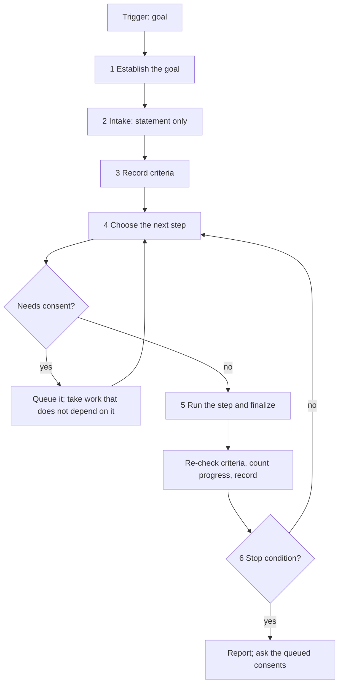

# Goal Workflow

Drives the pipeline toward a goal without the pauses between its stages. Every other command performs one stage and names the next; this one takes each computed next step itself — `spec`, `plan`, `task`, `run`, `simulate`, `fix` — until the goal's acceptance criteria hold or one of a closed list of stop conditions is reached. It removes the pause between one workflow's end and the next one's start, never a guard inside a workflow: every review, pre-flight check, containment rule and consent entry applies as it does outside this mode. The goal and its criteria are recorded in the workspace's live memory (`STATE.md`, section `## Goal`), so a new session continues the same goal.

**Contents:**

- Entry
- Argument Routing
- Core Invariants (Mandatory)
- Workflow: Pursuit
- Report
- Goal Completion Checklist
- Handoffs

## Entry

**Triggers:** *"Work toward this goal"*, *"Keep going until it works"*, *"Do all of it without stopping"*, *"Pursue this goal"*, *"Run the phase to the end"*, *"Do the next five tasks"*, *"Continue the goal"*, *"Goal"*.

**Trigger:** `/magicspec goal [scope]`. The scope is required unless a goal is recorded. Arguments:

- *(empty)* — continue the goal recorded for the workspace; with none recorded, say so in one line and show the argument form (`help.md` Step 4)
- `"{statement}"` — a goal in words
- `phase-{N}` — that phase of the plan, run to `Done`
- `{N} tasks` — a bound on the work: follow the plan from its next runnable task and stop after that many tasks reach `Done`
- `"{statement}" {N} tasks` or `phase-{N} {N} tasks` — a goal or a phase, bounded by a task count
- `{workspace} …` — any of the above in a specific workspace

Examples: `/magicspec goal "the import works end to end for all three file formats"`, `/magicspec goal phase-3`, `/magicspec goal 5 tasks`, `/magicspec goal phase-3 5 tasks`, `/magicspec goal`.

**Scope:**

- **Ownership**: this workflow writes the goal block of `STATE.md` and nothing else of its own. Every other file is written by the step it runs, under that step's rules.
- **Reads**: `STATE.md`, the registry, the plan and the workbooks, the findings of simulation runs, and the body of each step it is about to run.
- **Inside the session**: the mode schedules nothing outside the host's session. A host that ends the turn ends the iteration; the next session continues from the recorded goal.
- **Never commits**: changes stay uncommitted and reviewable. The report lists a commit suggestion per phase as text, never as an action.
- **Finalization**: this workflow does not finalize as itself. Each step finalizes as its own workflow (`finalize --workflow={step}`), as it does outside this mode.

## Argument Routing

Read the argument into a scope before anything is written. The tokens `phase-{N}` and `{N} tasks` (also `{N} task`) are names and counts, not prose.

| Input | Detection | Result |
| --- | --- | --- |
| *(empty)* | No argument | **Continue**: the goal recorded for the workspace. With none recorded, one line says so and the argument form asks for the scope once (a dismissed form runs nothing) |
| `phase-{N}` | The token matches `phase-` and a number | **Phase**: the goal is that phase `Done`. A phase the plan does not hold is answered with one line listing the plan's phases, and nothing runs |
| `{N} tasks` | A number and the unit `task` or `tasks` | **Count**: a bound on the work, not a goal; the mode stops at a task boundary after N tasks reach `Done`, never in the middle of one |
| `phase-{N} {N} tasks` | A phase and a count | **Phase, bounded**: the phase, stopping at its end or at the count, whichever comes first |
| `"{statement}"` | Quoted text, or text that is none of the above and names no workspace | **Statement**: a goal in words |
| `"{statement}" {N} tasks` | A statement and a count | **Statement, bounded**: the count bounds that goal, as a bound the goal states does |
| `{workspace} …` | First token is a workspace | **Scoped**: the same, in that workspace |

> **A number with no unit**, or a phrase that is neither a phase nor a count, is read as a goal statement.
> **A recorded goal and a new scope**: a new scope given while a goal is recorded replaces it, narrated as one `[DR]` line naming the replaced goal (`[DR] Replacing the recorded goal "{old}" ({n} criteria not met) — a goal is started by stating it. (Override: /magicspec goal "{old}")`); the work already done stays in the specifications, the plan and the workbooks.
> **Disambiguation**: a single unquoted word that matches a workspace name → workspace takes priority; force a statement by quoting it.

**Input Pass**: when the input carries prose — a directive, a report, a goal, the person's message that accompanies the command — run the Input Pass of `roles/prompt-engineer.md` (`@role:prompt-engineer`, section `## Input Pass`) first and act on its intent statement; arguments that are only names, flags or paths run no pass. A finding is resolved by the Consequence Forecast or a `<!-- TBD: … -->` marker where the work lands and narrated as one `[DR]` line, never asked (IP-5). A goal statement runs the pass, which feeds the intake (Step 2); a phase and a count are names and run none.

## Core Invariants (Mandatory)

1. **Context (Zero-Prompt)**: Apply [context.md](../references/context.md) as a whole — every section applies unless it names other workflows. Choose the workspace first, by the engine's chain (`context.md` §Workspace Resolution Chain): run `node scripts/executor.js resolve-workspace --command goal [--workspace {name}] --text "{request}"` (`--workspace` only when the invocation names a registered workspace; `{request}` is the rest of the argument, and when it is empty `--text` is left out: the script refuses an empty value), take its `Workspace:` line as the active workspace and print its `Narration:` line once. A bare `goal` whose resolved workspace records no goal looks at the others: `node scripts/executor.js resume-state --all --json` lists the workspaces with a recorded goal, and exactly one is the active workspace (`[DR] Continuing the goal of {name} — the only one recorded. (Override: /magicspec goal {other} …)`).
2. **Rules First**: read the constitution (`RULES.md`, global and workspace) and `STATE.md` before anything else; `Blockers` and `Blocking Constraints` are acknowledged as in `run.md`.
3. **Auto-Init**: if `.magicspec/` or system files are missing, silently execute `references/init.md` (do not prompt the user).
4. **Logic Guards**:
   - **One intake, then no questions (GM-1)**: a goal statement passes the Input Pass and the idea intake gate once, at the start (Step 2); questions are allowed there and only there. A phase or a count has no intake and asks nothing. After the intake the mode asks only the consent questions of its stop (the Report), and only when it stops.
   - **Consent is queued, never assumed (GM-5)**: an action that needs consent (E1 a destructive or irreversible action, E2 an external release artifact, E4 a constitutional amendment) is neither performed nor silently skipped. It is queued with its reason in the goal block, the work that depends on it is set `Blocked [!]` with the reason `waiting for consent: {action}`, and the iteration continues with work that does not depend on it.
   - **No guard is relaxed (GM-7)**: every review gate (`spec-critic`, `planner`, `prompt-engineer`, `code-reviewer`, `test-engineer`), every Pre-flight check, every HALT and every containment rule of a step runs as it does outside this mode. The mode adds nothing but the removal of the pause.
   - **The files carry the state (PS-6)**: each step ends at its own stage boundary and leaves the records the next one reads. The next step is computed from the files after each one, never from what was in mind when the previous step began. A goal interrupted at any boundary resumes from the files.
   - **The step is its body**: to run a step, read `workflows/{step}.md` in full and follow it with the argument the iteration gives it. This workflow re-implements no step, so a change to a body reaches goal mode with no edit here.
   - **Closed stop conditions (GM-6)**: the mode stops on exactly one of the six conditions of Step 6 and on nothing else.
   - **Containment**: the goal block is an SDD artifact; nothing written into the product's tree names it, a criterion, a task or a specification (`CONSTITUTION.md` §6).
5. **Engine Integrity (C14)**: if this skill folder is modified → `node scripts/executor.js update-engine-meta`.

## Workflow: Pursuit



### Steps

1. **Establish the goal**: read `STATE.md`'s `## Goal` section (`templates/state.md` documents its layout).
   - *(empty)* with a goal recorded → **continue**: report the goal and its criteria counts in one line (`Continuing: goal {scope} — {met} met, {open} open, {blocked} blocked`) and go to Step 4. A recorded goal is re-checked first (Step 5, criteria).
   - A new scope → build the goal object: `statement`, `phase` and `taskLimit` from the argument (a phase the plan lacks ends here, Argument Routing), a `bound` when the statement states one (iterations, phases, time, or rounds without progress), the counters at zero and `started` set to the date and time of the invocation. A phase the plan holds and a count give no criteria yet: the phase's criteria are its tasks (Step 3).
   - Run the pre-flight once: `node scripts/executor.js check-prerequisites --json --workspace={active-workspace}`. `ENGINE_INTEGRITY` or `GHOST_REGISTRY` → the C15 Filter (`init.md §1`): in scope → stop on the integrity condition (Step 6); out of scope → proceed silently. Each step then runs its own pre-flight.
2. **Intake** (a statement only): run the intake of `workflows/spec.md` on the statement as the idea — the Input Pass, then the Idea Intake Gate (comprehension, sufficiency, the survey and its convergence rules) — once. This is the one place the mode may ask (GM-1); whatever the survey leaves open or delegated is answered by the Consequence Forecast and recorded as `Assumption (forecast)`. The result is an intent statement. A phase or a count skips this step.
3. **Record the criteria (GM-2)**: from the intent statement, write the acceptance criteria — each verifiable by a named check: a command, a test, a simulation scenario, or a specification statement whose tasks are `Done`. A criterion with no possible check is rewritten until it has one, or recorded as an `Assumption (forecast)` the report names. For a phase the goal object holds one criterion — `phase {N} is Done` with the check *every task's Verify line passes and its status is Done* — because the phase's tasks are its criteria and their workbook is the per-task record (the block is bounded at 28 lines); it is `met` when the phase's status is `Done` (or `Done (Archived)`, which finalization writes once the phase is archived). A count has no criteria of its own: the goal it bounds does, and a count alone records the criterion `{N} tasks reach Done`. Write the block through the one writer, from a temporary file outside the project's tree (the host's scratch area or the system temporary directory), and delete the file after the call:

   ```bash
   node scripts/executor.js update-state --workspace={active-workspace} --goal-file {path-to-the-json}
   ```

   The file holds one JSON object: `statement`, `phase`, `taskLimit`, `bound`, `withoutProgress`, `tasksDone`, `iterations`, `phasesDone`, `started`, `criteria` (`{state: open|met|blocked, text, check}`) and `consents` (`{action, reason}`), each field optional but one of `statement`, `phase` and `taskLimit`. A refusal (an unknown field, a block over its bound) is a **HALT** of the mode with the writer's one line; nothing is written.
4. **Choose the next step** from the files, the first row that holds:

   | State read from the files | Step |
   | --- | --- |
   | A criterion of a statement that no `Stable` specification states (the criterion of a phase or a count is not one) | `spec` with that criterion as the idea (its intake is done; the survey does not run again) |
   | An open finding: a failed or inconclusive step in a scenario's `Last run`, or a failing check of a criterion | `fix` with that finding |
   | A phase goal and the phase has no workbook yet | `task {workspace} "phase-{N}"` |
   | A phase goal and the phase holds a `Todo` or `In Progress` task | `run {workspace} "phase-{N}"` |
   | `STATE.md`'s `Next Action` names `/magicspec spec`, `plan`, `task` or `run` (every finalization computes it, DA-6) | that step, with the argument it names |
   | Scenarios verify an open criterion and none has run since the behaviour last changed | `simulate` for that area |
   | None of the above | no step runs: the iteration is the re-check of Step 5 alone, and it counts as without progress when nothing changes |

   A task limit makes `run` execute one task at a time (`/magicspec run {workspace} "{task id}"`, the next runnable one), so the count is exact and the mode stops at a task boundary. A step the recorded state names that is not one of the six, or none, is not run. Before running the step, find the consent it would need: a step whose next action is itself consent-gated is queued (Core Invariant 4) and the next row is taken instead.
5. **Run the step**: read `workflows/{step}.md` in full and follow it, with its own pre-flight, gates and finalization (`finalize --workflow={step}`), displaying its finalization output verbatim as that body says. Where the body would ask a consent question, queue it instead (Core Invariant 4). Then:
   - **Re-check the criteria**: run each criterion's named check; set its state `met`, `open` or `blocked` (waiting for consent, or for a decision the mode may not make).
   - **Count progress (GM-6)**: an iteration makes progress when it changes a recorded state — a criterion's state, a task's status, a specification's status, the plan's membership or order, or a finding closed. Repeating a step on unchanged input with an unchanged outcome is no progress. Compare the states read before the step with those read after; the counters are `withoutProgress` (reset to 0 on progress, else +1), `iterations` (+1), `tasksDone` (the tasks that reached `Done` in this step) and `phasesDone` (a phase that reached `Done`).
   - **Record** the new block through the writer (Step 3's command).
6. **Stop condition** — the mode stops on exactly one of these, checked in this order after each iteration and once before the first (a goal already done, a bound already reached):
   1. **Done**: every criterion is `met`.
   2. **Consent queued**: Step 4 finds no step that does not depend on a queued consent, and consents are queued (Core Invariant 4).
   3. **No progress**: three consecutive iterations without progress (`withoutProgress` reached 3), or the number the goal states ("give up after 5 rounds without progress").
   4. **Integrity halt**: an objective integrity HALT — checksums, drift, parity — in the pre-flight or in a step's.
   5. **A bound the goal states**: `iterations`, `phasesDone` or elapsed time since `started` reached the `bound`; a task limit reached by `tasksDone`, at a task boundary.
   6. **Interrupted**: the user interrupts. The mode stops at the next step boundary and records the state; nothing is abandoned mid-step.

   None holds → go to Step 4. One holds → the Report.

## Report

When the mode stops, print one report in this layout, then the queued consents are asked (below):

```plaintext
Goal: {scope}
Stopped: {done | consent queued | no progress | integrity halt | bound reached | interrupted}
Criteria:
  [met]     {criterion} — {evidence}
  [open]    {criterion} — {what is missing}
  [blocked] {criterion} — {queued consent or blocker}
Work: Phase {N}: {summary} — commit suggestion: {message}
Queued consents: {n}
Next: {one command}
```

`{scope}` is spelled as the commands spell it. `{evidence}` is the check that passed, in the Evidence Capsule shape (`context.md §Read Hygiene`): the command, its outcome and at most three findings. One `Work:` line per phase the mode worked on, with a commit suggestion in the imperative, English, as text only — the engine never commits. The `Next:` line is the handoff line `Next: /magicspec {command} {argument} — {demand} reasoning`, printed once: `/magicspec goal` with the demand `per step` when only a bound, an interruption or the queued consents stopped the mode (the goal continues); the step the pipeline state computes when the goal is done; for a stop by no progress or an integrity halt, the one command the last HALT or finalization named.

**Queued consents** are asked after the report, only now (GM-5): one question at a time, in queue order, each a consent question of E1, E2 or E4 — one question, at most three fixed options, the forecast's winner marked as the default. A yes is carried out as that one action and nothing else; a no or a skip drops it. Each answered consent is removed from the block through the writer. The report stands whatever the answers; a yes that unblocks work makes `/magicspec goal` the next step.

## Goal Completion Checklist

```
Goal Workflow Checklist — {operation}
  ☐ Workspace Routing: `resolve-workspace` chose the workspace before any workspace file was read; with more than one workspace registered its line `[Workspace] {name} — {signal}. (Override: /magicspec {command} {other} …)` was printed once
  ☐ Scope read: a phase the plan lacks answered with one line listing the plan's phases and nothing run; a number with no unit read as a statement; a new scope over a recorded goal narrated as one `[DR]`
  ☐ Intake: a statement passed the Input Pass and the Idea Intake Gate once, at the start; a phase or a count asked nothing
  ☐ Criteria: each verifiable by a named check, or recorded as an `Assumption (forecast)`; the goal block written through `update-state` only, after every iteration, and the temporary file deleted
  ☐ Every step was its own body read in full, with its gates, its pre-flight and its own finalization; the next step was computed from the files after each one
  ☐ Consent: no E1, E2 or E4 action performed or silently skipped; each queued with its reason, its dependent work `Blocked [!]`, asked one at a time only after the report
  ☐ No guard relaxed: no review gate, pre-flight check, HALT or containment rule skipped in goal mode
  ☐ Progress counted by the recorded states that changed; a stop on exactly one of the six conditions
  ☐ A task limit: `run` one task at a time, the mode stopped at a task boundary, never in the middle of one
  ☐ One report in the layout above, once; commit suggestions as text only, nothing committed; the handoff line printed once
  ☐ Engine Meta: C14 bump performed if files of this skill folder were modified
  ☐ Engineer Posture (C25): every step executed and narrated; no "Go" prompts
  ☐ Decision Autonomy (C27): elective forks resolved as [DR] one-liners; questions only for the intake survey (E6) at the start, the queued consents (E1, E2, E4) at the stop, or the argument form of a bare `goal` with none recorded (E7)
```

## Handoffs

Where this workflow may hand over, and when:

- **Continue the goal** → `/magicspec goal`: name it, with its demand `per step`, when a bound, an interruption or the queued consents stopped the mode and criteria are not met. Condition: `goal_open`.
- **Revalidate the plan** → `/magicspec plan`: name it, with the workspace, when the last step ended on a stale plan or a recorded replan directive. Condition: `plan_stale`.
- **Repair what failed** → `/magicspec fix`: name it, with the workspace, when a stop by no progress leaves an open finding. Condition: `findings`.
- **Done** → name the command the pipeline state computes (the last finalization prints it).
