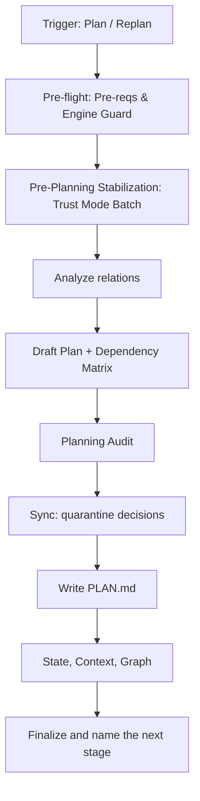

# Plan Workflow

Generates and revalidates `PLAN.md` (Phases → Specifications) and its `## Backlog`. Input: the specifications registered in `.magicspec/INDEX.md`. Decomposition into atomic tasks is `task.md`.

**Contents:**

- Entry
- Context Quality Guidance
- Argument Routing
- Core Invariants (Mandatory)
- Workflow: Planning
- Finalization Protocol (Mandatory)
- Plan Completion Checklist
- Handoffs

## Entry

**Triggers:** *"Create plan"*, *"Generate plan"*, *"Update plan"*, *"Replan"*, *"Revalidate the plan"*, *"Reorder phases"*, *"Postpone phase"*, *"Move phase"*, *"Split phase"*.

**Trigger:** `/magicspec plan [arg]`. Arguments:

- *(empty)* — revalidate the whole plan for the resolved workspace against the current registry and rules
- `{workspace}` — the same, scoped to one workspace
- `"text"` — guided replanning: an order or membership directive ("postpone phase 4", "move the auth specification before the API", "split phase 2", "only the new specifications")
- `{workspace} "text"` — scoped and guided

Examples: `/magicspec plan`, `/magicspec plan {workspace}`, `/magicspec plan "postpone phase 4"`, `/magicspec plan {workspace} "only the new specifications"`.

**Scope:**

- **Ownership (PL-1)**: this workflow owns the plan — phase membership, phase order, the backlog and its dispositions, the dependency matrix between specifications, the planning audit. It writes `PLAN.md` and nothing else of the task layer: never `TASKS.md`, a phase workbook or a tracking entry.
- **Reads**: the registry, the headers, overviews and invariants of the Stable specifications, the constitution, the plan with its backlog, the `provides` of finished phases, and a replan directive a later stage left for it (`## Replan Directive` of `TASKS.md`, while it records this plan's version). Not the whole body of a specification unless a step edits it.
- **Complete for the next stage (PL-9)**: the plan names, for each phase, its specifications, the order and the reason for it, the dependencies that order rests on, and for each backlog item its disposition — so `/magicspec task` decomposes the phase without reading what this workflow read. A missing record of an earlier stage is reported as a finding and never guessed.
- **Pipeline**: `/magicspec spec` → `/magicspec plan` → `/magicspec task` → `/magicspec run`. One stage per invocation: this workflow ends by recording its result in the files and naming the next command with its reasoning demand; it never starts `/magicspec task` itself, unless the request's own words asked for the following stage too.
- **Finalization**: after the plan write, run `node scripts/executor.js finalize --workflow=plan --workspace={active-workspace}` and display output verbatim. Never auto-commit. See `workflows/plan.md §Finalization Protocol`.

## Context Quality Guidance

Read economy is guidance, not a measurement: the agent has no reliable reading of its own context-window fill, so no tier or percentage is used here (see `context.md` §Context Budget Guard).

- Prefer the wiki, `INDEX.md`, `STATE.md` `Next Action` and the phase files' `provides` frontmatter before broad scans; read the relevant spec §sections rather than whole files.
- Once the context begins with a summary standing in for earlier turns, re-ground on `STATE.md` and the plan rather than on the summary (`context.md` §Post-Compaction Re-grounding).

## Argument Routing

Parse `[arg]` to determine the planning mode:

| Input | Detection | Result |
| --- | --- | --- |
| *(empty)* | No argument | **Revalidation**: resolve the workspace via `context.md` §Workspace Resolution Chain, then re-evaluate the whole plan (Step 8, Update Mode) |
| `{workspace}` | Matches a workspace name in `workspace.json` | **Scoped Revalidation**: only the specifications registered in that workspace's `INDEX.md` |
| `"postpone phase 4"` | Quoted text, or text that matches no workspace name | **Guided Replanning**: the text is an order or membership directive (focus, filter, instruction) |
| `{workspace} "only new specs"` | First token is a workspace, the rest is quoted text | **Scoped + Guided**: the directive applies within the workspace's scope |
| a replan directive left by `task` | `## Replan Directive` of `TASKS.md` records this plan's version | **Guided Replanning**: the directive is the argument; the invocation names it (`/magicspec plan {workspace} "{directive}"`) |

> **Workspace Fallback**: when no workspace is named, resolve via Core Invariant 1 before applying the directive. The plan is written for that one workspace; Step 2 (Pre-Planning Stabilization) still iterates every registered workspace, default first. The directive filters or guides planning but does not replace workspace resolution.
> **Disambiguation**: a single unquoted word that matches both a workspace name and a directive keyword → workspace takes priority. Force directive interpretation by quoting: `/magicspec plan "{workspace}"`.
> **A directive about decomposition** ("decompose phase-2", "smaller tasks") is not this workflow's: name `/magicspec task` with it as the one next step and write nothing.
> **Handoff Propagation**: when naming `/magicspec task` after planning, propagate the workspace context: `/magicspec task {workspace}`.

**Input Pass**: when the input carries prose — a directive, a report, a goal, the person's message that accompanies the command — run the Input Pass of `roles/prompt-engineer.md` (`@role:prompt-engineer`, section `## Input Pass`) first and act on its intent statement; arguments that are only names, flags or paths run no pass. A finding is resolved by the Consequence Forecast or a `<!-- TBD: … -->` marker where the work lands and narrated as one `[DR]` line, never asked (IP-5).

## Core Invariants (Mandatory)

1. **Context (Zero-Prompt)**: Apply [context.md](../references/context.md) as a whole — every section applies unless it names other workflows. Choose the workspace first, by the engine's chain (`context.md` §Workspace Resolution Chain): run `node scripts/executor.js resolve-workspace --command plan [--workspace {name}] --text "{request}"` (`--workspace` only when the invocation names a registered workspace; `{request}` is the rest of the argument, and when it is empty `--text` is left out: the script refuses an empty value), take its `Workspace:` line as the active workspace and print its `Narration:` line once.
2. **Registry Integrity**: Account for every spec registered in `INDEX.md` before planning — read the registry entries and the wiki, and open a spec body only where a step needs it. No spec may be left unaccounted for.
3. **Auto-Init**: If `.magicspec/` or system files missing, silently execute `references/init.md` (do not prompt user).
   - **Intent Preservation**: if `init.md` or `analyze.md` is sub-delegated during this workflow, memo the original user intent before delegating. After delegation resolves, resume explicitly: *"Resuming: '{original intent}'."* Intent MUST NOT be silently dropped across workflow boundaries.
4. **Logic Guards**:
   - **No Orphans**: every registered spec must be in `PLAN.md` or `## Backlog`.
   - **Auto-Plan (C9 default)**: automatically generate and write the plan without prompting. Narrate inline as the work happens — e.g., `[Auto-Plan] Phase 2: {N} specs → {short list}. (Adjust: /magicspec plan "{adjustment}" | Revert: git restore .magicspec/{ws}/PLAN.md)`. No "Go" confirm; no menu — a declarative proposal surface (DA-9), never a question (e.g. an `AskUserQuestion` call).
   - **One Stage**: after writing the plan, end the invocation. The next stage is named, never started (see Handoffs).
5. **Plan Record**: `PLAN.md` records the registry version it was written against (`**Based on:**`) and the constitution version (`**Based on RULES:**`); a plan whose recorded versions differ from the current ones is stale, and so is a plan in which a Stable specification is in neither a phase nor the backlog (PL-4). Add the `Based on RULES` line when the plan lacks it; notify the user of drift and re-sync during update.
6. **Engine Integrity (C14)**: If this skill folder is modified → `node scripts/executor.js update-engine-meta`.
7. **Architectural Logic**:
   - **Circular Guard (Semantic Split)**:
     - **Hard Dependencies** (`Implements:` chains, L2→L1): deep-scan across ALL levels. Any cycle → **HALT**. These are blocking dependencies that define build/planning order.
     - **Soft References** (`Related Specifications`): scan for mutual references. Cycles here are **warnings**, not HALTs — peer modules in the same layer commonly cross-reference each other (e.g., ECS core systems, networking subsystem). Log: `[Cycle-Info] {N} mutual references detected in Related Specifications (non-blocking).`
   - **Cycle Resolution** (Hard Dependencies only): suggest breaking the chain by identifying the "weakest link" — the edge that should be downgraded from `Implements` to `Related Specifications`.
   - **Layer Respect**: L1 (Concept) always scheduled BEFORE L2 (Implementation).
   - **Autonomous Selection (C6)**: **Default**: auto-pull ALL `Stable` specs into the active `PLAN.md`. Move `Draft`/`RFC` to `## Backlog`. No user prompt unless a priority conflict is detected.
   - **Guided Planning Filter**: when a directive is present (Guided / Scoped + Guided modes), restrict C6 selection to `Stable` specs whose filename, title, or content matches the directive (same matching approach as `analyze.md` Mode D Focus Directive). Non-matching `Stable` specs are left untouched in their current `PLAN.md`/Backlog placement — the directive narrows this invocation's scope, it does not reclassify specs it doesn't match. **Bootstrap interaction**: when the C6 Bootstrap Exception (below) activates, the filter applies identically to the Draft-spec pull — only MVC-passing Draft specs matching the directive are planned with `[Bootstrap]`; non-matching Draft specs stay untouched. **Stabilization interaction (C12.1)**: when the directive is the explicit request to stabilize or fix a spec, the spec it names is admitted whatever its status — it is planned with the marker `[Stabilize]` instead of being parked in Backlog — and counts as a match for the HALT below. The marker is the record `task` reads (`task.md` Decompose): a task is a stabilizing task only for a spec the plan marks so. Directive matches zero specs (Stable, Draft when Bootstrap is eligible, or named for stabilization) → **HALT**: *"Could not map planning directive '{text}' to any registered spec. Run `/magicspec plan {workspace}` for the whole plan, or author it first with `/magicspec spec`."*
   - **C6 Bootstrap Exception**: if, after Pre-Planning Stabilization (Step 2), **zero** specs reached `Stable` AND the project has **no prior `PLAN.md`** (file missing or contains zero active phase entries) → activate Bootstrap Mode. In Bootstrap Mode, `Draft` specs that pass MVC criteria (Overview + at least one design section) are treated as plannable with a `[Bootstrap]` marker. The generated plan is explicitly tentative: `[Bootstrap Plan] {N} Draft specs planned tentatively. Plan will be finalized when specs reach Stable.` Bootstrap Mode is automatically deactivated once ≥1 spec reaches `Stable` through normal lifecycle.
   - **Actionable Outcome**: after planning, show: `[Auto-Plan] {N} specs added to Phase {X}, {M} moved to Backlog.`
   - **Parent Header Parity (Cross-Workspace)**: when planning an L2 spec that implements an L1 parent in a DIFFERENT workspace, the agent MUST verify the parent's file header against its own workspace's `INDEX.md`. Drift (`STATUS_DRIFT`/`VERSION_DRIFT`) in the cross-workspace parent → **HALT**. Ensures L2 specs are never planned against mismatched L1 definitions.

## Workflow: Planning



### Steps

1. **Pre-flight**: `node scripts/executor.js check-prerequisites --json --require-specs --verify-headers --workspace={active-workspace}`.
   - **C15 Filter**: `ENGINE_INTEGRITY` or `GHOST_REGISTRY` → C15 Filter (`init.md §1`). In-scope → **HALT**. Out-of-scope → proceed silently.
   - **File-Header Parity**: for each spec in `INDEX.md`, read the actual file's `Status:` and `Version:` header fields. Either mismatches the corresponding `INDEX.md` entry → **HALT** with `STATUS_DRIFT` or `VERSION_DRIFT`. Report: *"Header parity failure on `{file}`: file {field} `{file_val}` ≠ registry `{index_val}`. Run `/magicspec spec` to reconcile spec headers, then re-run `/magicspec plan`."* Catches manual edits that bypassed the spec workflow.
   - **Cross-Workspace Parity**: if `workspace.json` registers >1 workspace, scan for identically-named spec files across workspaces. Any name collision with version mismatch → **HALT**. Report: *"Source of Truth Drift: `{file}` exists in `{ws-a}` (v{X}) and `{ws-b}` (v{Y}). Run `/magicspec spec` in `{ws-a}` (higher version) to reconcile, then re-run `/magicspec plan`."* One recommended path — no option menu.
   - **Cross-Workspace Parent Header Parity** (Pre-flight gate): for every L2 spec in the active workspace whose `Implements:` field references an L1 spec in a **different** workspace, read that parent's file header (`Status:`, `Version:`) and compare against the parent workspace's own `INDEX.md` entry. Mismatch → **HALT** with `STATUS_DRIFT` or `VERSION_DRIFT`. Report: *"Cross-workspace parent drift: `{parent-file}` in `{parent-ws}` — file header `{field}: {file_val}` ≠ registry `{index_val}`. Run `/magicspec spec` in `{parent-ws}` to reconcile, then re-run `/magicspec plan`."* Runs in Pre-flight (Step 1) — not deferred — to prevent planning against a drifted L1 parent before the plan is written.
   - **Design-Debt Backlog** (`DESIGN_DEBT_PENDING`, per SC-2.4): if `check-prerequisites` reports this warning type — plan complete (no active phase in `TASKS.md`) with ≥1 open item in `PLAN.md`'s `## Backlog` — **HALT**. Report: *"Backlog holds {N} item(s) needing design input — plan has no active phase to absorb them. Run `/magicspec spec {ws}` to author the queued specs, then re-run `/magicspec plan`."* This is the sanctioned door for `/magicspec spec` at plan-complete: every other mechanical gate above is clean by construction here, so without this check nothing would ever HALT and the persisted `Next Action` (SC-2.1(c)) would keep recommending the planning command itself — the command that just produced this exact HALT.
   - **Stable-Spec Requirement** (`--require-specs`): a `missing_required` entry naming `Stable specs` is **not** a HALT while the registry holds Draft or RFC specs — Pre-Planning Stabilization (Step 2) promotes the eligible ones and the C6 Bootstrap Exception covers the rest. An empty registry (`Stable specs (0 specs found)`) → **HALT**. Report: *"No specifications are registered. Run `/magicspec spec` to author the first one, then re-run `/magicspec plan`."* For an existing codebase (the `init.md` Step 4 indicators) the single recommendation is `/magicspec analyze first-time` instead. The report restates the original request (Core Invariant 3), so the intent survives the HALT.
   - **T4 Queue (Cross-Workflow)**: if the directive argument contains a T4 trigger phrase (`"remember that..."`, `"from now on..."`, `"project rule:"`) AND any Pre-flight gate above HALTs, acknowledge the embedded T4 explicitly: *"T4 rule detected — queued pending {drift_type} resolution. Will be handed to the Operational Logic of `rule.md` after resolution."* Do NOT write to `RULES.md` until Pre-flight passes on a subsequent invocation. Mirrors `spec.md §Updating → T4 Queue` semantics so a T4 phrase routed through `/magicspec plan` is never silently dropped.
2. **Pre-Planning Stabilization (Trust Mode Batch)**:
   - Iterate all `Draft` specs registered in `INDEX.md`, processing **L1 specs first**, then **L2 specs** (layer order is mandatory — an L2 spec cannot promote until its L1 parent is `Stable`). **Workspace order**: when multiple workspaces exist, process the `default` workspace first (per `workspace.json`), then remaining workspaces in registration order. Ensures foundational specs are promoted before consumer workspaces that depend on them.
   - For each spec, evaluate Trust Mode criteria from `spec.md`:
     - (a) No `RULES.md` conflicts.
     - (b) No hard-dependency cycles (per Circular Guard Semantic Split — soft reference cycles do NOT block promotion).
     - (c) Layer constraints satisfied (`Implements:` field present and valid for L2).
     - (d) **Minimum Viable Completeness (MVC)**: `Overview` + at least one design section (`Core Invariants` for L1, `Invariant Compliance` for L2, `Detailed Design`, or for non-standard layers like `test`/`tool` — any numbered section with substantive content). Full template compliance NOT required for Draft→Stable batch promotion — missing optional sections (`Drawbacks`, `Implementation Notes`) do not block.
   - **Promote**: specs passing all criteria → provisionally promoted `Draft → Stable`, updating both file headers and `INDEX.md` entries atomically. This batch IS `spec.md` Batch Stabilization (invoked from here); promoted specs are **subject to its Post-Update Review gate** (`@role:spec-critic` + `@role:prompt-engineer`) — a spec that fails the review reverts to `Draft`/`RFC` and is not left `Stable`.
   - **Skip**: specs failing any criterion remain `Draft` with a logged reason.
   - Report: `[Pre-Plan] {N} specs promoted to Stable, {M} remain Draft. Reasons: {summary}.`
   - **Field Normalization**: during iteration, if an L2 spec uses a non-standard field name for its L1 parent reference (e.g., `L1 Reference:` instead of `Implements:`), auto-rename to canonical `Implements:`. Log: `[Normalize] {file}: 'L1 Reference' → 'Implements'.`
3. **Analyze**: extract `Related Specifications` and `Implementation Notes`. Read the `provides` of finished phases (`tasks/phase-*.md` frontmatter, `archives/tasks/`) to see what earlier phases deliver; it supplements the plan's prose with machine-readable data.
4. **Draft Plan**: group by Layer. Build the full dependency matrix *before* the phases are fixed to detect N-level cycles. For each phase record its specifications, the order and why, and the dependencies that order rests on; for each backlog item its disposition (PL-9).
5. **Planning Audit**: activate `@role:planner` to review the draft `PLAN.md`. Audit for:
   - **Optimism Bias**: have the phases been sized too small for the work their specifications hold?
   - **Hidden Dependencies**: are the phases truly independent where the plan says so, or is there a shared resource/config bottleneck?
   - **Cascade Risk**: if a critical spec fails to implement in Phase 1, which Phase 2 specifications are instantly blocked?
   - **Plan check (CH-5)**: compare the draft with the other phases of the plan, with the plan of every other registered workspace and with what archived phases record as delivered, for an ordering conflict, a contradiction, a duplicate definition or an interaction gap (card step 6). An ordering conflict or a contradiction is resolved before the plan is written; work duplicated across workspaces is assigned to one of them and referenced from the other. A finding whose resolution needs a specification to change is not resolved here, because this workflow writes no specification → **HALT** once with the single recommendation. Report: *"Plan check: `{file-a}` §{x} ↔ `{file-b}` §{y} — {class}; resolving it changes a specification. Run `/magicspec spec`, then re-run `/magicspec plan`."* The check prints `[Coherence] {N} artifacts compared — {k} findings` and one line per finding.
6. **Sync (Update Mode)** — the planning decisions about a specification; applying them to tasks is `task.md`:
   - **C12 Quarantine**: if an L1 parent is not `Stable` in `INDEX.md` (status already changed by `spec.md` C12 cascade) → move its L2 children to `## Backlog` in `PLAN.md` with the reason *"L1 parent `{file}` is `{status}` (C12)"*. **Cross-Workspace C12**: if the L1 parent resides in a different workspace, verify its status by reading that parent workspace's `INDEX.md`. **Do NOT modify INDEX.md here** — downward C12/deprecation status changes are `spec.md`'s responsibility (this workflow writes only the upward `Draft → Stable` promotion in Step 2). **C12.1 Stabilization Exception**: only a spec the plan marks `[Stabilize]` (Guided Planning Filter) may bypass quarantine, and only that spec; every other child stays quarantined.
   - **Bootstrap Plan**: a spec carrying the `[Bootstrap]` marker is exempt from the C12 Quarantine above and from Demoted Spec below while it is `Draft` — a Bootstrap plan is tentative by construction (C6 Bootstrap Exception), so a spec and its `Draft` L1 parent are planned together before either is `Stable`. Once the spec leaves `Draft`, both rules judge it like any other.
   - **Demoted Spec**: a spec that is in the plan but no longer `Stable` in `INDEX.md` (an amendment or a status edit moved it to `RFC` or `Draft` after the plan was written) → move it to `## Backlog` in `PLAN.md` with the reason *"Spec `{file}` is `{status}`"*. **C12.1** applies as for a quarantined child. Like C12, this never modifies `INDEX.md`.
   - **Quarantine Release**: when a spec held by C12 or by Demoted Spec is `Stable` again (for C12, with its L1 parent `Stable` too), it returns to the active plan under C6.
   - **Phantom Specs**: a spec in `PLAN.md`/`INDEX.md` but missing from disk → move it to `## Backlog` with the reason *"Phantom: missing from disk"*.
   - **Phantom Parent Guard**: an L2 spec's parent missing from disk or `INDEX.md` (cross-workspace or local) → **HALT**. Report: *"Parent Spec `{parent-file}` (L1) is missing. Cannot plan dependent `{file}` (L2). Run `/magicspec spec` to author the missing parent, then re-run `/magicspec plan`."* Move the L2 to `## Backlog` with the reason *"Missing L1 Parent (Phantom)."*
   - **Renames**: global search-and-replace of a renamed specification's file name in `PLAN.md` (exclude archives). Ensure new names follow the `l1-`/`l2-` prefix convention. The matching task references are `task.md`'s.

### Plan Write-back

- Use `templates/plan.md`. `PLAN.md`: the strategic overview (Phases & Specifications) with its header — version, `Generated`, `Based on` (registry), `Based on RULES` (constitution) — and no atomic checklist items.
- Write nothing else of the task layer (PL-1): `TASKS.md`, the phase workbooks and every tracking entry stay as they are. A task whose specification leaves the active plan keeps its recorded state (PL-7); `task` blocks it with the reason this plan records.

### State Init/Update

After `PLAN.md` is written:

- If `STATE.md` does not exist → it will be created by `init.md` automatically (always called first).
- Update STATE.md to reflect the new plan:
  `node scripts/executor.js update-state --workspace={active-workspace} --phase="{N} — {Phase Name}" --status=Active --next-action="Run /magicspec task {active-workspace} to decompose Phase {N}"`
- On a revalidation that changed nothing the active or next phase holds, patch `--next-action` to the step the plan state computes (SC-2.1).

### Context Regeneration

After writing `PLAN.md`, regenerate the workspace context file:
`node scripts/executor.js generate-context --workspace={active-workspace}`

### Graph Refresh (Post-Write)

`PLAN.md` phases are graph nodes; plan mutations invalidate the spec graph and wiki. After the plan write and Context Regeneration, run **once per planning invocation**:

```bash
node scripts/executor.js export-wiki
```

Best-effort — log `[Graph-Refresh] export-wiki failed: {err}. Wiki may be stale.` on failure and continue. Skip in a pure dependency-graph audit (no plan written).

**Read-side tip (planning)**: before building the dependency matrix in Step 3, prefer reading `.magicspec/graph/wiki/index.md` and per-spec wiki articles over scanning every raw spec file. The wiki gives layer/status/version/refs at ~10× lower token cost than full spec reads. Fall back to direct `.magicspec/specifications/` reads only when the wiki is absent or `WIKI_STALE` was reported by the most recent `analyze` Mode C run.

## Finalization Protocol (Mandatory)

After all workflow steps (incl. Context Regeneration + Graph Refresh) and **before** the Completion Checklist:

1. Run `node scripts/executor.js finalize --workflow=plan --workspace={active-workspace}`. Output is either `✅ Finalization complete` (with version bump + CHANGELOG entry) or `⏭️ No significant changes detected`.
2. **Display the entire script output verbatim** in a fenced block. It ends with the handoff line — `Next: /magicspec {command} {argument} — {demand} reasoning` — printed once by the script, after the step it summarizes and before the Completion Checklist. The demand is advice for whoever chooses the model: never a warning and never a condition of running.
3. Script exit non-zero → emit WARNING, do NOT block the Completion Checklist.

**Opt-out**: `MAGIC_FINALIZE=0` env var, or `finalization.enabled = false` in `.magicspec/workspace.json`.

## Plan Completion Checklist

```
Plan Workflow Checklist — {operation}
  ☐ Workspace Routing: `resolve-workspace` chose the workspace before any workspace file was read; with more than one workspace registered its line `[Workspace] {name} — {signal}. (Override: /magicspec {command} {other} …)` was printed once
  ☐ All registered specs read; no orphans/phantoms left unaddressed
  ☐ Pre-Planning Stabilization: Trust Mode batch applied (L1→L2 order); field normalization done
  ☐ Stabilization Review: batch-promoted specs passed `spec.md` Post-Update Review gate; review failures reverted (not left Stable)
  ☐ Circular Guard: hard-dependency cycles checked (Implements chains); soft reference cycles logged
  ☐ Selective Planning (C6) and Quarantine (C12) applied; Bootstrap Exception evaluated if needed
  ☐ Planning Audit: Draft Plan reviewed by `@role:planner` (Optimism, Dependencies, Risk)
  ☐ Plan check (CH-5): draft compared with the other phases, the other workspaces' plans and the archived deliveries; findings resolved before write-back or halted once with `/magicspec spec`; result line printed
  ☐ Plan Record: PLAN.md carries the registry and constitution versions it was written against
  ☐ Complete for the next stage: each phase names its specifications, order and reason, dependencies; each backlog item its disposition (PL-9)
  ☐ Ownership: PLAN.md was the only plan or task file written; TASKS.md and the phase workbooks are untouched (PL-1)
  ☐ STATE.md updated with the new phase and next action; CONTEXT.md regenerated
  ☐ Graph: export-wiki run after the plan write (skip if no plan written)
  ☐ Engine Meta: C14 bump performed if files of this skill folder were modified
  ☐ One stage: the next command was named with its reasoning demand and not started; the request's own words did not ask for it
  ☐ Engineer Posture (C25): plan auto-written and narrated; no "Go" prompts
  ☐ Decision Autonomy (C27): elective forks resolved as [DR] one-liners; next step computed and narrated (DA-6), never asked; questions only for consent (E1, E2, E4), the intake survey (E6) or the command intake at the invocation (E7)
```

## Handoffs

Where this workflow may hand over, and when:

- **Decompose into tasks** → `/magicspec task`: name it, with the workspace, as the next step when the plan changed anything the active or next phase holds (PL-5). It is named in the handoff line with its reasoning demand and not started here. Condition: `plan_changed`.
- **Author what the plan cannot place** → `/magicspec spec`: surfaces only inside a HALT of Step 1, Step 5 (the plan check) or Step 6, with its one recommendation.
