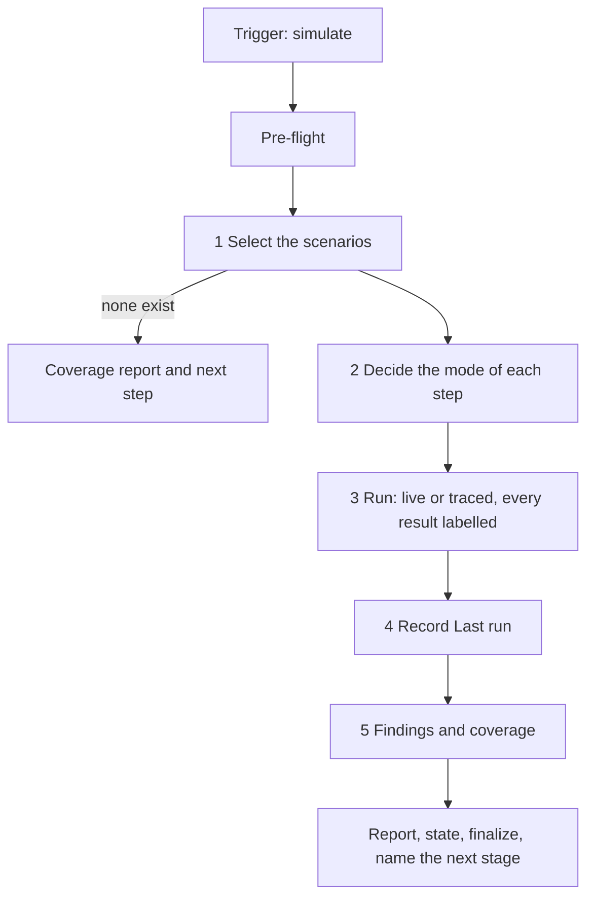

# Simulate Workflow

Runs the written scenarios of users interacting with the product, acting as those users, and reports where the product does not behave as its specifications say. Scenarios live in `.magicspec/{workspace}/simulations/` (`templates/simulation.md`); they are written when the work is planned and kept current by the tasks that change user-facing behaviour. This workflow executes them: live when the product can be started and driven in the session, traced through the code and the specifications when it cannot, and every result says which. Each failed or inconclusive step is a finding; nothing in the product is changed.

**Contents:**

- Entry
- Argument Routing
- Core Invariants (Mandatory)
- Workflow: Simulation
- Report
- Finalization Protocol (Mandatory)
- Simulate Completion Checklist
- Handoffs

## Entry

**Triggers:** *"Simulate the users"*, *"Run the scenarios"*, *"Walk through the user journeys"*, *"Test the product as a user"*, *"Check the user flows"*, *"Simulate"*.

**Trigger:** `/magicspec simulate [scope]`. The scope is optional. Arguments:

- *(empty)* — every scenario of the resolved workspace
- `{area}` — the scenarios of one file, `.magicspec/{workspace}/simulations/{area}.md`
- `"{feature or specification}"` — the scenarios that verify it
- `--live-only` — steps that cannot run live are skipped and listed, never traced
- `{workspace} …` — any of the above in a specific workspace

Examples: `/magicspec simulate`, `/magicspec simulate {area}`, `/magicspec simulate "checkout"`, `/magicspec simulate {workspace} --live-only`.

**Scope:**

- **Ownership**: this workflow writes scenario files, and only the `Last run` record of each scenario it ran. It never writes product code, specifications, `PLAN.md` or the task layer.
- **Reads**: the scenarios, the specification statements they verify and the statements about user-facing behaviour no scenario covers, and — when a step is traced — the code that implements it. A missing record of an earlier stage is reported as a finding and never guessed.
- **Asks nothing**, except one consent question before a step with an external side effect runs live (Core Invariant 4, E1).
- **Pipeline**: `simulate` feeds back into `/magicspec fix`. One stage per invocation: this workflow ends by recording its findings in the scenario files and naming one next command with its reasoning demand, and never starts it.
- **Finalization**: after the run, run `node scripts/executor.js finalize --workflow=simulate --workspace={active-workspace}` and display output verbatim. Never auto-commit. See `workflows/simulate.md §Finalization Protocol`.

## Argument Routing

| Input | Detection | Result |
| --- | --- | --- |
| *(empty)* | No argument | **Every scenario** of the workspace the routing chain chooses |
| `{area}` | Matches the name of a file in the workspace's `simulations/` folder | **One area**: that file's scenarios |
| `"{feature or specification}"` | Quoted text, or text that matches neither a workspace nor an area | **By topic**: the scenarios whose `Verifies` statements or titles match the text; none match → report it, run nothing |
| `--live-only` | The flag | **Live only**: a step the session cannot drive live is `skipped` and listed |
| `{workspace} …` | First token is a workspace | **Scoped**: the same, in that workspace |

> **Disambiguation**: a single unquoted word that matches both a workspace and an area → workspace takes priority; force the area by naming its file (`{area}.md`) or the topic by quoting it.
> **A directive about order or membership** ("postpone", "plan the scenarios") is not this workflow's: name `/magicspec plan` with it as the one next step and write nothing.

**Input Pass**: when the input carries prose — a directive, a report, a goal, the person's message that accompanies the command — run the Input Pass of `roles/prompt-engineer.md` (`@role:prompt-engineer`, section `## Input Pass`) first and act on its intent statement; arguments that are only names, flags or paths run no pass. A finding is resolved by the Consequence Forecast or a `<!-- TBD: … -->` marker where the work lands and narrated as one `[DR]` line, never asked (IP-5). A quoted feature or specification runs the pass; an area name, a workspace and `--live-only` are names and flags and run none.

## Core Invariants (Mandatory)

1. **Context (Zero-Prompt)**: Apply [context.md](../references/context.md) as a whole — every section applies unless it names other workflows. Choose the workspace first, by the engine's chain (`context.md` §Workspace Resolution Chain): run `node scripts/executor.js resolve-workspace --command simulate [--workspace {name}] --text "{request}"` (`--workspace` only when the invocation names a registered workspace; `{request}` is the rest of the argument, and when it is empty `--text` is left out: the script refuses an empty value), take its `Workspace:` line as the active workspace and print its `Narration:` line once.
2. **Rules First**: read the constitution (`RULES.md`, global and workspace) and `STATE.md` before the run; `Blockers` and `Blocking Constraints` are acknowledged as in `run.md`.
3. **Auto-Init**: if `.magicspec/` or system files are missing, silently execute `references/init.md` (do not prompt the user).
4. **Logic Guards**:
   - **Written from the specifications**: a step's expected outcome is judged against what a specification states. A step whose expectation no specification states is not judged by the code's behaviour: it is a specification gap, reported as a finding.
   - **Two modes, always labelled**: every step result carries `live` or `traced`. A traced `pass` is weaker evidence than a live one and is reported as such; it is never counted as a live pass.
   - **Safety**: a step runs live only against a local or disposable instance of the product, started in this session or named by the scenario's preconditions as disposable. A step against anything else — a shared, staging or production system, real accounts, real money, real messages to people — is never run live. A step with an external side effect (sending, paying, deleting data outside a disposable instance) runs live only after one consent question (E1): one question, at most three fixed options — skip it (the default, the irreversible side being the worse error), trace it, run it live. Under `--live-only` the options are skip and run it live.
   - **Findings, not patches**: no product file, specification or test is changed. Each failed or inconclusive step becomes a finding, written into the scenario's `Last run` record.
   - **Containment**: scenario files are SDD artifacts; the product never references them, and nothing written into the product's tree names a scenario, a task or a specification (`CONSTITUTION.md` §6).
   - **One Stage**: after the report, end the invocation. The next stage is named, never started.
5. **Engine Integrity (C14)**: if this skill folder is modified → `node scripts/executor.js update-engine-meta`.

## Workflow: Simulation



### Steps

1. **Pre-flight**: `node scripts/executor.js check-prerequisites --json --verify-headers --workspace={active-workspace}`.
   - **C15 Filter**: `ENGINE_INTEGRITY` or `GHOST_REGISTRY` → C15 Filter (`init.md §1`). In-scope → **HALT**. Out-of-scope → proceed silently.
   - **Select**: read the scenario files the scope names. No `simulations/` folder, no file, or no match → nothing runs: print the coverage report (Step 5) with every user-facing statement unverified and name `/magicspec plan {workspace}` as the next step (scenarios are planned with the work). Nothing is written.
2. **Decide the mode** of each step. Activate `@role:simulator-tester`. A step is *live* when the product can be started and driven in this session (a command run, a request sent, an interface operated through a tool the host provides) and the instance is local or disposable (Safety); otherwise it is *traced*, or — under `--live-only` — `skipped`. Find how the product starts from its own documentation and manifest; where none is found, every step is traced and the report says why.
3. **Run** each scenario, as its actor, from its preconditions, step by step: perform the action (live) or follow it through the code and the specifications (traced), then compare the observable outcome with the step's expectation. A step's result is `pass`, `fail` (the outcome differs from the expectation), `inconclusive` (it could not be observed or traced to an outcome) or `skipped`. A failed step does not stop the scenario unless a later step depends on its outcome; those later steps are `skipped` with that reason. Evidence quoted in a result follows the Evidence Capsule (`context.md §Read Hygiene`): the command or request, its outcome and at most three findings, never raw output.
4. **Record** the run in each scenario's `Last run`: the date, the product's version (from its own version file, else `unversioned`) and one line per step in the layout of `templates/simulation.md` — the result, the mode, and for a failed or inconclusive step the observed outcome. Only these lines are written; a scenario's steps, actor and expectations are never edited here.
5. **Findings and coverage**:
   - Each failed or inconclusive step is a finding: the scenario, the step, the expected outcome, the observed outcome and the mode. A step whose expectation no specification states is a finding of the class *specification gap*.
   - **Coverage report**: list the specification statements about user-facing behaviour — found by searching the specifications' text for what a person sees or does, not read from the graph — that no scenario verifies, with the specification section of each.
   - Where the scenarios cite a statement a specification no longer makes, or a step contradicts a statement it cites, the finding is `scenario out of date`.

## Report

End the invocation with one report in this layout, then the finalization output:

```plaintext
[Simulate] {s} scenarios, {n} steps → {p} passed, {f} failed, {i} inconclusive, {k} skipped ({l} live, {t} traced)
  {scenario} step {n} — {fail | inconclusive} — expected: {outcome} — observed: {outcome} — {live | traced}
  Coverage: {c} user-facing statements verified, {g} with no scenario
Next: {one command}
```

`{scenario}` is the scenario's identifier and its title. One line per finding; none → the line `No findings.` A traced pass is counted under `{t}` and never under `{l}`. The `Next:` line is the handoff line `finalize` prints: `/magicspec fix` with the findings when there are any, otherwise the command the pipeline state computes.

## Finalization Protocol (Mandatory)

After the report and **before** the Completion Checklist:

1. Run `node scripts/executor.js finalize --workflow=simulate --workspace={active-workspace}`. Output is either `✅ Finalization complete` (with version bump + CHANGELOG entry) or `⏭️ No significant changes detected`.
2. **Display the entire script output verbatim** in a fenced block. It ends with the handoff line — `Next: /magicspec {command} {argument} — {demand} reasoning` — printed once by the script. The demand is advice for whoever chooses the model: never a warning and never a condition of running.
3. Script exit non-zero → emit WARNING, do NOT block the Completion Checklist.

**Opt-out**: `MAGIC_FINALIZE=0` env var, or `finalization.enabled = false` in `.magicspec/workspace.json`.

## Simulate Completion Checklist

```
Simulate Workflow Checklist — {operation}
  ☐ Workspace Routing: `resolve-workspace` chose the workspace before any workspace file was read; with more than one workspace registered its line `[Workspace] {name} — {signal}. (Override: /magicspec {command} {other} …)` was printed once
  ☐ Scenarios selected by the scope; none found → nothing run, the coverage report printed and `/magicspec plan` named
  ☐ Every step result carries its mode; a traced pass reported as weaker evidence and never counted as live
  ☐ Safety: no step ran live against anything but a local or disposable instance; a side-effecting step ran live only after its one consent question
  ☐ Expectations judged against the specifications; a step no specification states is a specification-gap finding
  ☐ `Last run` written for every scenario that ran (date, product version, one line per step); nothing else of a scenario edited
  ☐ Findings, not patches: no product file, specification or test changed
  ☐ Coverage report: the user-facing statements no scenario verifies, with their sections
  ☐ Report printed in the layout above; the handoff line printed once, by finalization
  ☐ Engine Meta: C14 bump performed if files of this skill folder were modified
  ☐ One stage: the next command was named with its reasoning demand and not started
  ☐ Engineer Posture (C25): the run narrated; no "Go" prompts
  ☐ Decision Autonomy (C27): elective forks resolved as [DR] one-liners; next step computed and narrated (DA-6), never asked; questions only for consent (E1, E2, E4), the intake survey (E6) or the command intake at the invocation (E7)
```

## Handoffs

Where this workflow may hand over, and when:

- **Repair what failed** → `/magicspec fix`: name it, with the workspace, when the run has findings; the findings are read from the scenarios' `Last run` records. Condition: `findings`.
- **Plan the scenarios** → `/magicspec plan`: name it, with the workspace, when no scenario exists or a phase with user-facing behaviour has none. Condition: `no_scenarios`.
- **Nothing to repair** → name the command the pipeline state computes (`finalize` prints it).
