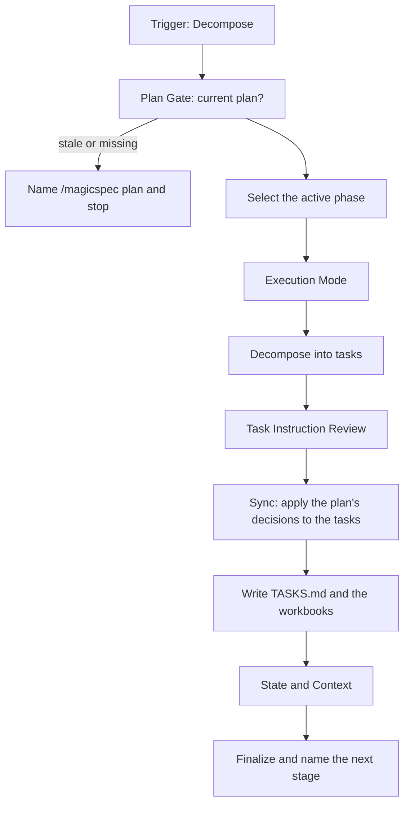

# Task Workflow

Decomposes a planned phase into atomic tasks: writes `TASKS.md` (the ledger) and `tasks/phase-{n}.md` (the workbooks). Input: `PLAN.md` and the specifications its active phase holds. The plan itself — phases, order, backlog — is `plan.md`.

**Contents:**

- Entry
- Context Quality Guidance
- Argument Routing
- Core Invariants (Mandatory)
- Workflow: Decomposition
- Finalization Protocol (Mandatory)
- Task Completion Checklist
- Handoffs

## Entry

**Triggers:** *"Generate tasks"*, *"Create tasks"*, *"Update tasks"*, *"Sync tasks"*, *"Decompose phase"*, *"Break down the phase"*, *"Smaller tasks"*.

**Trigger:** `/magicspec task [arg]`. Arguments:

- *(empty)* — decompose the active phase for the resolved workspace
- `{workspace}` — decompose the active phase of a specific workspace
- `update` — an alias of `/magicspec plan`, kept for habit (`{workspace} update` scopes it): say in one line that `update` is the plan's revalidation, run `workflows/plan.md` and end as it does, naming `/magicspec task`
- `"text"` — guided decomposition: a directive about decomposition ("decompose phase-2 in more detail", "smaller tasks", "validation tasks only")
- `{workspace} "text"` — scoped + guided decomposition

Examples: `/magicspec task`, `/magicspec task {workspace}`, `/magicspec task "decompose phase-2 in more detail"`, `/magicspec task {workspace} "validation tasks only"`.

**Scope:**

- **Ownership (PL-1)**: this workflow owns decomposition — task identifiers, tracks, verify lines, validation tasks, the tracking entries and their state transitions. It writes `TASKS.md` and the phase workbooks and never `PLAN.md`.
- **Reads**: the plan's active (or next) phase, the sections of the specifications that phase holds, the constitution, and the ledger and workbooks it updates. Not the whole body of a specification unless a step edits it.
- **Complete for the next stage (PL-9)**: each task names the specification section it implements and its `Verify` line, so `/magicspec run` executes it without reading the plan. A missing record of an earlier stage is reported as a finding and never guessed.
- **A directive about order or membership** ("postpone", "move before", "split phase", "only the new specifications") is not this workflow's: name `/magicspec plan` with it as the one next step and write nothing.
- **Rules Parity**: `RULES.md` version must be recorded in the `TASKS.md` header.
- **Pipeline**: `/magicspec spec` → `/magicspec plan` → `/magicspec task` → `/magicspec run`. One stage per invocation: this workflow ends by recording its result in the files and naming the next command with its reasoning demand; it never starts `/magicspec run` itself, unless the request's own words asked for the following stage too.
- **Finalization**: after the ledger write, run `node scripts/executor.js finalize --workflow=task --workspace={active-workspace}` and display output verbatim. Never auto-commit. See `workflows/task.md §Finalization Protocol`.

## Context Quality Guidance

Read economy is guidance, not a measurement: the agent has no reliable reading of its own context-window fill, so no tier or percentage is used here (see `context.md` §Context Budget Guard).

- Prefer the wiki, `INDEX.md`, `STATE.md` `Next Action` and the phase files' `provides` frontmatter before broad scans; read the relevant spec §sections rather than whole files unless the step edits the whole file.
- Once the context begins with a summary standing in for earlier turns, re-ground on `STATE.md` and the phase files rather than on the summary (`context.md` §Post-Compaction Re-grounding).

## Argument Routing

Parse `[arg]` to determine the decomposition mode:

| Input | Detection | Result |
| --- | --- | --- |
| *(empty)* | No argument | **Active Phase**: resolve the workspace via `context.md` §Workspace Resolution Chain, then decompose its active phase |
| `{workspace}` | Matches a workspace name in `workspace.json` | **Scoped**: decompose the active phase of that workspace |
| `update` | Reserved keyword, unquoted and not a workspace name (also `{workspace} update`) | **Plan alias**: the plan's revalidation, `workflows/plan.md` (see Entry); it is a mode, not a directive, so no decomposition directive ever applies to it |
| `"decompose phase-2"` | Quoted text, or text that matches neither a workspace name nor `update` | **Guided**: interpret text as a decomposition directive (focus, instruction, filter) |
| `{workspace} "only tests"` | First token is a workspace + remaining is quoted text | **Scoped + Guided**: the directive applied within the workspace |

> **Workspace Fallback**: when no workspace is specified, resolve via Core Invariant 1 (Zero-Prompt chain) before applying the directive. The directive filters or guides decomposition but does not replace workspace resolution.
> **Disambiguation**: a single unquoted word that matches both a workspace name and a directive keyword → workspace takes priority. Force directive interpretation by quoting: `/magicspec task "{workspace}"`. The same quoting turns `update` into a directive: `/magicspec task "update"`.
> **Handoff Propagation**: when naming `/magicspec run` after decomposition, propagate the workspace context: `/magicspec run {workspace}`.

**Input Pass**: when the input carries prose — a directive, a report, a goal, the person's message that accompanies the command — run the Input Pass of `roles/prompt-engineer.md` (`@role:prompt-engineer`, section `## Input Pass`) first and act on its intent statement; arguments that are only names, flags or paths run no pass. A finding is resolved by the Consequence Forecast or a `<!-- TBD: … -->` marker where the work lands and narrated as one `[DR]` line, never asked (IP-5). A clause the pass sets aside as a project rule (`"remember that…"`, `"from now on…"`, `"project rule:"`) goes to the T4 Capture of Core Invariant 4, as before.

## Core Invariants (Mandatory)

1. **Context (Zero-Prompt)**: Apply [context.md](../references/context.md) as a whole — every section applies unless it names other workflows. Choose the workspace first, by the engine's chain (`context.md` §Workspace Resolution Chain): run `node scripts/executor.js resolve-workspace --command task [--workspace {name}] --text "{request}"` (`--workspace` only when the invocation names a registered workspace; `{request}` is the rest of the argument, and when it is empty `--text` is left out: the script refuses an empty value), take its `Workspace:` line as the active workspace and print its `Narration:` line once.
2. **Plan Integrity**: Account for every specification the active phase holds before decomposing — read the plan's phase entry and the wiki, and open a spec body only where a step needs it. No specification of the phase may be left without tasks.
3. **Auto-Init**: If `.magicspec/` or system files missing, silently execute `references/init.md` (do not prompt user).
   - **Intent Preservation**: if `init.md` or `analyze.md` is sub-delegated during this workflow, memo the original user intent before delegating. After delegation resolves, resume explicitly: *"Resuming: '{original intent}'."* Intent MUST NOT be silently dropped across workflow boundaries.
4. **Logic Guards**:
   - **Plan Gate (PL-4)**: the plan is missing, or stale — its recorded registry or constitution version differs from the current one, or a Stable specification is in neither a phase nor the backlog. Then `task` decomposes nothing, writes nothing and ends with `/magicspec plan {workspace}` as its next step, naming why (which version moved, which specification is unplanned). The plan's own pre-flight findings (`SYNC_GAP`, `ORPHANED_SPEC`, a header or parent drift, `DESIGN_DEBT_PENDING`, an engine integrity finding) are judged by `plan`: seeing one, end the same way and name it.
   - **Atomic Tasks (C10)**: every specification of the active phase must have a concise checklist in **`TASKS.md`** (Phase Checklist) with `T-XXXX` IDs.
   - **Auto-Decompose (C9 default)**: automatically generate and write the tasks without prompting. Narrate inline as the work happens — e.g., `[Auto-Tasks] Phase 2: {N} tasks in {K} tracks. (Adjust: /magicspec task "{adjustment}" | Revert: git restore .magicspec/{ws}/TASKS.md)`. No "Go" confirm; no menu — a declarative proposal surface (DA-9), never a question (e.g. an `AskUserQuestion` call).
   - **One Stage**: after writing the ledger, end the invocation. The next stage is named, never started: when the current phase holds a `Todo` or `In Progress` task it is `/magicspec run`. A phase left with only `Blocked [!]` tasks would Stall `/magicspec run` at once, so the Sync step ends with its Stalled Plan report instead.
   - **Findings Go Back (PL-8)**: when decomposition finds that a phase cannot be decomposed as planned — a specification too large for one phase, a dependency between specifications the plan does not state, a phase order that the tasks' dependencies contradict, a specification whose content leaves a task without a verifiable outcome — `task` changes nothing in the plan (PL-1). It decomposes the phases the finding does not touch, records the finding as a replan directive in the ledger (see Plan Write-back) and ends with `/magicspec plan {workspace} "{directive}"` as its next step. A finding that needs a specification change is routed by `plan` to `/magicspec spec amend` in its own report.
   - **T4 Capture**: a directive that contains a T4 trigger phrase (`"remember that..."`, `"from now on..."`, `"project rule:"`) is handed to the Operational Logic of `rule.md` before decomposition, so such a phrase is never silently dropped; the decomposition proceeds on the rest.
5. **Rules Parity**: Record the current `RULES.md` version in the `TASKS.md` header. Notify the user of drift and re-sync during update.
6. **Engine Integrity (C14)**: If this skill folder is modified → `node scripts/executor.js update-engine-meta`.

## Workflow: Decomposition



### Steps

1. **Plan Gate**: `node scripts/executor.js check-prerequisites --json --require-specs --require-plan --workspace={active-workspace}` and the staleness test of Core Invariant 4 (`missing_required` naming `PLAN.md` is the missing plan, reported by the script). Stale or missing plan, or a finding `plan` owns → end naming `/magicspec plan {workspace}` (nothing written). Otherwise proceed.
2. **Select the Phase**: the phase `TASKS.md` marks `In Progress`; otherwise the first phase of `PLAN.md`, in order, whose specifications are not all decomposed. A directive may name another (`phase-3`). A specification the plan places in `## Backlog` is not decomposed.
3. **Execution Mode**: default to **Parallel mode (C3)**. If mode is not defined in `RULES.md §7`, assume Parallel (do not ask).
4. **Decompose**: split the active phase into 2-3 tasks per spec.
   - **IDs**: `T-{phase}{track}{seq}` (e.g., `T-1A01`).
   - **Tracks**: group tasks by file independence.
   - **Verify Line (Mandatory)**: every atomic task MUST include a `Verify` line with a concrete command, check, or evidence source. Vague criteria such as "works", "verify manually", or "covered by tests" are invalid unless the specific test/check is named.
   - **Testing (Mandatory)**: every feature track MUST include at least one `Validation Task` (e.g., `T-1T01`) to verify implementation vs spec.
   - **Stabilizing Tasks (C12.1)**: every task that targets a specification the plan marks `[Stabilize]` carries the flag `stabilizes: {spec-file}` in its tracking entry. The flag comes from the plan's marker and from nothing else — never from the request in the conversation, never inferred from a title or a description — and a task without it is never a stabilizing task.
   - **Bootstrap Tasks**: every task of a specification the plan marks `[Bootstrap]` carries the same marker.
5. **Task Instruction Review**: after the decomposition and before the write-back, activate `@role:prompt-engineer` over the generated task descriptions, `Verify` lines, and phase notes — the instruction text `run.md` executors receive. Six-dimension review per the PQ-3 taxonomy. Verdict per PQ-6: FAIL → revise the task units before write-back; PASS-WITH-REWRITES → apply rewrites inline; PASS → proceed.
6. **Sync (Update Mode)** — applying the plan's decisions to the tasks; whether a specification is in the plan is `plan.md`'s:
   - **Blocking a quarantined specification's tasks**: a specification the plan moved to `## Backlog` with the reason *"L1 parent `{file}` is `{status}` (C12)"* → its tasks not already `Done` become `Blocked [!]` (a `Status` value — the checklist line stays `- [ ]`) with that reason. **Cross-workspace**: the reason names the parent in its workspace. Only a task carrying the `stabilizes: {spec-file}` flag (Step 4) may bypass the block, and only for the specification the flag names; every other task stays blocked.
   - **Bootstrap exemption**: a task carrying the `[Bootstrap]` marker is exempt from this blocking and from the next one while its specification is `Draft` — a Bootstrap plan is tentative by construction, so a specification and its `Draft` L1 parent are decomposed together before either is `Stable`. Once the specification leaves `Draft`, both rules judge its tasks like any other.
   - **Blocking a demoted specification's tasks**: a specification the plan moved to `## Backlog` with the reason *"Spec `{file}` is `{status}`"* → its `Done` tasks keep their tracking entries, every other task not already `Blocked [!]` becomes `Blocked [!]` with that reason (a task blocked for another reason keeps that reason). The `stabilizes:` exception applies as above.
   - **Releasing a block**: when the plan returned a specification it had held to the active phase, the tasks blocked by that quarantine reason return to `Todo` — the reverse of the block, applied to the same tasks. A task blocked for any other reason is untouched.
   - **Missing specifications**: a specification the plan moved to `## Backlog` as *"Phantom: missing from disk"* → cancel its `Todo`/`Pending` tasks, archive its `Done` ones, block its active ones.
   - **Structural Refactor**: if sections merged or split, validate all `T-{ID}` mappings to §sections. Re-map in TASKS.md & phase files. **ID Splitting**: keep original `T-{ID}` for the first sub-task; append `.N` suffixes (e.g., `T-1A01.1`, `T-1A01.2`) for others. A renamed specification's file name is re-mapped in the ledger and the workbooks (exclude archives).
   - **Stalled Plan**: after the rules above, the current phase has no `Todo` or `In Progress` task but ≥1 `Blocked [!]` task → **HALT** after the ledger is written, with no handoff to `/magicspec run` (it would only Stall). Report each blocked task with its recorded reason, then exactly ONE next step, the one for the first blocked task in checklist order: a reason that names a specification gap (the spec is not `Stable`, or its content is ambiguous, conflicting or missing) ends *"Spec `{file}` requires design input: `{reason}`. Run `/magicspec spec`, then re-run `/magicspec plan`."* (`AGENT-RULES.md §5`); any other reason ends with the resolution its `Notes` or `Handoff` names. This workflow releases only the blocks it owns — a block it does not own is lifted by setting its task's `Status` to `Todo` once the cause is resolved, and `/magicspec run` then selects it.

### Plan Write-back

- Use `templates/tasks.md` and `templates/phase.md`.
- TASKS.md: master Phase Index. Contains the phase registry and status tracking, and records the plan version it was decomposed from (`Based on PLAN`) and the constitution version (`Based on RULES`). Its `Overview` says what the file is and how to read it and tracks nothing: the active phase is the phase table's status column, and what a finished phase produced lives in its phase file, the workspace changelog and the archive. Nobody appends to the `Overview` or rewrites it as the plan moves.
- tasks/phase-{n}.md: tactical execution workbooks. Contain atomic checklists (T-XXXX) for specific phases.
- **Never `PLAN.md`** (PL-1): a task whose specification leaves the active plan keeps its recorded state (PL-7) and is blocked with the reason the plan records.
- **Replan Directive**: a finding of Core Invariant 4 ("Findings Go Back") is written as a section `## Replan Directive` of `TASKS.md` with two fields — `**Plan version:**` (the version of `PLAN.md` at that moment) and `**Directive:**` (what, where, and the change it suggests, in plain words). It is pending only while `PLAN.md`'s version equals the recorded one: a plan rewritten since retires it, and `plan` never writes this file. A decomposition that completes without a finding removes a stale section; the next-step computation (`finalize`) reads a pending one as `/magicspec plan {workspace} "{directive}"`.
- **Preserve recorded task state (Update mode)**: when a phase workbook is regenerated or updated, every task ID that survives the rewrite keeps its tracking entry's `Status` (including `In Progress`), `Changes` and `Attempts` **verbatim** — they record work already done or attempted, and a rewrite that resets them erases exactly what a resuming session needs. Only new task IDs receive fresh template entries; a removed ID leaves with its entry. Only Step 6's explicit transitions change a surviving entry's `Status` — the blocks of a quarantined or demoted specification, the cancellation for a missing one, and the way back, the release of a block.
- **Phase Frontmatter**: when creating `tasks/phase-{N}.md`, populate the YAML frontmatter from the plan's phase entry. At minimum fill: `phase`, `name`, `status: Todo`, `subsystem` (inferred from touched directories/specs), `requires` (from the plan's dependency matrix). Leave `provides`, `key_files`, `patterns_established`, `duration_minutes` empty — filled by `run.md` on phase completion.

### State Init/Update

After TASKS.md and the phase files are written:

- If `STATE.md` does not exist → it will be created by `init.md` automatically (always called first).
- Update STATE.md to reflect the new tasks:
  `node scripts/executor.js update-state --workspace={active-workspace} --phase="{N} — {Phase Name}" --status=Active --next-action="Run /magicspec run {active-workspace} to execute Phase {N}"`
- On a decomposition that ended with a finding, patch `--next-action` to `Run /magicspec plan {active-workspace} "{directive}"`.

### Context Regeneration

After writing TASKS.md and the phase files, regenerate the workspace context file:
`node scripts/executor.js generate-context --workspace={active-workspace}`

## Finalization Protocol (Mandatory)

After all workflow steps (incl. Context Regeneration) and **before** the Completion Checklist:

1. Run `node scripts/executor.js finalize --workflow=task --workspace={active-workspace}`. Output is either `✅ Finalization complete` (with version bump + CHANGELOG entry) or `⏭️ No significant changes detected`.
2. **Display the entire script output verbatim** in a fenced block. It ends with the handoff line — `Next: /magicspec {command} {argument} — {demand} reasoning` — printed once by the script, after the step it summarizes and before the Completion Checklist. The demand is advice for whoever chooses the model: never a warning and never a condition of running.
3. Script exit non-zero → emit WARNING, do NOT block the Completion Checklist.

**Opt-out**: `MAGIC_FINALIZE=0` env var, or `finalization.enabled = false` in `.magicspec/workspace.json`.

## Task Completion Checklist

```
Task Workflow Checklist — {operation}
  ☐ Workspace Routing: `resolve-workspace` chose the workspace before any workspace file was read; with more than one workspace registered its line `[Workspace] {name} — {signal}. (Override: /magicspec {command} {other} …)` was printed once
  ☐ Plan Gate: a missing or stale plan ended the run with `/magicspec plan` named and nothing written
  ☐ Every specification of the active phase has tasks; none from the backlog was decomposed
  ☐ Stalled Plan: a phase left with only `Blocked [!]` tasks ended with the report and one next step, not a handoff to `/magicspec run`
  ☐ Verify Lines: Every atomic task has a concrete command/check/evidence criterion
  ☐ Testing Track: Validation tasks (T-XXXX) included for all new features
  ☐ Stabilizing flag taken from the plan's `[Stabilize]` marker only
  ☐ Rules Parity: Current RULES.md version recorded in TASKS.md; Task IDs valid
  ☐ Instruction Quality: task units reviewed by `@role:prompt-engineer` (PQ-6 verdict recorded)
  ☐ Phase Frontmatter: YAML block populated in phase-*.md files (phase, name, status, subsystem, requires)
  ☐ Ownership: TASKS.md and the workbooks were written and PLAN.md was not (PL-1)
  ☐ Findings Go Back: a finding became a `## Replan Directive` and the next step names `/magicspec plan` with it
  ☐ STATE.md updated with the phase and next action after the ledger write; CONTEXT.md regenerated
  ☐ Engine Meta: C14 bump performed if files of this skill folder were modified
  ☐ One stage: the next command was named with its reasoning demand and not started; the request's own words did not ask for it
  ☐ Engineer Posture (C25): tasks auto-written and narrated; no "Go" prompts
  ☐ Decision Autonomy (C27): elective forks resolved as [DR] one-liners; next step computed and narrated (DA-6), never asked; questions only for consent (E1, E2, E4), the intake survey (E6) or the command intake at the invocation (E7)
```

## Handoffs

Where this workflow may hand over, and when:

- **Execute tasks** → `/magicspec run`: name it, with the workspace, as the next step when the phase holds a `Todo` or `In Progress` task. It is named in the handoff line with its reasoning demand and not started here. Condition: `tasks_generated`.
- **Replan** → `/magicspec plan`: name it, with the workspace, when the plan is missing or stale (naming why), or with the recorded directive when decomposition found that the plan must change (PL-8). Condition: `plan_stale` or `finding`.
